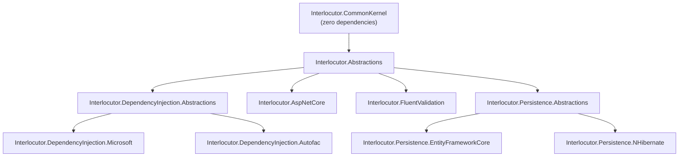

# Interlocutor

[](https://dotnet.microsoft.com/)
[](https://learn.microsoft.com/en-us/dotnet/csharp/)
[](LICENSE)

A mediator/CQRS pipeline library for .NET with allowances for C# union types.

> **Status**: This library has not shipped yet. You're looking at a pre-release implementation. API is subject to change.

## Concepts

### The Mediator Pattern

A structural pattern that defines an object (the mediator) that encapsulates how a set of objects interact. Instead of objects communicating directly, they communicate through the mediator, which coordinates their interaction. Interlocutor implements this as a `IMediator` service that dispatches requests to handlers.

### CQRS (Command Query Responsibility Segregation)

A pattern that separates read operations (queries) from write operations (commands) into distinct request types. Queries never mutate state; commands may. This separation allows each to be optimized independently - queries can pull from a read-optimized view, commands can ensure transactional consistency. Interlocutor supports both via `IQuery<TResponse>` and `ICommand<TResponse>` / `ICommand`.

### Vertical Slice Architecture

An architectural style where features are organized as thin slices cutting through all layers (presentation, business logic, persistence) rather than organizing by technical layer (all controllers together, all services together, etc.). Each slice is self-contained and can be developed/tested independently. A Vertical Slice Architecture works naturally with CQRS: one query or command per feature slice.

## Quick Start

### 1. Register the library

```csharp
// Program.cs - register Interlocutor and scan for handlers in your assemblies
services.AddInterlocutor(builder =>
{
    // Auto-scan the entry assembly for IQueryHandler, ICommandHandler implementations
    builder.ScanAssembly(typeof(Program).Assembly);

    // The pipeline is empty by default - compose exactly the behaviors you need.
    // This example uses the library's documented recommended chain:
    // Logging → Auditing → Authorization → Validation → Transaction
    // (See documentation/pipeline-and-behaviors.md for the full rationale.)
    builder.Pipeline.UseRecommendedChain();
});
```

### 2. Define a request and handler

```csharp
// A query - read data, never writes, returns a result
public record GetUser(int UserId) : IQuery<OperationOutcome<UserDto, NotFound>>;

// The handler - injected normally, no special requirements
public class GetUserHandler : IQueryHandler<GetUser, OperationOutcome<UserDto, NotFound>>
{
    private readonly IUserRepository repository;

    public GetUserHandler(IUserRepository repository) => this.repository = repository;

    public async Task<OperationOutcome<UserDto, NotFound>> Handle(
        GetUser query, CancellationToken ct)
    {
        var user = await repository.FindAsync(query.UserId, ct);
        return user == null
            ? new NotFound($"User {query.UserId} not found")
            : new UserDto(user.Id, user.Name);
    }
}
```

### 3. Send the request

```csharp
// Controllers, services, anywhere you've injected ISender or IMediator
var result = await mediator.Send(new GetUser(42), cancellationToken);

// Pattern-match the result - the compiler forces you to handle every case
var message = result switch
{
    OperationOutcome.SuccessCase<UserDto> success => $"Found: {success.Value.Name}",
    NotFound notfound => $"Not found: {notfound.Message}",
    _ => "Unexpected"
};
```

## Library Overview

| Package | Purpose |
|---------|---------|
| `Interlocutor.CommonKernel` | Result types. `IOperationOutcome` is the extension point every handler response implements - see [messages-and-result-types.md](documentation/messages-and-result-types.md) for the full walkthrough. `OperationOutcome<...>` unions and their failure cases (`Success`, `NotFound`, `Forbidden`, `Conflict`, `ValidationError`, `Failure`) are the library's own built-in implementation of it. Zero dependencies. |
| `Interlocutor.Abstractions` | Core: `IMediator`, `ISender`, `IPublisher`; handler interfaces; pipeline behaviors (`LoggingBehavior`, `AuthorizationBehavior`, `AuditingBehavior`, plus the opt-in `CancellationBehavior`, `TimeoutBehavior`, and `RateLimitedBehavior`, which have no prescribed position in the chain); marker interfaces for opt-in concerns. |
| `Interlocutor.DependencyInjection.Abstractions` | Container-neutral registration model shared by the two DI packages below - `InterlocutorBuilder`, `InterlocutorPipelineBuilder`, `RegistrationReport` - see [dependency-injection-abstractions.md](documentation/dependency-injection-abstractions.md). Pulled in transitively; not referenced directly by most consumers. |
| `Interlocutor.DependencyInjection.Microsoft` | Builder-based registration for Microsoft.Extensions.DependencyInjection - see [dependency-injection-microsoft.md](documentation/dependency-injection-microsoft.md). |
| `Interlocutor.DependencyInjection.Autofac` | Builder-based registration for Autofac - see [dependency-injection-autofac.md](documentation/dependency-injection-autofac.md). |
| `Interlocutor.AspNetCore` | `ToActionResult()` - maps result types to HTTP responses. ASP.NET Core only. |
| `Interlocutor.FluentValidation` | `ValidationBehavior` - automatic request validation via FluentValidation. |
| `Interlocutor.Persistence.Abstractions` | Optional, opt-in `IUnitOfWork`/`IDomainRepository<TEntity, TKey>` persistence abstraction - see [persistence-abstraction.md](documentation/persistence-abstraction.md). Zero ORM dependency. |
| `Interlocutor.Persistence.EntityFrameworkCore` | EF Core implementation of the persistence abstraction, plus `UnitOfWorkBehavior` - the unit-of-work-owned transaction commit/rollback gate - see [persistence-implementations.md](documentation/persistence-implementations.md) and [transactions-and-store-integration.md](documentation/transactions-and-store-integration.md). |
| `Interlocutor.Persistence.NHibernate` | NHibernate implementation of the persistence abstraction, plus `UnitOfWorkBehavior` - see the same two docs. |
| `Interlocutor.Generator` | The Roslyn incremental source generator behind compile-time handler discovery - see [handler-selection-and-dispatch.md](documentation/handler-selection-and-dispatch.md). A `PrivateAssets="all"` analyzer reference pulled in by `Interlocutor.Abstractions`; it never ships in your build output. |

`Interlocutor.CommonKernel` has zero dependencies; every other package builds on `Interlocutor.Abstractions`, directly or transitively. `Interlocutor.Generator` rides along as an analyzer on `Interlocutor.Abstractions` rather than a normal dependency edge, so it's omitted below. The `Interlocutor.Persistence.*` packages build on `Interlocutor.Persistence.Abstractions` instead, which itself builds only on `Interlocutor.Abstractions` - independently adoptable, and neither depends on the other:



## Deeper dive

### User documentation

For people using Interlocutor as a library in their own application:

- **[Full documentation index](documentation/index.md)** - detailed guides on handlers, pipelines, result types, notifications, testing, and more.

### Developer documentation

For contributors and maintainers working on *this repository* - not needed to use the library:

- **[Developer documentation index](maintainer_docs/README.md)** - Architecture Decision Records, the project PRD, contributor guides, and agent process docs.

## A Note on AI Aid

This project was aided in part by large language models and agentic coding tools in its development. Every line of code and documentation was read, reviewed, and approved by a tired human before it shipped. Nothing here ran on autopilot.

The tooling was used as a speed multiplier, not a replacement for the developer - most of what's here is human-written code, with LLMs brought in for refinement, cleanup, and grinding through the tedious parts. People still build open source for the love of the game, not because a model can. That hasn't changed here.

So if you find a bug, an awkward refactor, a confusing design decision, or a doc that contradicts the code three files over: that's not the model's fault. That's a human, doing what humans do. Blame accordingly.

## License

Licensed under the Apache License, Version 2.0. See [LICENSE](LICENSE) for details.
