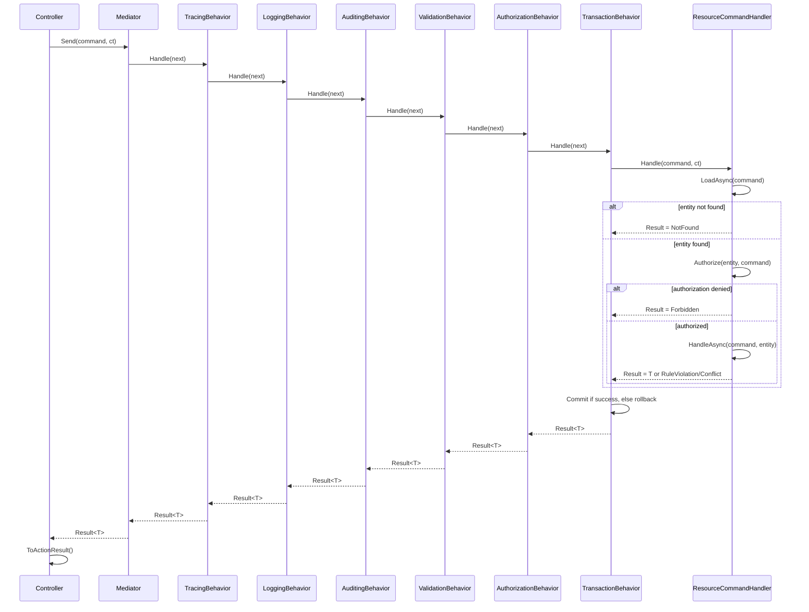
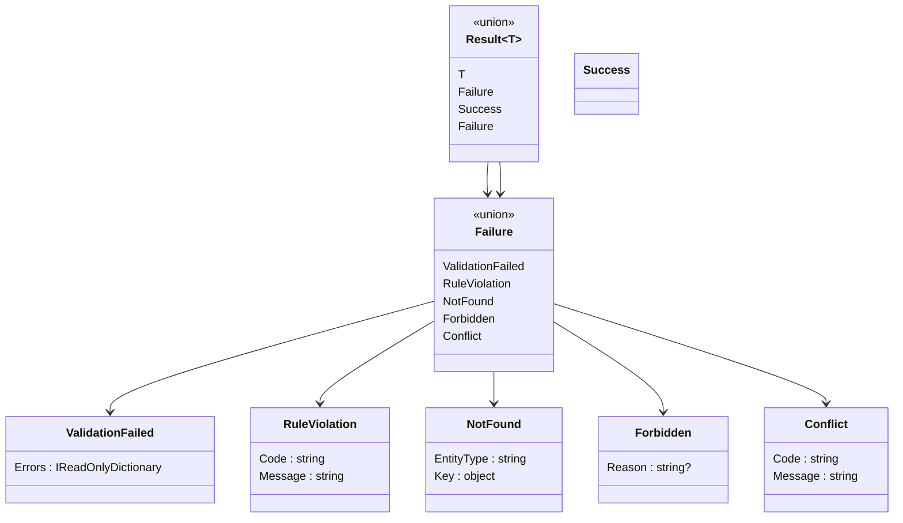
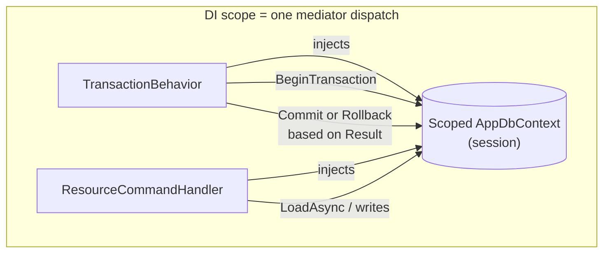
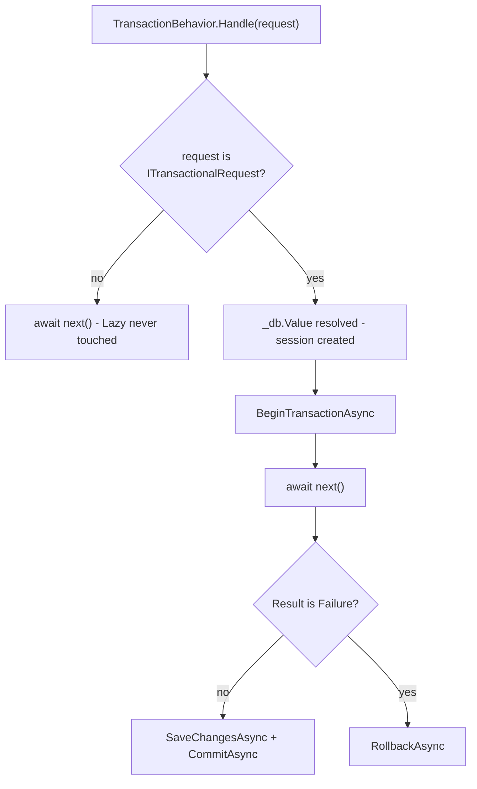

# PRD: Mediator Result Pipeline for Queries & Commands

**Status:** Draft
**Target platform:** .NET 11 / C# 15 (union types, Preview 3+)
**Author context:** Internal architecture proposal, derived from design discussion

---

## 1. Summary

We are standardizing how query and command handlers report outcomes across
the application. Instead of throwing exceptions for expected, user-triggered
outcomes (not found, forbidden, validation failure, conflict), handlers
return a closed, compiler-checked **Result** type built on C# 15 union
types. Cross-cutting concerns (logging, auditing, validation, authorization,
transactions) are composed around handlers using the **pipeline
behavior** (onion / Russian-doll) pattern from the Mediator pattern family.
Exceptions remain reserved for genuinely exceptional conditions - bugs,
infrastructure faults - never for expected branches of business logic.

## 2. Problem statement

Prior to this design, "what can go wrong" for a given handler was implicit:
discoverable only by reading the method body, not the signature. Failure
paths were inconsistently represented (some thrown as exceptions, some as
null returns, some as boolean flags), which made:

- API-layer error mapping ad hoc and duplicated per endpoint,
- testing incomplete (missing failure branches don't fail compilation),
- cross-cutting concerns (auth, validation, transactions) hard to compose
  consistently across handlers.

## 3. Goals

- Make every possible outcome of a query or command **visible in the type
  signature** and **exhaustively checked** by the compiler.
- Reserve thrown exceptions for bugs and infrastructure failures only.
- Provide one consistent, reusable mapping from domain outcome → HTTP
  response.
- Compose cross-cutting concerns (logging, auditing, validation,
  authorization, transactions) without introducing shared mutable state.
- Guarantee that a single logical request (lookup + business logic) executes
  against **one transactional session/scope**.

## 4. Non-goals

- Replacing ASP.NET's exception-handling middleware - that remains the
  catch-all for unexpected faults.
- Modeling infrastructure retries/circuit breakers in the mediator pipeline
  - that belongs at the data-access/HTTP-client layer.
- Serializing the `Result`/`Failure` union directly over the wire - the API
  boundary always maps to a dedicated response shape (see §9).

## 5. Patterns in use (glossary)

| Pattern | Where it's used | Why |
|---|---|---|
| **CQRS** (Command Query Responsibility Segregation) | `IQuery<T>` vs `ICommand<T>`/`ICommand` | Reads and writes have different pipelines, different concerns (caching vs transactions), different return semantics. |
| **Mediator** | `IMediator.Send(...)` | Decouples callers (controllers) from handler resolution/composition. |
| **Result / Railway-Oriented Programming**, realized via **C# 15 union types** | `Result<T>`, `Result`, `Failure` | Expected outcomes are values, not control flow. Compiler enforces exhaustive handling. |
| **Chain of Responsibility / Onion (Russian-doll) middleware** | `IPipelineBehavior<TRequest,TResponse>` | Cross-cutting concerns wrap the handler; each layer sees both the "in" and "out" side of the call around a single `next()` invocation. |
| **Template Method** | `ResourceCommandHandler<TCommand,TEntity,TResponse>` | Fixes the sequence (load → authorize → handle) while letting concrete handlers fill in the steps - avoids sharing fetched state through a mutable context. |
| **Marker Interface** | `ITransactionalRequest`, `IAuditableRequest`, `IRequiresPolicy` | Opt a request into a cross-cutting concern via its declared type, not pipeline configuration - visible at the request-type definition site. |
| **Unit of Work** | Scoped `DbContext`/session shared by `TransactionBehavior` and handlers | One transactional boundary per request, guaranteed by DI scope lifetime. |

## 6. Functional requirements

### 6.1 Result modeling
- `Result<T>` represents the outcome of a query, or a command that returns a
  value. `T` is always a read-only projection/DTO for queries, never the
  tracked entity itself.
- `Result` (non-generic) represents the outcome of a command with no return
  payload.
- Both compose the same closed `Failure` union, so a single failure-mapping
  function is reusable everywhere (§9).
- No case in `Failure` may ever be constructed from a caught, unexpected
  exception. Failure cases are only ever returned deliberately by handlers.

### 6.2 Pipeline behaviors
- Ordered, per §7 diagram: tracing → logging → auditing → shape validation →
  non-resource authorization → transaction → handler.
- Each behavior is generic over `<TRequest, TResponse>` and never inspects
  `T` - it only forwards `Func<Task<Result<TResponse>>> next`.
- A behavior that doesn't apply to a given request type (e.g. auditing on a
  query) is a no-op via marker-interface check, not a special-cased list.

### 6.3 Resource-based authorization
- Any authorization decision that requires the *loaded entity* (ownership,
  claims against resource state) happens inside `ResourceCommandHandler`,
  **not** a generic pipeline behavior - a behavior would need shared mutable
  state to pass the entity forward, which we're explicitly avoiding.
- Non-resource authorization (e.g. "does the caller have role X at all") is
  a pipeline behavior and is frequently a no-op (request doesn't declare
  `IRequiresPolicy`).

### 6.4 Transactional scope
- A `ITransactionalRequest` command executes its lookup and its write
  against **the same scoped session** (`DbContext`/`ISession`). This is
  guaranteed by DI: the session is registered `Scoped`, and both
  `TransactionBehavior` and `ResourceCommandHandler` receive it via
  constructor injection within the same mediator dispatch.
- Commit happens once, in `TransactionBehavior`, only when the pipeline
  result is not a `Failure`. Any `Failure` outcome rolls back - including
  domain outcomes like `Conflict`, not just thrown exceptions.

### 6.5 Cancellation
- `CancellationToken` is required (no default) on every handler and
  behavior method. A default value is supplied exactly once, at
  `IMediator.Send`, to avoid the interface-default-parameter dispatch
  gotcha (see ADR-0007).

### 6.6 API mapping
- Controllers/endpoints call `.ToActionResult()` (or a minimal-API
  equivalent) on the returned `Result`/`Result<T>`. This is the only place
  HTTP status codes are decided.

## 7. Architecture diagrams

### 7.1 Request flow (sequence)



### 7.2 Type composition



### 7.3 Transactional scope boundary



The key guarantee: `TransactionBehavior` and `ResourceCommandHandler` both
resolve the *same instance* of the scoped session because DI scope lifetime
matches the mediator dispatch lifetime (one HTTP request = one scope).
Nothing manually threads the session between layers.

## 8. Type catalog

See companion document **Type Reference** below (also embedded here for
completeness - kept in sync with the ADRs).

| Type | Kind | Definition | Purpose |
|---|---|---|---|
| `Success` | `record` | `record Success;` | Marks a no-payload command's success. |
| `ValidationFailed` | `record` | `record ValidationFailed(IReadOnlyDictionary<string, IReadOnlyList<(string Code, string Message)>> Errors);` | Input/shape validation failed, before any lookup. |
| `RuleViolation` | `record` | `record RuleViolation(string Code, string Message);` | A domain/business invariant failed, after input was structurally valid. |
| `NotFound` | `record` | `record NotFound(string EntityType, object Key);` | Referenced entity doesn't exist. |
| `Forbidden` | `record` | `record Forbidden(string? Reason = null);` | Resource-based (or policy-based) authorization denied. |
| `Conflict` | `record` | `record Conflict(string Code, string Message);` | State conflict - concurrency, uniqueness, invalid transition. |
| `Failure` | `union` | `union Failure(ValidationFailed, RuleViolation, NotFound, Forbidden, Conflict);` | Closed set of all failure outcomes. |
| `Result<T>` | `union` | `union Result<T>(T, Failure);` | Outcome of a query, or a value-returning command. |
| `Result` | `union` | `union Result(Success, Failure);` | Outcome of a no-payload command. |

## 9. API boundary mapping

A single reusable extension set maps every `Result`/`Result<T>` to HTTP,
using `ProblemDetails` (RFC 7807) for failures so error shape is uniform
and standards-based rather than ad hoc JSON:

```csharp
public static class ResultExtensions
{
    public static IActionResult ToActionResult<T>(this Result<T> result) => result.Value switch
    {
        T ok => new OkObjectResult(ok),
        Failure f => f.ToActionResult(),
    };

    public static IActionResult ToActionResult(this Result result) => result.Value switch
    {
        Success => new NoContentResult(),
        Failure f => f.ToActionResult(),
    };

    public static IActionResult ToActionResult(this Failure failure) => failure.Value switch
    {
        ValidationFailed v => new BadRequestObjectResult(new ValidationProblemDetails(
            v.Errors.ToDictionary(kv => kv.Key, kv => kv.Value.Select(e => e.Message).ToArray()))),
        RuleViolation r => new UnprocessableEntityObjectResult(new ProblemDetails
        {
            Title = r.Code, Detail = r.Message, Status = StatusCodes.Status422UnprocessableEntity
        }),
        NotFound => new NotFoundResult(),
        Forbidden f => new ObjectResult(new ProblemDetails { Detail = f.Reason }) { StatusCode = StatusCodes.Status403Forbidden },
        Conflict c => new ConflictObjectResult(new ProblemDetails
        {
            Title = c.Code, Detail = c.Message, Status = StatusCodes.Status409Conflict
        }),
    };
}
```

## 10. Non-functional requirements

- **Testability:** handlers are unit-testable directly (bypassing the
  pipeline) for business logic; the pipeline itself gets a small number of
  integration tests (e.g. "validation short-circuits before DB access",
  "failure rolls back transaction").
- **Observability:** `LoggingBehavior`/`TracingBehavior` wrap every request,
  including failures, so failed domain outcomes are visible in telemetry
  without being treated as exceptions/alerts.
- **Consistency enforcement:** pipeline composition order is pinned by a
  test (DI resolution order is not guaranteed to match registration order
  in every container).
- **Language risk:** C# union type syntax is not final until .NET 11 GA
  (targeted ~November 2026). Union usage is isolated to the type catalog in
  §8 rather than scattered `union` declarations, to localize any syntax
  churn.

## 11. Anticipated shapes / future evolution

- **List/paged queries.** Current `Result<T>` assumes a single projection.
  A future `PagedResult<T>` (or `Result<PagedList<T>>`) will likely wrap
  paging metadata (page, size, total) around the same `T`/`Failure`
  contract - no change to `Failure` itself.
- **Bulk commands.** Multi-item commands may need a per-item outcome
  (`IReadOnlyList<Result<TItem>>`) rather than one aggregate `Result`. Not
  in scope now; flagging so `Failure` additions don't collide with a later
  bulk-result design.
- **Concurrency-specific conflict data.** `Conflict` may grow an optional
  payload (e.g. current row version) for optimistic-concurrency retries.
  Additive change, not breaking, since `Conflict` is a record.
- **ASP.NET native union support.** `TypedResults`/minimal-API integration
  with union types is on Microsoft's roadmap for later in 2026 but not
  available now. `ToActionResult` mapping in §9 is intentionally isolated
  so it can be replaced with native support later without touching
  handlers or behaviors.
- **Serialization at the boundary only.** No case type gets a
  `JsonConverter` for the union itself; the mapping in §9 always produces a
  concrete DTO/`ProblemDetails`. This avoids depending on runtime union
  metadata that isn't stable yet.

## 12. Risks & open questions

- Preview language surface may change before GA - mitigated per §10/§11.
- Marker-interface opt-in (`ITransactionalRequest`, etc.) has no compiler
  enforcement that the *right* commands implement it - recommend an
  analyzer or architecture test asserting all `ICommand` types implement
  `ITransactionalRequest` unless explicitly exempted.
- Struct-based unions box value-type `T`. Acceptable for now; revisit if a
  high-frequency query returns a primitive/struct projection under load.

---

## Addendum A: Non-database-backed requests, collection results, and validator composition

*Continuation of the above. Nothing below revises or negates a prior
decision - the base contract (`Result<T>`, `Result`, `Failure`, the onion
pipeline, template-method resource handling) is unchanged. This addendum
closes three gaps: requests that must never touch the SQL session,
collection/paged success payloads, and how FluentValidation is composed
generically - including for collection-shaped requests.

### A.1 Non-database-backed requests

**Problem.** Some commands/queries are backed entirely by an external API
or a non-relational store (a CRM webhook, a search index, a blob store).
`TransactionBehavior` must never construct a SQL session for these - not
just "not open a transaction," but not resolve the session at all, since
some stores/drivers open a connection eagerly on construction.

**Decision.** Resolve the session lazily inside `TransactionBehavior`, and
require every command to declare *one* of a paired pair of markers so the
choice is explicit rather than inferred from absence:

```csharp
public interface ITransactionalRequest { }   // opts into the SQL unit-of-work
public interface IExternalStoreRequest { }   // documents "deliberately no SQL session"
```

```csharp
public sealed class TransactionBehavior<TRequest, TResponse> : IPipelineBehavior<TRequest, TResponse>
{
    private readonly Lazy<AppDbContext> _db; // AppDbContext resolved only if .Value is touched

    public TransactionBehavior(Lazy<AppDbContext> db) => _db = db;

    public async Task<Result<TResponse>> Handle(TRequest request, CancellationToken ct, Func<Task<Result<TResponse>>> next)
    {
        if (request is not ITransactionalRequest)
            return await next(); // _db.Value never evaluated - no SQL session created

        var db = _db.Value;
        await using var tx = await db.Database.BeginTransactionAsync(ct);
        var result = await next();

        if (result.Value is not Failure) { await db.SaveChangesAsync(ct); await tx.CommitAsync(ct); }
        else await tx.RollbackAsync(ct);

        return result;
    }
}
```

**Composition:** an architecture test (or Roslyn analyzer) asserts every
concrete `ICommand`/`ICommand<T>` implements exactly one of
`ITransactionalRequest` or `IExternalStoreRequest`. Neither marker changes
`Result<T>`/`Failure` - a `RuleViolation` or `Conflict` returned from an
external-store handler maps to HTTP exactly the same way a DB-backed one
does.

**Example.**

```csharp
public sealed record SyncCustomerToCrmCommand(Guid CustomerId) : ICommand, IExternalStoreRequest;

public sealed class SyncCustomerToCrmHandler : ICommandHandler<SyncCustomerToCrmCommand>
{
    private readonly ICrmClient _crm; // external API client, not a DbContext

    public SyncCustomerToCrmHandler(ICrmClient crm) => _crm = crm;

    public async Task<Result> Handle(SyncCustomerToCrmCommand command, CancellationToken ct)
    {
        var outcome = await _crm.UpsertCustomerAsync(command.CustomerId, ct);
        return outcome switch
        {
            CrmUpsertOutcome.Ok => new Success(),
            CrmUpsertOutcome.NotFoundInCrm => new NotFound(nameof(SyncCustomerToCrmCommand), command.CustomerId),
            CrmUpsertOutcome.RemoteConflict => new Conflict("crm.stale_record", "CRM record was modified concurrently."),
        };
        // transient HTTP faults from ICrmClient are allowed to throw - handled by
        // resilience policies at the client layer and the global exception middleware,
        // per ADR-0005; they are never translated into a Failure case here.
    }
}
```

External-store `ResourceCommandHandler`-style flows (lookup → authorize →
act) work unchanged - `LoadAsync` just calls the external client instead of
`AppDbContext`; the template method never assumed EF specifically.

### A.2 Enumerable / paged collection results

**Problem.** Returning `IEnumerable<T>` or `IQueryable<T>` as a success
payload risks deferred execution outliving the scoped session (a
`Result<T>` handed back to a behavior/controller after the session that
would materialize it is gone), and can't carry paging metadata.

**Decision.** Success payloads are always **materialized** collections.
Unbounded/small lists use `IReadOnlyList<T>`. Paged lists use a new
catalog type:

```csharp
public sealed record PagedResult<T>(IReadOnlyList<T> Items, int Page, int PageSize, long TotalCount)
{
    public int TotalPages => PageSize <= 0 ? 0 : (int)Math.Ceiling(TotalCount / (double)PageSize);
    public bool HasNextPage => (long)Page * PageSize < TotalCount;
}
```

`PagedResult<T>` is an ordinary record - it slots into the existing
contract as `Result<PagedResult<T>>` with **no change to `Failure`, no new
pipeline behavior, and no change to any existing behavior's signature**,
since every behavior is already generic over the opaque `TResponse`.

An empty result set is success, not `NotFound` - `NotFound` remains
reserved for "this specific resource-by-id doesn't exist," never for "this
query returned zero rows."

**Example.**

```csharp
public sealed record GetWidgetsQuery(int Page, int PageSize, string? SearchTerm)
    : IQuery<PagedResult<WidgetDto>>;

public sealed class GetWidgetsQueryHandler : IQueryHandler<GetWidgetsQuery, PagedResult<WidgetDto>>
{
    private readonly AppDbContext _db;
    public GetWidgetsQueryHandler(AppDbContext db) => _db = db;

    public async Task<Result<PagedResult<WidgetDto>>> Handle(GetWidgetsQuery query, CancellationToken ct)
    {
        var baseQuery = _db.Widgets.AsNoTracking()
            .Where(w => query.SearchTerm == null || w.Name.Contains(query.SearchTerm));

        var total = await baseQuery.LongCountAsync(ct);
        var items = await baseQuery
            .OrderBy(w => w.Name)
            .Skip((query.Page - 1) * query.PageSize)
            .Take(query.PageSize)
            .Select(w => new WidgetDto(w.Id, w.Name))
            .ToListAsync(ct); // materialized before the session goes out of scope

        return new PagedResult<WidgetDto>(items, query.Page, query.PageSize, total);
    }
}
```

`GetWidgetsQuery` is a plain `IQuery<T>` - it implements neither
`ITransactionalRequest` nor `IExternalStoreRequest` unless queries are
included in the same architecture-test rule (recommended: queries default
to "no transaction, DB session read directly," a third implicit category
that doesn't need `TransactionBehavior` involvement at all since reads
don't require commit/rollback semantics).

### A.3 Validator composition for `T` and collections of `T`

**Decision (no new behavior needed).** `ValidationBehavior<TRequest,
TResponse>` is already generic over `TResponse` and never inspects it -
composition for both scalar and collection/paged requests falls out of
FluentValidation's own generic resolution, not special pipeline logic:

```csharp
public sealed class ValidationBehavior<TRequest, TResponse> : IPipelineBehavior<TRequest, TResponse>
{
    private readonly IEnumerable<IValidator<TRequest>> _validators;
    public ValidationBehavior(IEnumerable<IValidator<TRequest>> validators) => _validators = validators;

    public async Task<Result<TResponse>> Handle(TRequest request, CancellationToken ct, Func<Task<Result<TResponse>>> next)
    {
        if (!_validators.Any()) return await next();

        var failures = new Dictionary<string, List<(string Code, string Message)>>();
        foreach (var validator in _validators)
            foreach (var error in (await validator.ValidateAsync(request, ct)).Errors)
                (failures.TryGetValue(error.PropertyName, out var list) ? list : failures[error.PropertyName] = [])
                    .Add((error.ErrorCode, error.ErrorMessage));

        return failures.Count == 0
            ? await next()
            : new ValidationFailed(failures.ToDictionary(kv => kv.Key, kv => (IReadOnlyList<(string, string)>)kv.Value));
    }
}
```

Registration is a single open-generic line, applied once for the whole
application:

```csharp
services.AddValidatorsFromAssemblyContaining<Program>(); // registers every AbstractValidator<T>
services.AddTransient(typeof(IPipelineBehavior<,>), typeof(ValidationBehavior<,>));
```

**Scalar example:**

```csharp
public sealed record CreateWidgetCommand(string Name) : ICommand<WidgetDto>, ITransactionalRequest;

public sealed class CreateWidgetCommandValidator : AbstractValidator<CreateWidgetCommand>
{
    public CreateWidgetCommandValidator() => RuleFor(x => x.Name).NotEmpty().MaximumLength(200);
}
```

**Collection example - validating each item of a bulk command:**

```csharp
public sealed record CreateWidgetItem(string Name, int Quantity);
public sealed record BulkCreateWidgetsCommand(IReadOnlyList<CreateWidgetItem> Items)
    : ICommand<IReadOnlyList<WidgetDto>>, ITransactionalRequest;

public sealed class CreateWidgetItemValidator : AbstractValidator<CreateWidgetItem>
{
    public CreateWidgetItemValidator()
    {
        RuleFor(x => x.Name).NotEmpty().MaximumLength(200);
        RuleFor(x => x.Quantity).GreaterThan(0);
    }
}

public sealed class BulkCreateWidgetsCommandValidator : AbstractValidator<BulkCreateWidgetsCommand>
{
    // item validator injected, not newed up - reusable if CreateWidgetItem is ever validated standalone
    public BulkCreateWidgetsCommandValidator(IValidator<CreateWidgetItem> itemValidator)
    {
        RuleFor(x => x.Items).NotEmpty();
        RuleForEach(x => x.Items).SetValidator(itemValidator);
    }
}
```

**Paged query example:**

```csharp
public sealed class GetWidgetsQueryValidator : AbstractValidator<GetWidgetsQuery>
{
    public GetWidgetsQueryValidator()
    {
        RuleFor(x => x.Page).GreaterThan(0);
        RuleFor(x => x.PageSize).InclusiveBetween(1, 100);
    }
}
```

No behavior, marker interface, or `Result` case needed to know whether
`TResponse` is `WidgetDto`, `IReadOnlyList<WidgetDto>`, or
`PagedResult<WidgetDto>` - genericity over `TResponse` was the deliberate
payoff of the original pipeline design (§6.2), and it holds without
modification for collection-shaped payloads.

### A.4 Updated type catalog (additions only - prior entries unchanged)

| Type | Kind | Definition | Purpose |
|---|---|---|---|
| `ITransactionalRequest` | marker interface | `interface ITransactionalRequest { }` | Opts a command into the SQL unit-of-work (ADR-0006, extended by ADR-0009). |
| `IExternalStoreRequest` | marker interface | `interface IExternalStoreRequest { }` | Declares a command is deliberately backed by a non-SQL store/API; SQL session is never resolved. |
| `PagedResult<T>` | record | `record PagedResult<T>(IReadOnlyList<T> Items, int Page, int PageSize, long TotalCount);` | Materialized page of results plus paging metadata; used as the `T` in `Result<PagedResult<T>>`. |

### A.5 Updated diagram - session resolution decision



### A.6 Risk/notes added

- Queries that read from SQL but are not "transactional" in the write
  sense (no `ITransactionalRequest`) still receive `AppDbContext`
  directly via constructor injection in the handler - they just skip
  `TransactionBehavior`'s transaction/commit logic entirely, since reads
  don't need commit/rollback semantics. This is a third implicit category
  worth naming explicitly in the architecture test from §12 alongside the
  two markers.
- `PagedResult<T>.TotalCount` as `long` anticipates large tables; `Page`/
  `PageSize` stay `int` since no realistic page size approaches `int`
  bounds - validated by `GetWidgetsQueryValidator` regardless.
