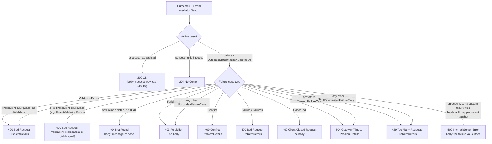

# ASP.NET Core Integration & HTTP Mapping

Mapping Interlocutor outcomes to HTTP responses via `Interlocutor.AspNetCore`.

> [!CAUTION]
> This is the **only documentation file** in this project permitted to reference HTTP status codes. Other docs should link here instead of mentioning HTTP anywhere. See house conventions in the documentation index.

## Installation & Registration

Add the NuGet package:

```bash
dotnet add package Interlocutor.AspNetCore
```

No additional registration needed - `Interlocutor.AspNetCore` provides extension methods used at the edge (controller/endpoint).

## ToActionResult() Extension

Map an `IOutcome` to an ASP.NET Core `IActionResult`:

```csharp
[ApiController]
[Route("api/[controller]")]
public class OrdersController : ControllerBase
{
    private readonly ISender mediator;

    public OrdersController(ISender mediator) => this.mediator = mediator;

    [HttpPost]
    public async Task<IActionResult> CreateOrder(
        [FromBody] CreateOrderRequest request,
        CancellationToken ct)
    {
        var command = new CreateOrder(request.CustomerId, request.Items);
        var result = await this.mediator.Send(command, ct);

        // Map the outcome to HTTP - built-in mapping handles all case types
        return result.ToActionResult();
    }

    [HttpDelete("{id}")]
    public async Task<IActionResult> DeleteOrder(int id, CancellationToken ct)
    {
        var result = await this.mediator.Send(new DeleteOrder(id), ct);

        // Same extension method - maps the outcome type-safely
        return result.ToActionResult();
    }
}
```

## Minimal API

Minimal API endpoints use the parallel `ToMinimalApiResult()` extension, returning `IResult` instead of `IActionResult` - same mapping decisions, same `IOutcomeStatusMapper`, different transport type:

```csharp
app.MapPost("/api/orders", async (CreateOrderRequest request, ISender mediator, CancellationToken ct) =>
{
    var command = new CreateOrder(request.CustomerId, request.Items);
    var result = await mediator.Send(command, ct);
    return result.ToMinimalApiResult();
});

app.MapDelete("/api/orders/{id}", async (int id, ISender mediator, CancellationToken ct) =>
{
    var result = await mediator.Send(new DeleteOrder(id), ct);
    return result.ToMinimalApiResult();
});
```

## Status Code Mapping

Each outcome case maps to an HTTP status code via `IOutcomeStatusMapper.Map<TFailure>(failure)`, which both `ToActionResult()` and `ToMinimalApiResult()` delegate to for every failure case - the success case never reaches the mapper, since `ToActionResult`/`ToMinimalApiResult` handle it directly. The dedicated arity-specific overloads (`Outcome<TSuccess, TFailure>`, `<TSuccess, TCase2, TCase3>`, ...) resolve which case is active via an ordinary `switch` at compile time; only the base-`IOutcome` overload used for runtime-typed dispatch needs `IOutcomeCaseRegistry`'s reflective lookup:



| Outcome Case | HTTP Status | Body | Details |
|--------------|-------------|------|---------|
| Success (payload) | 200 OK | The success payload (JSON) | For `Outcome<TSuccess, ...>`, `TSuccess` is serialized. |
| Success (unit) | 204 No Content | None | For the non-generic `Outcome`. |
| ValidationErrors | 400 Bad Request | `ProblemDetails` | `Detail` is every message joined with `"; "` - no per-field errors dictionary, since `ValidationError` carries a message and optional code, not a field name. |
| Any other [`IValidationFailureCase`](glossary.md#result-types) implementer with no field data | 400 Bad Request | `ProblemDetails` | Recognized via the interface, not a type-specific branch - a consumer's own validation-shaped failure case maps the same way without a mapper override. `Detail` is every `Messages` entry joined with `"; "`. |
| [`IFieldValidationFailureCase`](glossary.md#outcome-mapping) implementer (e.g. `FluentValidationErrors`) | 400 Bad Request | `ValidationProblemDetails` | `Errors` is `FieldMessages` grouped by property name (empty-string key for an entry with no property) - see [Field-Keyed Validation Errors](#field-keyed-validation-errors) below. |
| NotFound | 404 Not Found | The message, or none | `NotFound<TId>` (the generic form) maps the same way via a separate reflective path. |
| Forbidden | 403 Forbidden | None | Reason is never sent to the client. |
| Any other `IForbiddenFailureCase` implementer | 403 Forbidden | None | Recognized via the interface, not a type-specific branch - a consumer's own `IPolicyEvaluator`-specific failure case maps the same way without a mapper override, even though only the single built-in `IPolicyEvaluator` ships today. |
| Conflict | 409 Conflict | `ProblemDetails` | `Title` is the conflict code, `Detail` is the message. |
| Failure | 400 Bad Request | `ProblemDetails` | Deliberately not 500 - `Failure` is an outcome a handler chose to report, not a server fault. An unhandled exception still reaches ASP.NET Core's exception middleware as 500, independently of this mapping. |
| Failures (aggregate) | 400 Bad Request | `ProblemDetails` | `Detail` is every reason joined with `"; "`. |
| Cancelled | 499 Client Closed Request | None | Not 400 - the caller withdrew interest before the operation completed, which is neither a malformed request nor a domain failure. |
| Timeout | 504 Gateway Timeout | `ProblemDetails` | Not 408 - 408 means the *client* was slow sending its request; this is the server exceeding its own time budget waiting on an operation, which 504 represents. `Detail` is the message, or `Budget`/`Elapsed` if none was set. |
| Any other `ITimeoutFailureCase` implementer | 504 Gateway Timeout | `ProblemDetails` | Recognized via the interface - a consumer's own `ITimeoutPolicy`-specific failure case maps the same way without a mapper override, and for the same reason as the exact `Timeout` case above. `Detail` is the message verbatim (no `Budget`/`Elapsed` fallback - the interface guarantees only the message). |
| RateLimited | 429 Too Many Requests | `ProblemDetails` | `Detail` is the message, or the `LimitKey`. Does not set a `Retry-After` header - override `MapRateLimited` to add one. |
| Any other `IRateLimitedFailureCase` implementer | 429 Too Many Requests | `ProblemDetails` | Recognized via the interface - a consumer's own `IRateLimiter`-specific failure case maps the same way without a mapper override. `Detail` is the message verbatim (no `LimitKey` fallback - the interface guarantees only the message). |
| Anything else (a custom failure type) | 500 Internal Server Error | The failure value itself | The default mapper doesn't know this type - supply your own `IOutcomeStatusMapper`, or override `MapUnrecognized`, to map it precisely. |

### Runtime-Typed Dispatch and Unmappable Cases

The base-`IOutcome` overload (the one reached only when a caller has no concrete `Outcome<...>` type to dispatch on at compile time - a hand-rolled `IOutcome` implementation, or generic code constrained only to `IOutcome`) has no static `TSuccess`/`TFailure` to switch over, so it classifies the active case at runtime instead: the bare `Success` marker is success, a resolved case whose payload is legitimately `null` is success, and any of the failure case types/interfaces listed in the table above is a failure dispatched to the status mapper as usual.

A case matching none of those - most commonly a hand-rolled or generically-dispatched response whose success case carries some payload type other than `Success` - throws `OutcomeCaseNotMappableException` rather than guessing. This is deliberate: an HTTP response must carry *some* status code, and a wrong guess here (misreporting a custom success payload as a failure, or vice versa) is worse than an immediate, loud failure. Fix it by calling the dedicated `Outcome<TSuccess, ...>` overload against the concrete type instead of the reflective one - it resolves success-versus-failure at compile time and cannot hit this ambiguity - or, for a hand-rolled `IOutcome`, use `Success` as the success payload the way the built-in unions do.

## Custom HTTP Mapping

`IOutcomeStatusMapper` maps one failure case value to an `OutcomeHttpMapping` (a status code and optional body) - it's never invoked for the success case, which `ToActionResult`/`ToMinimalApiResult` handle directly. `IOutcomeStatusMapper` is itself the HTTP specialization of a transport-agnostic `IOutcomeMapper<TResult>` contract - see [Extensibility § Mapping failure cases to any output shape](extensibility.md#mapping-failure-cases-to-any-output-shape-ioutcomemappertresult) if you need the same pattern for a non-HTTP consumer. Two ways to customize the HTTP mapping:

**Derive from `DefaultHttpOutcomeStatusMapper` and override just the case you want to change** - each case is a separate protected method, overridable one further level:

```csharp
public class MyStatusMapper : DefaultHttpOutcomeStatusMapper
{
    // Change only how ValidationErrors maps; every other case keeps the default behavior
    protected override OutcomeHttpMapping MapValidationErrors(ValidationErrors validationErrors) =>
        new(StatusCodes.Status400BadRequest, new { errors = validationErrors.Messages });

    // Change every OTHER IValidationFailureCase implementer at once (e.g. FluentValidationErrors) -
    // this override doesn't affect ValidationErrors, since that exact-type branch is checked first
    protected override OutcomeHttpMapping MapValidationFailureCase(IValidationFailureCase validationFailureCase) =>
        new(StatusCodes.Status400BadRequest, new { errors = validationFailureCase.Messages });

    // Add a Retry-After-friendly body for a case the default mapper leaves generic
    protected override OutcomeHttpMapping MapUnrecognized<TFailure>(TFailure failure) =>
        failure is CustomConflict conflict
            ? new(StatusCodes.Status409Conflict, new { conflict.Code, conflict.Message })
            : base.MapUnrecognized(failure);
}
```

**Or implement `IOutcomeStatusMapper` from scratch** when you want to replace every mapping decision rather than override individual cases:

```csharp
public class MyStatusMapper : IOutcomeStatusMapper
{
    public OutcomeHttpMapping Map<TFailure>(TFailure failure) =>
        failure switch
        {
            CustomConflict conflict => new(StatusCodes.Status409Conflict, new { conflict.Code, conflict.Message }),
            _ => new DefaultHttpOutcomeStatusMapper().Map(failure),  // fall back to built-in cases
        };
}
```

Pass an instance explicitly per call - there's no DI registration to override, since the mapper is a plain constructor argument on `ToActionResult`/`ToMinimalApiResult`, not resolved from the container:

```csharp
private static readonly IOutcomeStatusMapper Mapper = new MyStatusMapper();

return result.ToActionResult(Mapper);
```

## Example Responses

### Success (Typed Command)

```csharp
// Command
public record CreateUser(string Name, string Email)
    : ICommand<Outcome<int, ValidationError>>;

// Handler returns Success with new user ID
var result = await mediator.Send(new CreateUser("Alice", "alice@example.com"));

// Response: 200 OK
// Body: 42  (the user ID, as plain JSON)
```

### ValidationErrors

```csharp
// Command with invalid data
var result = await mediator.Send(new CreateUser("", "not-an-email"));

// Response: 400 Bad Request
// Body:
// {
//   "title": "Validation Failed",
//   "detail": "'Name' must not be empty; 'Email' is not a valid email address.",
//   "status": 400
// }
```

`ValidationError` carries a message and an optional error code, not a field name, so the default mapping joins every message into `Detail` rather than building a per-field errors dictionary. Override `MapValidationErrors` if you want field-keyed output instead - or use `FluentValidationErrors` in place of `ValidationErrors`, which gets field-keyed output automatically; see [Field-Keyed Validation Errors](#field-keyed-validation-errors) below.

### Field-Keyed Validation Errors

`Interlocutor.FluentValidation.FluentValidationErrors` (see [Pipeline & Behavior Composition § `FluentValidationErrorsBehavior`](pipeline-and-behaviors.md#fluentvalidationerrorsbehavior)) preserves each failure's property name, unlike the message-only `ValidationErrors`. `DefaultHttpOutcomeStatusMapper` recognizes this via `IFieldValidationFailureCase` - implemented by `FluentValidationErrors`, not by `ValidationErrors` - and builds a field-keyed `ValidationProblemDetails` body instead of the flat `ProblemDetails` other validation-shaped failures get:

```csharp
// Command with invalid data, using FluentValidationErrorsBehavior instead of ValidationBehavior
var result = await mediator.Send(new CreateUser("", "not-an-email"));

// Response: 400 Bad Request
// Body:
// {
//   "title": "Validation Failed",
//   "status": 400,
//   "errors": {
//     "Name": ["'Name' must not be empty."],
//     "Email": ["'Email' is not a valid email address."]
//   }
// }
```

A failure not tied to a specific property (a cross-field or whole-object rule) groups under the empty-string key, matching `ValidationProblemDetails`'s own convention. Override `MapFieldValidationFailureCase` to change this shape, the same way any other case is customized.

### NotFound

```csharp
// Query that finds nothing
var result = await mediator.Send(new GetUser(999));

// Response: 404 Not Found
// Body: (empty)
```

### Forbidden

```csharp
// Command rejected by authorization
var result = await mediator.Send(new DeleteOrder(42));  // Current user not authorized

// Response: 403 Forbidden
// Body: (empty, reason logged server-side)
```

### Conflict

```csharp
// Update with version mismatch
var result = await mediator.Send(new UpdateProduct(1, "New Name", 10));  // Old version

// Response: 409 Conflict
// Body:
// {
//   "title": "version_mismatch",
//   "detail": "The product was modified by another request",
//   "status": 409
// }
```

`Title` is `Conflict.Code` and `Detail` is `Conflict.Message` - both are mandatory on `Conflict`, so this body's two fields are always present.

## Problem Details (RFC 7807)

Most non-2xx responses carry a plain ASP.NET Core `ProblemDetails` body by default (`Title`, `Detail`, `Status`) - `Forbidden` and `Cancelled` carry no body at all, and an unrecognized custom failure type's body is the failure value itself, not a `ProblemDetails`. A validation-shaped failure that implements `IFieldValidationFailureCase` (`FluentValidationErrors`, but not `ValidationErrors`) is the one exception: it gets the per-field-errors `ValidationProblemDetails` variant instead - see [Field-Keyed Validation Errors](#field-keyed-validation-errors) above.

## Error Handling at the Edge

Exceptions thrown in handlers or behaviors (not converted to outcomes) are handled by ASP.NET Core's exception middleware, not by `ToActionResult()`:

```csharp
[ApiController]
[Route("api/[controller]")]
public class OrdersController : ControllerBase
{
    private readonly ISender mediator;

    [HttpPost]
    public async Task<IActionResult> CreateOrder(
        [FromBody] CreateOrderRequest request,
        CancellationToken ct)
    {
        var command = new CreateOrder(request.CustomerId, request.Items);

        try
        {
            var result = await this.mediator.Send(command, ct);
            return result.ToActionResult();  // Maps outcomes to HTTP
        }
        catch (Exception ex)
        {
            // Unexpected exceptions (bugs) reach here and are handled by ASP.NET Core middleware
            // Configure middleware to return 500 + ProblemDetails
            throw;
        }
    }
}
```

## CORS & Content Negotiation

`ToActionResult()` respects ASP.NET Core's content negotiation. If the client requests JSON, you get JSON; if XML, you get XML (if configured). The outcome mapper respects this.

## Testing with IActionResult

Unit test your action results:

```csharp
[Fact]
public async Task CreateOrder_Valid_Returns200()
{
    var mediator = new Mock<ISender>();
    mediator
        .Setup(m => m.Send(It.IsAny<ICommand<Outcome<int, ValidationError>>>(), It.IsAny<CancellationToken>()))
        .ReturnsAsync(new Outcome<int, ValidationError>(42));  // Success with ID 42

    var controller = new OrdersController(mediator.Object);

    var result = await controller.CreateOrder(new CreateOrderRequest { /* ... */ }, default);

    var okResult = Assert.IsType<OkObjectResult>(result);
    Assert.Equal(42, okResult.Value);
}

[Fact]
public async Task DeleteOrder_NotFound_Returns404()
{
    var mediator = new Mock<ISender>();
    mediator
        .Setup(m => m.Send(It.IsAny<ICommand<Outcome<Success, NotFound>>>(), It.IsAny<CancellationToken>()))
        .ReturnsAsync(new Outcome<Success, NotFound>(new NotFound()));

    var controller = new OrdersController(mediator.Object);

    var result = await controller.DeleteOrder(999, default);

    // A NotFound with no Message maps to a bare StatusCodeResult, not NotFoundResult -
    // OutcomeHttpMapping with a null body always renders as StatusCodeResult(statusCode).
    var statusResult = Assert.IsType<StatusCodeResult>(result);
    Assert.Equal(StatusCodes.Status404NotFound, statusResult.StatusCode);
}
```
