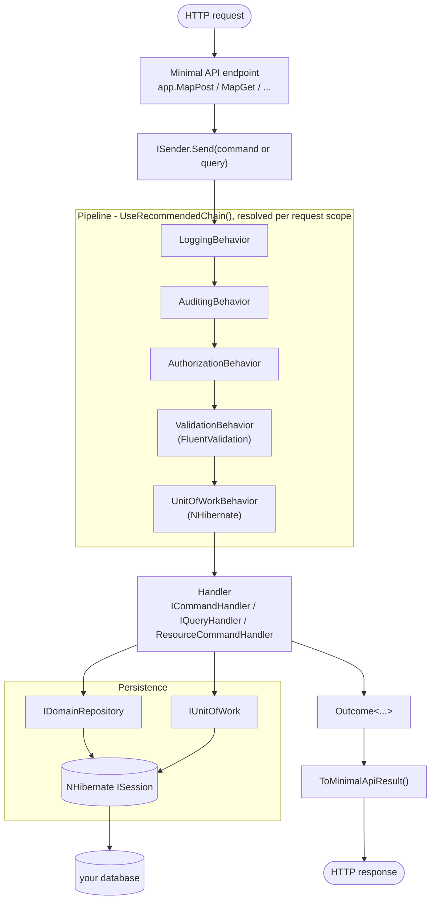
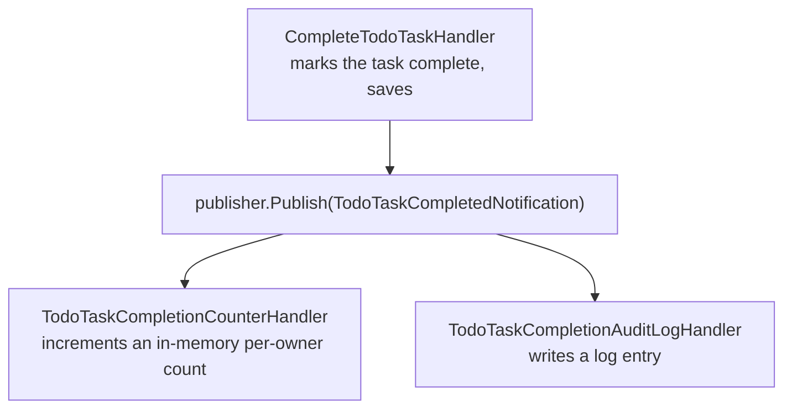
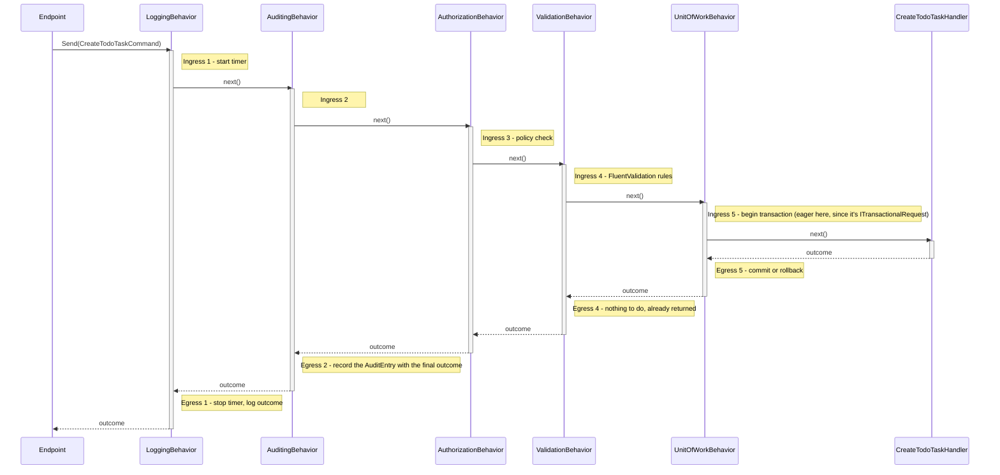

# Beginner's Guide: Building a To-Do API

A start-to-finish walkthrough of building a small HTTP API with Interlocutor - from an empty folder to a working set of endpoints backed by a real pipeline (logging, auditing, authorization, validation, transactions) and a real store. The running example is a "TodoTasks" API: create, list, update, complete/reopen, and delete to-do items.

This guide is deliberately hands-on rather than a reference - it builds one project, one concept at a time, in the order you'd actually add them to a real application. For the concepts themselves in depth, each step links to the relevant page under [documentation/](index.md); this guide won't re-explain what those pages already cover well.

## What you'll build

- A Minimal API-first ASP.NET Core API (an MVC controller equivalent is shown too) over one `TodoTask` resource: full CRUD, a bare-`ICommand` unit command, a raw-`ISession` query, and a paged query.
- A pipeline built up behavior by behavior: logging, auditing, policy-based authorization, FluentValidation, and NHibernate-backed transactions - plus how to see exactly what order they run in, and how to add one of your own.
- Two authorization styles: a coarse policy check (`IRequiresPolicy`) and a fine-grained, entity-based ownership check (`ResourceCommandHandler`).
- A notification with two independent subscribers, and the subtlety in exactly when "after" a command actually means once it's published from inside the handler.
- Registration wired through Autofac, with callouts showing the Microsoft.Extensions.DependencyInjection equivalent at each step.

## Before you start

This guide assumes you're comfortable with C#, ASP.NET Core minimal APIs, and dependency injection in general - it only lightly touches non-Interlocutor code (project setup, NHibernate mapping, Autofac wiring) rather than teaching those from scratch. It does *not* assume any prior Interlocutor knowledge, but skimming the [Glossary](glossary.md) first will make the vocabulary below (outcome, behavior, marker interface) familiar rather than new.

One rule shapes every handler in this guide, so it's worth stating before writing any of them: **outcomes are for failures the caller can reasonably trigger** (a missing task, a duplicate title, a denied policy) **- exceptions are for bugs and infrastructure faults**, and the pipeline never converts one into the other. A handler that throws lets the exception propagate to whatever's hosting it (ASP.NET Core's own exception middleware, by default, outside anything Interlocutor controls) rather than becoming a `Failure` case - see [Pipeline & Behavior Composition](pipeline-and-behaviors.md#registering-custom-behaviors) for where this is stated as a hard rule. This guide's endpoints use that distinction deliberately: a missing `TodoTask` is a `NotFound` outcome (the caller can trigger this legitimately), while a missing authenticated caller - which shouldn't be reachable once real authentication middleware is in place - throws, on purpose, rather than being modeled as an outcome case.

> [!NOTE]
> This guide has a runnable counterpart: [`TutorialProject/TodoTasks.Api`](../TutorialProject/TodoTasks.Api/) implements this exact guide end to end, on the same stack (NHibernate, FluentValidation, Autofac) - every "blank" left here as an exercise is filled in there, along with a Users feature this guide doesn't cover. See [Sample App Walkthrough](sample-app-walkthrough.md) if you want something you can actually run today, or read alongside the code as you work through the steps below.

The stack this guide uses, with the alternative noted inline at each relevant step:

| Concern | This guide | Alternative (see the callout at that step) |
|---|---|---|
| DI container | Autofac | Microsoft.Extensions.DependencyInjection |
| Store | NHibernate (Fluent NHibernate mapping) | Entity Framework Core |
| Validation | FluentValidation | Anything - it's opt-in, not required (see Step 5) |
| Transport | ASP.NET Core Minimal APIs | MVC controllers (`ToActionResult()` instead of `ToMinimalApiResult()`) |

Here's the shape of the finished project - a request's path from the wire down to the database and back:



The pipeline row is empty until you ask for each behavior - Step 2 registers all five at once, and the rest of the guide meets each one where its marker interface first shows up.

## Step 1: Create the project and install packages

```bash
dotnet new web -n TodoTasks.Api
cd TodoTasks.Api
```

`dotnet new web` is the empty minimal-API template - no controllers, no scaffolding to strip out.

Interlocutor's result types are C# discriminated unions, a preview language feature, so a consuming project needs the same two properties the library itself builds with. Add these to `TodoTasks.Api.csproj`:

```xml
<PropertyGroup>
  <TargetFramework>net11.0</TargetFramework>
  <EnablePreviewFeatures>true</EnablePreviewFeatures>
  <Nullable>enable</Nullable>
  <ImplicitUsings>enable</ImplicitUsings>
</PropertyGroup>
```

> [!WARNING]
> Skipping `EnablePreviewFeatures` doesn't fail immediately - it surfaces as a `CA2252` build warning (which analyzers commonly escalate to an error) the first time you reference a type from `Interlocutor.CommonKernel`, since those types carry `RequiresPreviewFeaturesAttribute`.

Now install the packages:

```bash
dotnet add package Interlocutor.Abstractions
dotnet add package Interlocutor.DependencyInjection.Autofac
dotnet add package Interlocutor.Persistence.NHibernate
dotnet add package Interlocutor.AspNetCore
dotnet add package Interlocutor.FluentValidation
dotnet add package Autofac.Extensions.DependencyInjection
dotnet add package NHibernate
dotnet add package FluentNHibernate
```

`Interlocutor.CommonKernel` and `Interlocutor.Persistence.Abstractions` aren't listed - they come in transitively (through `Interlocutor.Abstractions` and `Interlocutor.DependencyInjection.Autofac` respectively), so there's nothing to install for them directly.

<details>

<summary>Using Entity Framework Core instead?</summary>

Swap the NHibernate packages for their EF Core equivalents:

```bash
dotnet add package Interlocutor.Persistence.EntityFrameworkCore
dotnet add package Microsoft.EntityFrameworkCore
dotnet add package Microsoft.EntityFrameworkCore.SqlServer   # or whichever provider you use
```

Skip `NHibernate`/`FluentNHibernate` entirely. Everything from Step 4 onward has an EF Core version of the same callout - see [Persistence Implementations](persistence-implementations.md) for the full `EntityFrameworkUnitOfWork<TContext>` / `EntityFrameworkRepository<TEntity, TKey, TContext>` surface these register.

</details>

<details>

<summary>Using Microsoft.Extensions.DependencyInjection instead?</summary>

Swap `Interlocutor.DependencyInjection.Autofac` for `Interlocutor.DependencyInjection.Microsoft`, and skip `Autofac.Extensions.DependencyInjection` - you won't need it, since the built-in host already uses Microsoft.Extensions.DependencyInjection.

```bash
dotnet add package Interlocutor.DependencyInjection.Microsoft
```

See [Dependency Injection: Microsoft.Extensions.DependencyInjection](dependency-injection-microsoft.md) for the full registration surface.

</details>

## Step 2: Host Interlocutor on Autofac

By default, ASP.NET Core's `WebApplicationBuilder` uses Microsoft.Extensions.DependencyInjection as its container. Point it at Autofac instead, then configure Interlocutor inside that container:

**`Program.cs`**

```csharp
using Autofac;
using Autofac.Extensions.DependencyInjection;
using Interlocutor.AspNetCore;
using Interlocutor.Abstractions.Core;
using Interlocutor.DependencyInjection.Autofac;

var builder = WebApplication.CreateBuilder(args);

// Host the app on an Autofac container instead of the built-in one.
builder.Host.UseServiceProviderFactory(new AutofacServiceProviderFactory());

// AspNetCoreRequestContextAccessor (registered below) needs this to read the caller's identity.
builder.Services.AddHttpContextAccessor();

builder.Host.ConfigureContainer<ContainerBuilder>(containerBuilder =>
{
    // Register this before AddInterlocutor - its own try-add default must never win over it.
    containerBuilder.RegisterType<AspNetCoreRequestContextAccessor>()
        .As<IRequestContextAccessor>()
        .InstancePerLifetimeScope();

    containerBuilder.AddInterlocutor(interlocutor =>
    {
        interlocutor.ScanAssembly(typeof(Program).Assembly);

        // The pipeline is empty until you ask for something - this adds the five behaviors
        // documented in pipeline-and-behaviors.md, in the order that matters:
        // Logging -> Auditing -> Authorization -> Validation -> Transaction. We meet each one
        // as its marker interface first shows up, starting in Step 5.
        interlocutor.Pipeline.UseRecommendedChain();
    });

    // NHibernate session factory and the store-specific behaviors it needs - Step 4.
    // IAuditSink and IPolicyEvaluator implementations - Steps 5 and 9.
});

var app = builder.Build();

// Endpoints go here - Step 6 onward.

app.Run();
```

> [!IMPORTANT]
> `UnitOfWorkBehavior` needs an `ISession` resolvable from the container, but nothing registers one yet - that's fine. Autofac only resolves the dependency graph when the container is actually built (`builder.Build()` at the bottom of this file), not as each `containerBuilder.Register...` call runs, so the order these registration blocks appear in doesn't matter as long as everything is registered before `Build()`.

<details>

<summary>Using Microsoft.Extensions.DependencyInjection instead?</summary>

No `UseServiceProviderFactory`/`ConfigureContainer` step at all - register directly on `builder.Services`:

```csharp
using Interlocutor.AspNetCore;
using Interlocutor.Abstractions.Core;
using Interlocutor.DependencyInjection.Microsoft;

var builder = WebApplication.CreateBuilder(args);

builder.Services.AddHttpContextAccessor();
builder.Services.AddScoped<IRequestContextAccessor, AspNetCoreRequestContextAccessor>();

builder.Services.AddInterlocutor(interlocutor =>
{
    interlocutor.ScanAssembly(typeof(Program).Assembly);
    interlocutor.Pipeline.UseRecommendedChain();
});

var app = builder.Build();
```

</details>

### Advanced: manual registration, targeted scanning, and startup validation

Not part of the running example above - `ScanAssembly(typeof(Program).Assembly)` plus `UseRecommendedChain()` is everything this guide's own registration actually needs. This is for when a single blanket scan isn't precise enough, or when you want registration gaps caught at startup instead of at first dispatch.

<details>

<summary>Show manual registration, scanning, and validation options</summary>

#### Registering one handler explicitly, instead of by scan

`ScanAssembly` covers the normal case - every handler in an assembly, picked up automatically. `AddHandler` registers exactly one type, bypassing the scan - useful for a handler that lives outside the scanned assembly, or one you want to double-check by name during a refactor:

```csharp
interlocutor.ScanAssembly(typeof(Program).Assembly);
interlocutor.AddHandler(typeof(CreateTodoTaskHandler));
interlocutor.AddHandler(typeof(SomeGenericHandler<>), RegistrationLifetime.Singleton); // open generic
```

> [!NOTE]
> FYI: if a request type ever matches both an open generic handler and a specific closed one (e.g. a generic `GetByIdHandler<T>` alongside a `GetTodoTaskByIdHandler` for this guide's own `TodoTask`), the closed handler always wins - no configuration needed. Two handlers that could *both* match at the same specificity (two closed, or two open) is a build error instead of a silent pick. See [Handler Selection & Dispatch § Closed Handler Beats Open Generic](handler-selection-and-dispatch.md#closed-handler-beats-open-generic) for the full rule.

#### Registering by predicate

For a group of types that share a trait a plain assembly scan can't express - a namespace, a naming convention - `AddTypeMatch` registers every matching type at once, with an optional exclusion and a name for the registration report below:

```csharp
interlocutor.AddTypeMatch(
    t => t.Namespace == "TodoTasks.Api.Application.TodoTasks",
    TypeMatchTarget.Handler,
    except: t => t == typeof(LegacyCreateTodoTaskHandler),
    name: "todo-task-handlers");
```

#### Scanning a specific assembly with its own lifetime

`ScanAssembly` defaults every handler it finds to scoped. A second call against a different assembly can pin a different lifetime for just that assembly - handlers discovered by the guide's own `ScanAssembly(typeof(Program).Assembly)` call are unaffected:

```csharp
interlocutor.ScanAssembly(typeof(Program).Assembly);                                    // Scoped (default)
interlocutor.ScanAssembly(typeof(SomeSingletonHandler).Assembly, RegistrationLifetime.Singleton);
```

#### Startup validation - catching a missing handler before the first request

Nothing about `ScanAssembly`/`AddHandler`/`AddTypeMatch` checks that every request type this project declares actually has a matching handler - a typo'd or forgotten handler otherwise surfaces as a failure the first time something dispatches that request, not at startup. `ValidateOnBuild()` closes that gap synchronously, inside `AddInterlocutor` itself, before `ContainerBuilder` is mutated at all:

```csharp
containerBuilder.AddInterlocutor(interlocutor =>
{
    interlocutor.ScanAssembly(typeof(Program).Assembly);
    interlocutor.ValidateOnBuild();
});
// Throws InterlocutorRegistrationValidationException naming every request type with no handler,
// before this call returns - not on the first request that needs the missing one.
```

Autofac has no native `IServiceProvider` to validate against directly, so the equivalent check *after* the container is built goes through the bridged one instead - useful if you'd rather defer this to a dedicated startup-check step than fail inside `AddInterlocutor` itself:

```csharp
var container = containerBuilder.Build();

// Opt in explicitly - AddInterlocutor above did not do this for you.
container.Resolve<IServiceProvider>().ValidateHandlerRegistrations(typeof(Program).Assembly);
// Throws InvalidOperationException naming every missing handler, in one message.
```

#### Inspecting what actually got registered

`DescribeRegistrations()` returns a `RegistrationReport` covering every handler, behavior, and infrastructure default `AddInterlocutor` accumulated - useful for confirming a scan or type-match picked up what you expected, without stepping through a debugger:

```csharp
containerBuilder.AddInterlocutor(interlocutor =>
{
    interlocutor.ScanAssembly(typeof(Program).Assembly);
    var report = interlocutor.DescribeRegistrations();
    Console.WriteLine(report.Format());
});
```

See [Dependency Injection: Autofac](dependency-injection-autofac.md) and [Builder & Registration](builder-and-registration.md) for the full registration and validation surface - this is the subset most likely to come up once the blanket `ScanAssembly` call this guide uses stops being precise enough.

</details>

## Step 3: Model the domain

One entity, one DTO. The entity is what NHibernate maps and tracks; the DTO is what a handler actually returns - keeping them separate means the API's shape never accidentally depends on the persistence model's shape.

**`Domain/TodoTask.cs`**

```csharp
namespace TodoTasks.Api.Domain;

/// <summary>A single to-do item, owned by the caller who created it.</summary>
public class TodoTask
{
    // NHibernate needs a parameterless constructor to build lazy-loading proxies from query
    // results - it never calls this directly for entities you construct yourself.
    protected TodoTask()
    {
        this.Title = string.Empty;
        this.OwnerId = string.Empty;
    }

    public TodoTask(string title, string ownerId, string? notes)
        : this()
    {
        this.Title = title;
        this.OwnerId = ownerId;
        this.Notes = notes;
        this.CreatedAtUtc = DateTimeOffset.UtcNow;
    }

    // Members are virtual because NHibernate proxies override them for lazy loading and
    // change tracking - a non-virtual property silently never gets tracked.
    public virtual int Id { get; protected set; }

    public virtual string Title { get; set; }

    public virtual string? Notes { get; set; }

    // Never trust this from a request body - only ever set from the authenticated caller.
    public virtual string OwnerId { get; protected set; }

    public virtual bool IsCompleted { get; set; }

    public virtual DateTimeOffset CreatedAtUtc { get; protected set; }
}
```

**`Domain/TodoTaskDto.cs`**

```csharp
namespace TodoTasks.Api.Domain;

/// <summary>The shape returned to callers - deliberately narrower than the entity above.</summary>
public sealed record TodoTaskDto(int Id, string Title, string? Notes, bool IsCompleted, DateTimeOffset CreatedAtUtc)
{
    public static TodoTaskDto FromEntity(TodoTask task) =>
        new(task.Id, task.Title, task.Notes, task.IsCompleted, task.CreatedAtUtc);
}
```

## Step 4: Persist it with NHibernate

Map the entity with Fluent NHibernate, then register a session factory and the two Interlocutor persistence pieces (`IUnitOfWork`, `IDomainRepository<TodoTask, int>`) that handlers will inject instead of the raw `ISession`.

**`Persistence/TodoTaskMap.cs`**

```csharp
using FluentNHibernate.Mapping;
using TodoTasks.Api.Domain;

namespace TodoTasks.Api.Persistence;

public sealed class TodoTaskMap : ClassMap<TodoTask>
{
    public TodoTaskMap()
    {
        this.Id(t => t.Id);
        this.Map(t => t.Title).Not.Nullable().Length(200);
        this.Map(t => t.Notes).Nullable().Length(2000);
        this.Map(t => t.OwnerId).Not.Nullable();
        this.Map(t => t.IsCompleted).Not.Nullable();
        this.Map(t => t.CreatedAtUtc).Not.Nullable();
    }
}
```

`GetConnectionString("TodoTasks")` below reads from the standard ASP.NET Core configuration - add it to `appsettings.json` (or `appsettings.Development.json`, environment variables, or a secrets store, per the usual ASP.NET Core configuration precedence, which this guide won't re-teach):

```json
{
  "ConnectionStrings": {
    "TodoTasks": "Server=.;Database=TodoTasks;Trusted_Connection=True;TrustServerCertificate=True;"
  }
}
```

Build a session factory and add it to `Program.cs`, above the `ConfigureContainer` block from Step 2:

```csharp
using FluentNHibernate.Cfg;
using FluentNHibernate.Cfg.Db;
using NHibernate;
using TodoTasks.Api.Persistence;

// FluentNHibernate.Cfg.Db ships a configuration type per database (MsSqlConfiguration,
// PostgreSQLConfiguration, SQLiteConfiguration, ...) - swap this for whichever matches yours.
var sessionFactory = Fluently.Configure()
    .Database(MsSqlConfiguration.MsSql2012.ConnectionString(
        builder.Configuration.GetConnectionString("TodoTasks")))
    .Mappings(m => m.FluentMappings.AddFromAssemblyOf<TodoTaskMap>())
    .BuildSessionFactory();
```

Then, inside the `ConfigureContainer` block:

```csharp
using Interlocutor.Persistence.NHibernate;

containerBuilder.RegisterInstance(sessionFactory).As<ISessionFactory>().SingleInstance();

// Scoped so the whole dispatch - repository reads, IUnitOfWork writes - shares one session.
containerBuilder.Register(c => c.Resolve<ISessionFactory>().OpenSession())
    .As<ISession>()
    .InstancePerLifetimeScope();

containerBuilder.AddInterlocutorUnitOfWork(c => new NHibernateUnitOfWork(c.Resolve<Lazy<ISession>>()));

containerBuilder.AddInterlocutorRepository<TodoTask, int, NHibernateRepository<TodoTask, int>>(
    c => new NHibernateRepository<TodoTask, int>(c.Resolve<Lazy<ISession>>(), t => t.Id));
```

> [!TIP]
> Autofac resolves `Lazy<T>` for any registered `T` automatically - there's no separate `Lazy<ISession>` registration to write.

`AddInterlocutorUnitOfWork`/`AddInterlocutorRepository` are opt-in and separate from `AddInterlocutor()` itself - see [Persistence Abstraction](persistence-abstraction.md) for the full `IUnitOfWork`/`IDomainRepository<TEntity, TKey>` surface they register.

<details>

<summary>Using Entity Framework Core instead?</summary>

```csharp
using Interlocutor.Persistence.EntityFrameworkCore;

builder.Services.AddDbContext<TodoTasksDbContext>(
    options => options.UseSqlServer(builder.Configuration.GetConnectionString("TodoTasks")),
    ServiceLifetime.Scoped);

containerBuilder.AddInterlocutorUnitOfWork(c =>
    new EntityFrameworkUnitOfWork<TodoTasksDbContext>(c.Resolve<Lazy<TodoTasksDbContext>>()));

containerBuilder.AddInterlocutorRepository<TodoTask, int, EntityFrameworkRepository<TodoTask, int, TodoTasksDbContext>>(
    c => new EntityFrameworkRepository<TodoTask, int, TodoTasksDbContext>(
        c.Resolve<Lazy<TodoTasksDbContext>>(), t => t.Id));
```

> [!WARNING]
> `interlocutor.Pipeline.AddUnitOfWorkBehavior()` (part of `UseRecommendedChain()`) works as shown here on Autofac. **Under Microsoft.Extensions.DependencyInjection specifically**, the EF Core `UnitOfWorkBehavior<TRequest, TResponse, TContext>` fails to register - its extra `TContext` type parameter breaks Microsoft DI's open-generic arity matching. If you're combining EF Core with Microsoft.Extensions.DependencyInjection, see [Transactions & Store Integration § EntityFramework Core Integration](transactions-and-store-integration.md#entityframework-core-integration) for the small subclass workaround. NHibernate's `UnitOfWorkBehavior` doesn't have this problem on either container, since `ISession` isn't generic.

</details>

## Step 5: Your first command - creating a task

This is the first place four of the five recommended-chain behaviors actually do something: `ITransactionalRequest`, `IAuditableRequest`, FluentValidation, and the transaction itself.

**`Application/TodoTasks/CreateTodoTaskCommand.cs`**

```csharp
using Interlocutor.Abstractions.Commands;
using Interlocutor.Abstractions.Markers;
using Interlocutor.CommonKernel;
using Interlocutor.CommonKernel.ResultTypes;

namespace TodoTasks.Api.Application.TodoTasks;

// OwnerId is filled in by the endpoint from the authenticated caller (Step 6) - it's part of the
// command, not the request body, so it can never come from client-supplied JSON.
public sealed record CreateTodoTaskCommand(string Title, string? Notes, string OwnerId)
    : ICommand<Outcome<TodoTaskDto, ValidationErrors, Conflict>>,
      ITransactionalRequest,   // Begin the transaction eagerly - see why below
      IAuditableRequest
{
    public string ActionName => "create_todo_task";
}
```

> [!NOTE]
> `Outcome<...>` here is the library's own built-in implementation of `IOutcome` - the actual compiler constraint every `IQuery<TResponse>`/`ICommand<TResponse>` response type must satisfy, and the thing `ValidationBehavior`, `AuthorizationBehavior`, and the rest of the pipeline genuinely depend on. It isn't the only legal implementation: a hand-rolled class implementing `IOutcome` directly works too, once it's teachable to `IOutcomeCaseRegistry` (the seam the pipeline uses to build and inspect a response's active case without knowing its concrete shape). This guide uses `Outcome<...>` throughout because it's the batteries-included default, not because anything requires it - see [Messages, Result Types & Variance § IOutcome as an Extension Point](messages-and-result-types.md#ioutcome-as-an-extension-point) for a worked example of a fully custom outcome type (useful for, say, wrapping a third-party SDK's own result shape instead of translating it).

> [!IMPORTANT]
> FYI: if you do reach for a custom outcome type, also register a matching `IResponseOutcomeDescriber` (via `interlocutor.Pipeline.OverrideOutcomeDescriber<TDescriber>()`). `LoggingBehavior`, `AuditingBehavior`, and `UnitOfWorkBehavior` all use it to decide what to log and whether a response counts as a failure worth rolling back - and the default classifier is fail-closed, so a response type it's never seen is treated as a failure, silently rolling back a genuine success. Every type this guide actually uses (`Outcome<...>` and its case types) is already pre-seeded, so this only matters if you go custom.

**`Application/TodoTasks/CreateTodoTaskValidator.cs`**

```csharp
using FluentValidation;

namespace TodoTasks.Api.Application.TodoTasks;

public sealed class CreateTodoTaskValidator : AbstractValidator<CreateTodoTaskCommand>
{
    public CreateTodoTaskValidator()
    {
        this.RuleFor(c => c.Title).NotEmpty().MaximumLength(200);
        this.RuleFor(c => c.Notes).MaximumLength(2000);
    }
}
```

> [!NOTE]
> FluentValidation is one option Interlocutor ships an integration for - it isn't a requirement. `ValidationBehavior` only does anything if `Interlocutor.FluentValidation` is referenced and a validator like this one is registered for the command; nothing about the rest of the pipeline depends on it. You could validate inside the handler itself, or plug a different rules engine in behind your own `IPipelineBehavior<TRequest, TResponse>` (see [Registering Custom Behaviors](pipeline-and-behaviors.md#registering-custom-behaviors)) - `UseRecommendedChain()` just happens to reach for this one.

**`Application/TodoTasks/CreateTodoTaskHandler.cs`**

```csharp
using Interlocutor.Abstractions.Commands;
using Interlocutor.CommonKernel;
using Interlocutor.CommonKernel.ResultTypes;
using Interlocutor.Persistence.Abstractions;

namespace TodoTasks.Api.Application.TodoTasks;

public sealed class CreateTodoTaskHandler(IDomainRepository<TodoTask, int> repository, IUnitOfWork unitOfWork)
    : ICommandHandler<CreateTodoTaskCommand, Outcome<TodoTaskDto, ValidationErrors, Conflict>>
{
    public async Task<Outcome<TodoTaskDto, ValidationErrors, Conflict>> Handle(
        CreateTodoTaskCommand command, CancellationToken ct)
    {
        // The read below and the insert that follows it need to share one transaction, or two
        // concurrent requests could both pass this check before either commits - that's exactly
        // what ITransactionalRequest on the command buys us: an eager begin, at pipeline start,
        // instead of the default begin-on-first-write.
        var hasDuplicateTitle = (await repository.GetManyAsync(
            t => t.OwnerId == command.OwnerId && t.Title == command.Title, cancellationToken: ct)).Count > 0;

        if (hasDuplicateTitle)
        {
            return new Conflict("duplicate_title", $"You already have a task titled '{command.Title}'.");
        }

        var task = new TodoTask(command.Title, command.OwnerId, command.Notes);
        await repository.InsertAsync(task, ct);
        await unitOfWork.SaveChangesAsync(ct); // UnitOfWorkBehavior commits from here on success

        return TodoTaskDto.FromEntity(task);
    }
}
```

Add the endpoint - the first place we read the caller's identity out of `IRequestContextAccessor`:

```csharp
app.MapPost("/todo-tasks", async (
    CreateTodoTaskRequest request,
    ISender sender,
    IRequestContextAccessor contextAccessor,
    CancellationToken ct) =>
{
    var ownerId = contextAccessor.Context?.UserId
        ?? throw new InvalidOperationException("This endpoint requires an authenticated caller.");

    var result = await sender.Send(new CreateTodoTaskCommand(request.Title, request.Notes, ownerId), ct);
    return result.ToMinimalApiResult();
});

public sealed record CreateTodoTaskRequest(string Title, string? Notes);
```

> [!NOTE]
> This guide assumes the app already has real authentication configured (JWT bearer, cookies - anything ASP.NET Core supports) and stays out of that setup, since it's non-Interlocutor territory. Once *something* populates `HttpContext.User`, the `AspNetCoreRequestContextAccessor` registered in Step 2 reads `UserId` off it automatically - no bespoke "current user" plumbing needed on Interlocutor's side. See [Mediator, Lifetimes, Scope & Ambient Context § Ambient Context](mediator-lifetimes-and-scope.md#ambient-context) for the full `IRequestContextAccessor` picture.

`ToMinimalApiResult()` maps the outcome to an HTTP response - see [ASP.NET Core Integration & HTTP Mapping](aspnetcore-integration.md) for the full status-code table; this guide won't restate it.

### Bonus: managing the response manually

Not part of the running example above - this is here for when the default mapping isn't enough.

<details>

<summary>Show the manual-response example (Minimal API + MVC controller)</summary>

`ToMinimalApiResult()`/`ToActionResult()` cover the default mapping - not every outcome case, but every case *this guide's* commands and queries actually produce. Sometimes you need more control per endpoint: a response envelope that doesn't match the default shape, an extra header, or a status code the default mapper doesn't assign. Since `Outcome<...>` is a discriminated union, a `switch` on `.Value` is all `ToMinimalApiResult()` is doing under the hood - nothing stops you from writing that switch yourself instead:

```csharp
app.MapGet("/todo-tasks/{id:int}/manual", async (int id, ISender sender, CancellationToken ct) =>
{
    var result = await sender.Send(new GetTodoTaskByIdQuery(id), ct);

    // The compiler enforces exhaustiveness here exactly like any other union switch - add a case
    // to GetTodoTaskByIdQuery's arity later and this stops compiling until you handle it too.
    return result.Value switch
    {
        TodoTaskDto dto => Results.Ok(dto),
        NotFound => Results.NotFound(),
        _ => throw new InvalidOperationException("Unhandled TodoTaskDto outcome case."),
    };
});
```

> [!WARNING]
> The trade-off is real: `ToMinimalApiResult()`/`ToActionResult()` guarantee every endpoint in the API maps outcomes to HTTP the same way, verified once, centrally. Switching to a manual `switch` per endpoint means each one is now your own responsibility to keep exhaustive and consistent with the rest of the API - reach for a custom `IOutcomeStatusMapper` (see [ASP.NET Core Integration & HTTP Mapping § Custom HTTP Mapping](aspnetcore-integration.md#custom-http-mapping)) instead if the need for control is API-wide rather than per endpoint.

<details>

<summary>As an MVC controller action instead?</summary>

Same idea, `IActionResult` instead of `IResult`:

```csharp
[ApiController]
[Route("todo-tasks")]
public sealed class TodoTasksController(ISender sender) : ControllerBase
{
    [HttpGet("{id:int}/manual")]
    public async Task<IActionResult> GetByIdManual(int id, CancellationToken ct)
    {
        var result = await sender.Send(new GetTodoTaskByIdQuery(id), ct);

        return result.Value switch
        {
            TodoTaskDto dto => this.Ok(dto),
            NotFound => this.NotFound(),
            _ => throw new InvalidOperationException("Unhandled TodoTaskDto outcome case."),
        };
    }
}
```

</details>

</details>

Two behaviors we haven't wired anything for yet are already doing work here without any extra code: `LoggingBehavior` timed and logged this whole dispatch, and `AuditingBehavior` recorded `"create_todo_task"` and its outcome via whatever `IAuditSink` is registered. Register one now, in the `ConfigureContainer` block:

```csharp
using Interlocutor.Abstractions.Pipeline;

containerBuilder.RegisterType<LoggingAuditSink>().As<IAuditSink>().InstancePerLifetimeScope();
```

**`Infrastructure/LoggingAuditSink.cs`**

```csharp
using Interlocutor.Abstractions.Pipeline;

namespace TodoTasks.Api.Infrastructure;

/// <summary>Writes audit entries to the application log - swap for a real audit store as needed.</summary>
public sealed class LoggingAuditSink(ILogger<LoggingAuditSink> logger) : IAuditSink
{
    public Task RecordAsync(AuditEntry entry, CancellationToken ct)
    {
        logger.LogInformation(
            "AUDIT {ActionName} on {RequestType} -> {Outcome} (user: {UserId})",
            entry.ActionName, entry.RequestType, entry.Outcome, entry.UserId ?? "anonymous");
        return Task.CompletedTask;
    }
}
```

## Step 6: Reading tasks back

Plain queries - no markers, no writes, nothing but a repository read each.

**`Application/TodoTasks/GetTodoTaskByIdQuery.cs`** and its handler:

```csharp
using Interlocutor.Abstractions.Queries;
using Interlocutor.CommonKernel;
using Interlocutor.CommonKernel.ResultTypes;
using Interlocutor.Persistence.Abstractions;

namespace TodoTasks.Api.Application.TodoTasks;

public sealed record GetTodoTaskByIdQuery(int Id) : IQuery<Outcome<TodoTaskDto, NotFound>>;

public sealed class GetTodoTaskByIdHandler(IDomainRepository<TodoTask, int> repository)
    : IQueryHandler<GetTodoTaskByIdQuery, Outcome<TodoTaskDto, NotFound>>
{
    public Task<Outcome<TodoTaskDto, NotFound>> Handle(GetTodoTaskByIdQuery query, CancellationToken ct) =>
        Task.FromResult<Outcome<TodoTaskDto, NotFound>>(
            repository.GetById(query.Id) is { } task ? TodoTaskDto.FromEntity(task) : new NotFound($"TodoTask {query.Id}"));
}
```

**`Application/TodoTasks/ListTodoTasksQuery.cs`** and its handler:

```csharp
using Interlocutor.Abstractions.Queries;
using Interlocutor.CommonKernel;
using Interlocutor.CommonKernel.ResultTypes;
using Interlocutor.Persistence.Abstractions;

namespace TodoTasks.Api.Application.TodoTasks;

public sealed record ListTodoTasksQuery(bool OnlyIncomplete)
    : IQuery<Outcome<IReadOnlyList<TodoTaskDto>, Failure>>;

public sealed class ListTodoTasksHandler(IDomainRepository<TodoTask, int> repository)
    : IQueryHandler<ListTodoTasksQuery, Outcome<IReadOnlyList<TodoTaskDto>, Failure>>
{
    public async Task<Outcome<IReadOnlyList<TodoTaskDto>, Failure>> Handle(
        ListTodoTasksQuery query, CancellationToken ct)
    {
        var tasks = await repository.GetManyAsync(
            filter: query.OnlyIncomplete ? t => !t.IsCompleted : null,
            sort: [new SortCriterion<TodoTask>(t => t.CreatedAtUtc, SortDirection.Descending)],
            cancellationToken: ct);

        return tasks.Select(TodoTaskDto.FromEntity).ToList();
    }
}
```

> [!TIP]
> Returning a large list unpaged is a starting point, not the destination - once the list can grow without bound, reach for `IDomainRepository<TEntity, TKey>.GetPagedAsync` and its `Page<T>` return shape instead of `GetManyAsync`. See the worked example below.

Endpoints:

```csharp
app.MapGet("/todo-tasks/{id:int}", async (int id, ISender sender, CancellationToken ct) =>
{
    var result = await sender.Send(new GetTodoTaskByIdQuery(id), ct);
    return result.ToMinimalApiResult();
});

app.MapGet("/todo-tasks", async (bool onlyIncomplete, ISender sender, CancellationToken ct) =>
{
    var result = await sender.Send(new ListTodoTasksQuery(onlyIncomplete), ct);
    return result.ToMinimalApiResult();
});
```

### Bonus: querying directly against the session

Not part of the running example above - `GetTodoTaskByIdHandler`/`ListTodoTasksHandler` cover what the finished project actually needs.

<details>

<summary>Show the QueryOver example</summary>

`IDomainRepository<TEntity, TKey>` covers the common cases - a filter expression, a sort, paging. When a query needs more than that fixed method set expresses, drop to the same `ISession` the repository itself wraps, injected directly with `Lazy<ISession>` exactly like `IUnitOfWork`'s own implementation does. It's still the same scoped session as everything else in the dispatch, so it still participates in whatever transaction `UnitOfWorkBehavior` is managing.

NHibernate gives you three ways to query that session: LINQ (`session.Query<TEntity>()` - what `IDomainRepository.Query` already wraps), HQL (`session.CreateQuery("from TodoTask t where ...")`), and QueryOver, its fluent Criteria API. Here's a title search via QueryOver - closer to full-text matching than a LINQ `Contains` expression can express cleanly:

**`Application/TodoTasks/SearchTodoTasksQuery.cs`** and its handler:

```csharp
using Interlocutor.Abstractions.Queries;
using Interlocutor.CommonKernel;
using Interlocutor.CommonKernel.ResultTypes;
using NHibernate;
using NHibernate.Criterion;

namespace TodoTasks.Api.Application.TodoTasks;

public sealed record SearchTodoTasksQuery(string OwnerId, string TitleContains)
    : IQuery<Outcome<IReadOnlyList<TodoTaskDto>, Failure>>;

public sealed class SearchTodoTasksHandler(Lazy<ISession> session)
    : IQueryHandler<SearchTodoTasksQuery, Outcome<IReadOnlyList<TodoTaskDto>, Failure>>
{
    public async Task<Outcome<IReadOnlyList<TodoTaskDto>, Failure>> Handle(
        SearchTodoTasksQuery query, CancellationToken ct)
    {
        var tasks = await session.Value.QueryOver<TodoTask>()
            .Where(t => t.OwnerId == query.OwnerId)
            .AndRestrictionOn(t => t.Title).IsInsensitiveLike(query.TitleContains, MatchMode.Anywhere)
            .OrderBy(t => t.CreatedAtUtc).Desc
            .ListAsync(ct);

        return tasks.Select(TodoTaskDto.FromEntity).ToList();
    }
}
```

> [!WARNING]
> Never share the `ISession` this way across concurrent threads, or use it with more than one open transaction per connection - NHibernate's own concurrency contract for `ISession`. Injecting `Lazy<ISession>` scoped, one session per dispatch (exactly as registered in Step 4), satisfies that contract by construction; it's only a risk if you go out of your way to cache or hand off a resolved `ISession` yourself.

```csharp
app.MapGet("/todo-tasks/search", async (
    string titleContains, ISender sender, IRequestContextAccessor contextAccessor, CancellationToken ct) =>
{
    var ownerId = contextAccessor.Context?.UserId
        ?? throw new InvalidOperationException("This endpoint requires an authenticated caller.");
    var result = await sender.Send(new SearchTodoTasksQuery(ownerId, titleContains), ct);
    return result.ToMinimalApiResult();
});
```

</details>

### Bonus: paging

Not part of the running example above - `ListTodoTasksHandler` stays unpaged throughout the rest of this guide.

<details>

<summary>Show the paged query example</summary>

`Page<T>` (from `Interlocutor.Persistence.Abstractions`) is repository-return-shape vocabulary, not an `Outcome` success-case type - map it into your own success type rather than returning it unwrapped, the same way `TodoTaskDto` stands in front of the `TodoTask` entity everywhere else in this guide:

> [!NOTE]
> FYI: this - a materialized page, one outcome - is the only shape a query can return. There's no `IAsyncEnumerable<T>`/streaming response type; it's deliberately out of scope permanently, because a partial stream can fail mid-flight and a transaction's "all or nothing" commit/rollback boundary can't express that. Paging is the supported way to bound a large result set.

**`Application/TodoTasks/PagedTodoTasksDto.cs`**

```csharp
namespace TodoTasks.Api.Application.TodoTasks;

public sealed record PagedTodoTasksDto(IReadOnlyList<TodoTaskDto> Items, int Page, int PageSize, int TotalCount);
```

**`Application/TodoTasks/ListTodoTasksPagedQuery.cs`** and its handler:

```csharp
using Interlocutor.Abstractions.Queries;
using Interlocutor.CommonKernel;
using Interlocutor.CommonKernel.ResultTypes;
using Interlocutor.Persistence.Abstractions;

namespace TodoTasks.Api.Application.TodoTasks;

public sealed record ListTodoTasksPagedQuery(string OwnerId, int Page, int PageSize)
    : IQuery<Outcome<PagedTodoTasksDto, Failure>>;

public sealed class ListTodoTasksPagedHandler(IDomainRepository<TodoTask, int> repository)
    : IQueryHandler<ListTodoTasksPagedQuery, Outcome<PagedTodoTasksDto, Failure>>
{
    public async Task<Outcome<PagedTodoTasksDto, Failure>> Handle(
        ListTodoTasksPagedQuery query, CancellationToken ct)
    {
        var page = await repository.GetPagedAsync(
            query.Page,
            query.PageSize,
            filter: t => t.OwnerId == query.OwnerId,
            sort: [new SortCriterion<TodoTask>(t => t.CreatedAtUtc, SortDirection.Descending)],
            cancellationToken: ct);

        return new PagedTodoTasksDto(
            page.Items.Select(TodoTaskDto.FromEntity).ToList(), page.PageNumber, page.PageSize, page.TotalCount);
    }
}
```

```csharp
app.MapGet("/todo-tasks/paged", async (
    int page, int pageSize, ISender sender, IRequestContextAccessor contextAccessor, CancellationToken ct) =>
{
    var ownerId = contextAccessor.Context?.UserId
        ?? throw new InvalidOperationException("This endpoint requires an authenticated caller.");
    var result = await sender.Send(new ListTodoTasksPagedQuery(ownerId, page, pageSize), ct);
    return result.ToMinimalApiResult();
});
```

</details>

## Step 7: Fine-grained authorization - updating a task

Update needs to check *who owns the specific task being edited* - a check that can only happen after the entity is loaded. That's not something `AuthorizationBehavior` can express (it runs before anything is loaded); it's what `ResourceCommandHandler<TCommand, TEntity, TSuccess>` exists for.

**`Application/TodoTasks/UpdateTodoTaskCommand.cs`**

```csharp
using Interlocutor.Abstractions.Commands;
using Interlocutor.Abstractions.Markers;
using Interlocutor.CommonKernel;
using Interlocutor.CommonKernel.ResultTypes;

namespace TodoTasks.Api.Application.TodoTasks;

// RequestedByUserId is filled in by the endpoint from the authenticated caller, exactly like
// CreateTodoTaskCommand.OwnerId - never trust an identity field from the request body.
public sealed record UpdateTodoTaskCommand(int Id, string Title, string? Notes, string RequestedByUserId)
    : ICommand<Outcome<TodoTaskDto, NotFound, Failure>>, IAuditableRequest
{
    public string ActionName => "update_todo_task";
}
```

`ResourceCommandHandler` fixes the response shape to `Outcome<TSuccess, NotFound, Failure>` - it's the load/authorize/handle template's own contract, not something you choose per command.

**`Application/TodoTasks/UpdateTodoTaskHandler.cs`**

```csharp
using Interlocutor.Abstractions.Commands;
using Interlocutor.CommonKernel;
using Interlocutor.CommonKernel.ResultTypes;
using Interlocutor.Persistence.Abstractions;

namespace TodoTasks.Api.Application.TodoTasks;

public sealed class UpdateTodoTaskHandler(IDomainRepository<TodoTask, int> repository, IUnitOfWork unitOfWork)
    : ResourceCommandHandler<UpdateTodoTaskCommand, TodoTask, TodoTaskDto>
{
    // 1. Load - a null result short-circuits with NotFound before Authorize ever runs.
    protected override Task<TodoTask?> LoadAsync(UpdateTodoTaskCommand command, CancellationToken ct) =>
        Task.FromResult(repository.GetById(command.Id));

    // 2. Authorize against the *loaded* entity's state - the part AuthorizationBehavior can't do.
    protected override Failure? Authorize(TodoTask entity, UpdateTodoTaskCommand command) =>
        entity.OwnerId == command.RequestedByUserId ? null : new Failure("Only the task's owner can update it.");

    // 3. Handle - entity is already loaded and authorized by the time this runs.
    protected override async Task<Outcome<TodoTaskDto, NotFound, Failure>> HandleAsync(
        UpdateTodoTaskCommand command, TodoTask entity, CancellationToken ct)
    {
        entity.Title = command.Title;
        entity.Notes = command.Notes;
        await unitOfWork.SaveChangesAsync(ct);

        return TodoTaskDto.FromEntity(entity);
    }
}
```

> [!IMPORTANT]
> Don't stack FluentValidation on top of a `ResourceCommandHandler` command without checking the arity first. `ValidationBehavior` needs to construct a `ValidationError`/`ValidationErrors` case on a validation failure - but `ResourceCommandHandler`'s response shape is fixed to `Outcome<TSuccess, NotFound, Failure>`, which has no such case. Registering a validator for `UpdateTodoTaskCommand` would throw at the first validation failure, not silently do nothing. Fold input checks like this into `Authorize` (returning a `Failure`) or `HandleAsync` instead.

Endpoint:

```csharp
app.MapPut("/todo-tasks/{id:int}", async (
    int id,
    UpdateTodoTaskRequest request,
    ISender sender,
    IRequestContextAccessor contextAccessor,
    CancellationToken ct) =>
{
    var requestedBy = contextAccessor.Context?.UserId
        ?? throw new InvalidOperationException("This endpoint requires an authenticated caller.");

    var result = await sender.Send(
        new UpdateTodoTaskCommand(id, request.Title, request.Notes, requestedBy), ct);
    return result.ToMinimalApiResult();
});

public sealed record UpdateTodoTaskRequest(string Title, string? Notes);
```

Contrast this with Step 9's `DeleteTodoTaskCommand`, which uses the other authorization style - a coarse, non-resource policy check via `IRequiresPolicy`. See [Handler Selection & Dispatch § Contrast: Resource vs. Non-Resource Authorization](handler-selection-and-dispatch.md#contrast-resource-vs-non-resource-authorization) for when to reach for which.

## Step 8: State transitions and a notification

Completing a task is a state transition that can fail for a domain reason (`Conflict`, if it's already complete) - and it's a natural place to fire a notification for anything downstream that cares, without coupling the handler to what that downstream work actually is.

**`Application/TodoTasks/TodoTaskCompletedNotification.cs`**

```csharp
using Interlocutor.Abstractions.Notifications;

namespace TodoTasks.Api.Application.TodoTasks;

public sealed record TodoTaskCompletedNotification(int TodoTaskId, string OwnerId, string Title) : INotification;
```

**`Application/TodoTasks/CompleteTodoTaskCommand.cs`** and its handler:

```csharp
using Interlocutor.Abstractions;
using Interlocutor.Abstractions.Commands;
using Interlocutor.Abstractions.Markers;
using Interlocutor.CommonKernel;
using Interlocutor.CommonKernel.ResultTypes;
using Interlocutor.Persistence.Abstractions;

namespace TodoTasks.Api.Application.TodoTasks;

public sealed record CompleteTodoTaskCommand(int Id)
    : ICommand<Outcome<TodoTaskDto, NotFound, Conflict>>, IAuditableRequest
{
    public string ActionName => "complete_todo_task";
}

public sealed class CompleteTodoTaskHandler(
    IDomainRepository<TodoTask, int> repository, IUnitOfWork unitOfWork, IPublisher publisher)
    : ICommandHandler<CompleteTodoTaskCommand, Outcome<TodoTaskDto, NotFound, Conflict>>
{
    public async Task<Outcome<TodoTaskDto, NotFound, Conflict>> Handle(
        CompleteTodoTaskCommand command, CancellationToken ct)
    {
        if (repository.GetById(command.Id) is not { } task)
        {
            return new NotFound($"TodoTask {command.Id}");
        }

        if (task.IsCompleted)
        {
            return new Conflict("already_completed", "This task is already complete.");
        }

        task.IsCompleted = true;
        await unitOfWork.SaveChangesAsync(ct);

        // Persist first, publish second. This still runs inside the same transaction UnitOfWorkBehavior
        // hasn't committed yet - it only commits once this method returns - so a subscriber that throws
        // rolls the completion back too. See Transactions & Store Integration § Transactions with
        // Notifications for the full mechanism, including the pattern that publishes genuinely after
        // commit instead.
        await publisher.Publish(new TodoTaskCompletedNotification(task.Id, task.OwnerId, task.Title), ct);

        return TodoTaskDto.FromEntity(task);
    }
}
```

Two independent subscribers - neither knows the other exists:

**`Application/TodoTasks/TodoTaskCompletionCounterHandler.cs`**

```csharp
using Interlocutor.Abstractions.Notifications;

namespace TodoTasks.Api.Application.TodoTasks;

public sealed class TodoTaskCompletionCounterHandler(ICompletionCounter counter)
    : INotificationHandler<TodoTaskCompletedNotification>
{
    public Task Handle(TodoTaskCompletedNotification notification, CancellationToken ct)
    {
        counter.Increment(notification.OwnerId);
        return Task.CompletedTask;
    }
}
```

**`Application/TodoTasks/TodoTaskCompletionAuditLogHandler.cs`**

```csharp
using Interlocutor.Abstractions.Notifications;

namespace TodoTasks.Api.Application.TodoTasks;

public sealed class TodoTaskCompletionAuditLogHandler(ILogger<TodoTaskCompletionAuditLogHandler> logger)
    : INotificationHandler<TodoTaskCompletedNotification>
{
    public Task Handle(TodoTaskCompletedNotification notification, CancellationToken ct)
    {
        logger.LogInformation(
            "Task {TodoTaskId} ('{Title}') completed by {OwnerId}",
            notification.TodoTaskId, notification.Title, notification.OwnerId);
        return Task.CompletedTask;
    }
}
```



`ICompletionCounter` is a small in-memory stand-in so the counter handler has something real to do:

**`Infrastructure/ICompletionCounter.cs`**

```csharp
using System.Collections.Concurrent;

namespace TodoTasks.Api.Infrastructure;

public interface ICompletionCounter
{
    void Increment(string ownerId);
}

public sealed class InMemoryCompletionCounter : ICompletionCounter
{
    private readonly ConcurrentDictionary<string, int> counts = new();

    public void Increment(string ownerId) => this.counts.AddOrUpdate(ownerId, 1, (_, count) => count + 1);
}
```

Register it in the `ConfigureContainer` block:

```csharp
containerBuilder.RegisterType<InMemoryCompletionCounter>().As<ICompletionCounter>().SingleInstance();
```

Both handlers run **sequentially by default** - if one throws, the other doesn't run. Neither can change the outcome value the caller receives, since `TodoTaskDto.FromEntity(task)` above is already the value `Handle` returns regardless of what a subscriber does - but a subscriber that throws *does* still affect the command: `UnitOfWorkBehavior` hasn't committed yet at the point `Publish` is called here (it commits only once `Handle` itself returns), so an exception propagating out of a subscriber unwinds past that commit and the completion rolls back with it. See [Transactions & Store Integration § Transactions with Notifications](transactions-and-store-integration.md#transactions-with-notifications) for the full mechanism, and for the pattern that publishes only once the transaction has genuinely committed (publishing from the caller of `Send`, after it returns, rather than from inside the handler). See [Notifications & Fan-out](notifications-and-fan-out.md) for `Parallel` publishing and everything else about multi-subscriber dispatch - this guide only needed the default.

### Bonus: forcing a rollback without a failure outcome

`CompleteTodoTaskHandler` above never needs to roll back on purpose - it returns `Conflict` before staging any write, so there's nothing to undo. But `IUnitOfWork` carries a second method beyond `SaveChangesAsync`: `Cancel`, a rare escape hatch for the opposite case - a handler that *has* already staged a write, then discovers mid-flight that it shouldn't commit, without that being a `Failure`-shaped outcome. `Cancel` rolls back immediately; `UnitOfWorkBehavior` then finds nothing pending at pipeline completion and does nothing further - it isn't a short-circuit primitive, so the handler still decides what outcome to return afterward.

The case where this actually earns its keep: the desired end state is already true, for a reason unrelated to this request. Imagine `TodoTask` completion can also be driven by an external calendar integration that syncs independently of this API - illustrative only, not part of the running example above (it would replace, not join, `CompleteTodoTaskHandler`):

```csharp
using Interlocutor.Abstractions.Commands;
using Interlocutor.CommonKernel;
using Interlocutor.CommonKernel.ResultTypes;
using Interlocutor.Persistence.Abstractions;

namespace TodoTasks.Api.Application.TodoTasks;

public sealed class SyncAwareCompleteTodoTaskHandler(
    IDomainRepository<TodoTask, int> repository,
    IUnitOfWork unitOfWork,
    ICalendarSyncClient calendarSync)  // Illustrative - not a package Interlocutor ships
    : ICommandHandler<CompleteTodoTaskCommand, Outcome<TodoTaskDto, NotFound, Conflict>>
{
    public async Task<Outcome<TodoTaskDto, NotFound, Conflict>> Handle(
        CompleteTodoTaskCommand command, CancellationToken ct)
    {
        if (repository.GetById(command.Id) is not { } task)
        {
            return new NotFound($"TodoTask {command.Id}");
        }

        task.IsCompleted = true; // Staged - not committed until SaveChangesAsync or pipeline egress

        if (await calendarSync.WasAlreadyCompletedElsewhere(task.Id, ct))
        {
            // Someone else already completed this task through the calendar integration - abandon
            // our own staged write rather than double-apply it. This still isn't our failure: the
            // task ends up completed either way, so report success, not Conflict.
            await unitOfWork.Cancel(ct);
            return TodoTaskDto.FromEntity(task);
        }

        await unitOfWork.SaveChangesAsync(ct);
        return TodoTaskDto.FromEntity(task);
    }
}
```

See [Transactions & Store Integration § Cancel](transactions-and-store-integration.md#cancel-forcing-a-rollback-without-a-failure-outcome) for the full semantics, including why this is deliberately not wired up as the "real" `CompleteTodoTaskHandler` in this guide - it's a rare-case tool, not something every write handler needs.

### Bonus: multiple repositories, one unit of work

Every handler so far injects exactly one `IDomainRepository<TodoTask, int>`. A handler can inject more than one - one per entity type - and they all still share the *same* `IUnitOfWork`, because `IUnitOfWork` and every `IDomainRepository<TEntity, TKey>` are built over the same scoped `Lazy<ISession>` (Step 4). One `SaveChangesAsync()` call commits (or one rollback undoes) everything staged through all of them together - that's the actual point of "unit of work": not one repository, but one atomic boundary spanning however many the handler needs.

Not part of the running example above - `CompleteTodoTaskHandler` (Step 8) stays single-repository throughout the rest of this guide.

<details>

<summary>Show the multi-repository example</summary>

Suppose completing a task should also leave a permanent, queryable history record. `TodoTaskCompletedNotification`'s subscribers above are the wrong tool for this even though they run inside the same transaction too (see the `[!IMPORTANT]` note below the multi-repository handler for why "notification" doesn't mean "decoupled" here) - a history record that must be atomic with the completion itself, present if and only if the completion itself succeeded, needs to be written through a second repository in the *same* unit of work instead, not left to a notification subscriber that could independently fail or be reordered.

**`Domain/TodoTaskActivityLogEntry.cs`**

```csharp
namespace TodoTasks.Api.Domain;

/// <summary>A permanent record of something that happened to a <see cref="TodoTask"/>.</summary>
public class TodoTaskActivityLogEntry
{
    protected TodoTaskActivityLogEntry() => this.Action = string.Empty;

    public TodoTaskActivityLogEntry(int todoTaskId, string action)
        : this()
    {
        this.TodoTaskId = todoTaskId;
        this.Action = action;
        this.OccurredAtUtc = DateTimeOffset.UtcNow;
    }

    public virtual int Id { get; protected set; }

    public virtual int TodoTaskId { get; protected set; }

    public virtual string Action { get; protected set; }

    public virtual DateTimeOffset OccurredAtUtc { get; protected set; }
}
```

**`Persistence/TodoTaskActivityLogEntryMap.cs`** - mapped and registered exactly like `TodoTask` was in Step 4:

```csharp
using FluentNHibernate.Mapping;
using TodoTasks.Api.Domain;

namespace TodoTasks.Api.Persistence;

public sealed class TodoTaskActivityLogEntryMap : ClassMap<TodoTaskActivityLogEntry>
{
    public TodoTaskActivityLogEntryMap()
    {
        this.Id(e => e.Id);
        this.Map(e => e.TodoTaskId).Not.Nullable();
        this.Map(e => e.Action).Not.Nullable().Length(100);
        this.Map(e => e.OccurredAtUtc).Not.Nullable();
    }
}
```

```csharp
// Alongside the TodoTask repository registration from Step 4 - a second AddInterlocutorRepository
// call, one per entity type, both built over the same Lazy<ISession>.
containerBuilder.AddInterlocutorRepository<TodoTaskActivityLogEntry, int, NHibernateRepository<TodoTaskActivityLogEntry, int>>(
    c => new NHibernateRepository<TodoTaskActivityLogEntry, int>(c.Resolve<Lazy<ISession>>(), e => e.Id));
```

**`Application/TodoTasks/CompleteTodoTaskWithActivityLogHandler.cs`** - two repositories, one `IUnitOfWork`:

```csharp
using Interlocutor.Abstractions;
using Interlocutor.Abstractions.Commands;
using Interlocutor.CommonKernel;
using Interlocutor.CommonKernel.ResultTypes;
using Interlocutor.Persistence.Abstractions;

namespace TodoTasks.Api.Application.TodoTasks;

public sealed class CompleteTodoTaskWithActivityLogHandler(
    IDomainRepository<TodoTask, int> tasks,
    IDomainRepository<TodoTaskActivityLogEntry, int> activityLog,
    IUnitOfWork unitOfWork,
    IPublisher publisher)
    : ICommandHandler<CompleteTodoTaskCommand, Outcome<TodoTaskDto, NotFound, Conflict>>
{
    public async Task<Outcome<TodoTaskDto, NotFound, Conflict>> Handle(
        CompleteTodoTaskCommand command, CancellationToken ct)
    {
        if (tasks.GetById(command.Id) is not { } task)
        {
            return new NotFound($"TodoTask {command.Id}");
        }

        if (task.IsCompleted)
        {
            return new Conflict("already_completed", "This task is already complete.");
        }

        task.IsCompleted = true;

        // A different entity, a different repository, the same IUnitOfWork - this insert and the
        // change staged above commit or roll back together in the one SaveChangesAsync call below.
        await activityLog.InsertAsync(new TodoTaskActivityLogEntry(task.Id, "Completed"), ct);

        await unitOfWork.SaveChangesAsync(ct);

        await publisher.Publish(new TodoTaskCompletedNotification(task.Id, task.OwnerId, task.Title), ct);

        return TodoTaskDto.FromEntity(task);
    }
}
```

> [!IMPORTANT]
> This is the distinction that matters: the activity-log row above is written through a repository *inside* this handler, so it shares this dispatch's transaction *by construction* - it exists if and only if the task's completion itself was committed, because both are staged against the same session before the one `SaveChangesAsync` call. `TodoTaskCompletedNotification`'s subscribers (Step 8), called from inside the handler the same way, are not actually decoupled the same way: `UnitOfWorkBehavior` doesn't commit until `Handle` itself returns, so a subscriber failure here still unwinds past that commit and rolls the completion back too - see [Transactions & Store Integration § Transactions with Notifications](transactions-and-store-integration.md#transactions-with-notifications) for why, and for how to publish in a way that's genuinely independent of the command's own transaction. Reach for a second repository when a write must be atomic with the rest of the command; reach for a notification, published from outside the handler, when the downstream work should be allowed to fail independently.

</details>

`ReopenTodoTaskCommand` is the mirror image of `CompleteTodoTaskCommand` (`Conflict` when the task *isn't* completed, no notification) - the code is symmetric enough that it isn't repeated here in full:

**`Application/TodoTasks/ReopenTodoTaskCommand.cs`**

```csharp
using Interlocutor.Abstractions.Commands;
using Interlocutor.Abstractions.Markers;
using Interlocutor.CommonKernel;
using Interlocutor.CommonKernel.ResultTypes;
using Interlocutor.Persistence.Abstractions;

namespace TodoTasks.Api.Application.TodoTasks;

public sealed record ReopenTodoTaskCommand(int Id)
    : ICommand<Outcome<TodoTaskDto, NotFound, Conflict>>, IAuditableRequest
{
    public string ActionName => "reopen_todo_task";
}

public sealed class ReopenTodoTaskHandler(IDomainRepository<TodoTask, int> repository, IUnitOfWork unitOfWork)
    : ICommandHandler<ReopenTodoTaskCommand, Outcome<TodoTaskDto, NotFound, Conflict>>
{
    public async Task<Outcome<TodoTaskDto, NotFound, Conflict>> Handle(
        ReopenTodoTaskCommand command, CancellationToken ct)
    {
        if (repository.GetById(command.Id) is not { } task)
        {
            return new NotFound($"TodoTask {command.Id}");
        }

        if (!task.IsCompleted)
        {
            return new Conflict("not_completed", "This task isn't complete, so it can't be reopened.");
        }

        task.IsCompleted = false;
        await unitOfWork.SaveChangesAsync(ct);

        return TodoTaskDto.FromEntity(task);
    }
}
```

Endpoints:

```csharp
app.MapPost("/todo-tasks/{id:int}/complete", async (int id, ISender sender, CancellationToken ct) =>
{
    var result = await sender.Send(new CompleteTodoTaskCommand(id), ct);
    return result.ToMinimalApiResult();
});

app.MapPost("/todo-tasks/{id:int}/reopen", async (int id, ISender sender, CancellationToken ct) =>
{
    var result = await sender.Send(new ReopenTodoTaskCommand(id), ct);
    return result.ToMinimalApiResult();
});
```

## Step 9: Coarse-grained authorization - deleting a task

Delete uses the last of the five recommended-chain behaviors: `AuthorizationBehavior`, gated by `IRequiresPolicy`. Unlike Step 7's ownership check, this runs *before* the entity is loaded at all - it's a "can this caller attempt this kind of command" check, not an "is this specific task theirs" check.

**`Application/TodoTasks/DeleteTodoTaskCommand.cs`** and its handler:

```csharp
using Interlocutor.Abstractions.Commands;
using Interlocutor.Abstractions.Markers;
using Interlocutor.CommonKernel;
using Interlocutor.CommonKernel.ResultTypes;
using Interlocutor.Persistence.Abstractions;

namespace TodoTasks.Api.Application.TodoTasks;

public sealed record DeleteTodoTaskCommand(int Id)
    : ICommand<Outcome<Success, NotFound, Forbidden>>, IRequiresPolicy, IAuditableRequest
{
    public string PolicyName => "DeleteTodoTask";

    public string ActionName => "delete_todo_task";
}

public sealed class DeleteTodoTaskHandler(IDomainRepository<TodoTask, int> repository, IUnitOfWork unitOfWork)
    : ICommandHandler<DeleteTodoTaskCommand, Outcome<Success, NotFound, Forbidden>>
{
    public async Task<Outcome<Success, NotFound, Forbidden>> Handle(
        DeleteTodoTaskCommand command, CancellationToken ct)
    {
        if (repository.GetById(command.Id) is not { } task)
        {
            return new NotFound($"TodoTask {command.Id}");
        }

        await repository.DeleteAsync(task, ct);
        await unitOfWork.SaveChangesAsync(ct);

        return new Success();
    }
}
```

`AuthorizationBehavior` needs an `IPolicyEvaluator` to ask - there's no default:

**`Infrastructure/TodoTaskPolicyEvaluator.cs`**

```csharp
using Interlocutor.Abstractions.Core;
using Interlocutor.Abstractions.Pipeline;

namespace TodoTasks.Api.Infrastructure;

// A stand-in for a real policy system - AuthorizationBehavior only asks "is this policy name
// satisfied for this request", so any engine can sit behind this one method. In a production app
// this would typically delegate to ASP.NET Core's IAuthorizationService instead.
public sealed class TodoTaskPolicyEvaluator(IRequestContextAccessor contextAccessor) : IPolicyEvaluator
{
    public Task<bool> EvaluateAsync(string policyName, object request, CancellationToken ct) =>
        Task.FromResult(policyName switch
        {
            "DeleteTodoTask" => contextAccessor.Context?.UserId is not null,
            _ => false,
        });
}
```

Register it in the `ConfigureContainer` block:

```csharp
containerBuilder.RegisterType<TodoTaskPolicyEvaluator>().As<IPolicyEvaluator>().InstancePerLifetimeScope();
```

Endpoint:

```csharp
app.MapDelete("/todo-tasks/{id:int}", async (int id, ISender sender, CancellationToken ct) =>
{
    var result = await sender.Send(new DeleteTodoTaskCommand(id), ct);
    return result.ToMinimalApiResult();
});
```

That's all five recommended-chain behaviors exercised: Logging and Auditing from Step 5's create endpoint, Validation from Step 5's `CreateTodoTaskValidator`, the Transaction from every write handler's `IUnitOfWork.SaveChangesAsync` call, and now Authorization here.

### One more command: no payload, caller-chosen outcome type

Every command so far implements `ICommand<TResponse>` - a response type fixed in the command's own declaration. The bare `ICommand` marker (no type parameter) works differently: its handler contract is `IVoidCommandHandler<TCommand, TResult>`, where `TResult` - any `IOutcome`-implementing type - is chosen by the *caller*, via the type argument on `ISender.Send<TResult>(ICommand, CancellationToken)`, not fixed by the command or baked into the handler's registration.

Clearing every completed task for a caller is a natural fit for this - there's no domain data to hand back, only whether it worked:

**`Application/TodoTasks/ClearCompletedTodoTasksCommand.cs`**

```csharp
using Interlocutor.Abstractions.Commands;
using Interlocutor.Abstractions.Markers;

namespace TodoTasks.Api.Application.TodoTasks;

// The bare ICommand marker - no <TResponse>. Compare to every command above, each of which
// implements ICommand<TResponse> with a response type fixed at declaration.
public sealed record ClearCompletedTodoTasksCommand(string OwnerId) : ICommand, IAuditableRequest
{
    public string ActionName => "clear_completed_todo_tasks";
}
```

**`Application/TodoTasks/ClearCompletedTodoTasksHandler.cs`**

```csharp
using Interlocutor.Abstractions.Commands;
using Interlocutor.CommonKernel;
using Interlocutor.CommonKernel.ResultTypes;
using Interlocutor.Persistence.Abstractions;

namespace TodoTasks.Api.Application.TodoTasks;

// IVoidCommandHandler<TCommand, TResult> is the contract for a bare ICommand - registered against
// the specific TResult this handler produces. This one only ever needs Success or Failure.
public sealed class ClearCompletedTodoTasksHandler(IDomainRepository<TodoTask, int> repository, IUnitOfWork unitOfWork)
    : IVoidCommandHandler<ClearCompletedTodoTasksCommand, Outcome>
{
    public async Task<Outcome> Handle(ClearCompletedTodoTasksCommand command, CancellationToken ct)
    {
        var completed = await repository.GetManyAsync(
            t => t.OwnerId == command.OwnerId && t.IsCompleted, cancellationToken: ct);

        foreach (var task in completed)
        {
            await repository.DeleteAsync(task, ct);
        }

        await unitOfWork.SaveChangesAsync(ct);
        return new Success();
    }
}
```

The endpoint has to say which outcome type it wants back - unlike every other endpoint so far, it can't be inferred from a bare `ICommand`:

```csharp
app.MapPost("/todo-tasks/clear-completed", async (
    ISender sender, IRequestContextAccessor contextAccessor, CancellationToken ct) =>
{
    var ownerId = contextAccessor.Context?.UserId
        ?? throw new InvalidOperationException("This endpoint requires an authenticated caller.");

    var result = await sender.Send<Outcome>(new ClearCompletedTodoTasksCommand(ownerId), ct);
    return result.ToMinimalApiResult();
});
```

> [!TIP]
> Because `TResult` is chosen by the caller rather than fixed by the command, a second `IVoidCommandHandler<ClearCompletedTodoTasksCommand, Outcome<int, Failure>>` could exist alongside this one and report how many tasks were cleared - a different call site (or a v2 endpoint) opts into the richer outcome without changing this handler or the command itself.

## Step 10: Putting it together

Here's the complete `Program.cs` - everything from Steps 2, 4, 5, 6, 8, and 9 in one file, in the order it actually needs to run:

```csharp
using Autofac;
using Autofac.Extensions.DependencyInjection;
using FluentNHibernate.Cfg;
using FluentNHibernate.Cfg.Db;
using Interlocutor.Abstractions;
using Interlocutor.Abstractions.Core;
using Interlocutor.Abstractions.Pipeline;
using Interlocutor.AspNetCore;
using Interlocutor.CommonKernel;
using Interlocutor.CommonKernel.ResultTypes;
using Interlocutor.DependencyInjection.Autofac;
using Interlocutor.Persistence.NHibernate;
using NHibernate;
using TodoTasks.Api.Application.TodoTasks;
using TodoTasks.Api.Domain;
using TodoTasks.Api.Infrastructure;
using TodoTasks.Api.Persistence;

var builder = WebApplication.CreateBuilder(args);

builder.Host.UseServiceProviderFactory(new AutofacServiceProviderFactory());
builder.Services.AddHttpContextAccessor();

var sessionFactory = Fluently.Configure()
    .Database(MsSqlConfiguration.MsSql2012.ConnectionString(
        builder.Configuration.GetConnectionString("TodoTasks")))
    .Mappings(m => m.FluentMappings.AddFromAssemblyOf<TodoTaskMap>())
    .BuildSessionFactory();

builder.Host.ConfigureContainer<ContainerBuilder>(containerBuilder =>
{
    containerBuilder.RegisterType<AspNetCoreRequestContextAccessor>()
        .As<IRequestContextAccessor>()
        .InstancePerLifetimeScope();

    containerBuilder.RegisterInstance(sessionFactory).As<ISessionFactory>().SingleInstance();
    containerBuilder.Register(c => c.Resolve<ISessionFactory>().OpenSession())
        .As<ISession>()
        .InstancePerLifetimeScope();

    containerBuilder.AddInterlocutorUnitOfWork(c => new NHibernateUnitOfWork(c.Resolve<Lazy<ISession>>()));
    containerBuilder.AddInterlocutorRepository<TodoTask, int, NHibernateRepository<TodoTask, int>>(
        c => new NHibernateRepository<TodoTask, int>(c.Resolve<Lazy<ISession>>(), t => t.Id));

    containerBuilder.RegisterType<LoggingAuditSink>().As<IAuditSink>().InstancePerLifetimeScope();
    containerBuilder.RegisterType<TodoTaskPolicyEvaluator>().As<IPolicyEvaluator>().InstancePerLifetimeScope();
    containerBuilder.RegisterType<InMemoryCompletionCounter>().As<ICompletionCounter>().SingleInstance();

    containerBuilder.AddInterlocutor(interlocutor =>
    {
        interlocutor.ScanAssembly(typeof(Program).Assembly);
        interlocutor.Pipeline.UseRecommendedChain();
    });
});

var app = builder.Build();

app.MapPost("/todo-tasks", async (
    CreateTodoTaskRequest request, ISender sender, IRequestContextAccessor contextAccessor, CancellationToken ct) =>
{
    var ownerId = contextAccessor.Context?.UserId
        ?? throw new InvalidOperationException("This endpoint requires an authenticated caller.");
    var result = await sender.Send(new CreateTodoTaskCommand(request.Title, request.Notes, ownerId), ct);
    return result.ToMinimalApiResult();
});

app.MapGet("/todo-tasks/{id:int}", async (int id, ISender sender, CancellationToken ct) =>
{
    var result = await sender.Send(new GetTodoTaskByIdQuery(id), ct);
    return result.ToMinimalApiResult();
});

app.MapGet("/todo-tasks", async (bool onlyIncomplete, ISender sender, CancellationToken ct) =>
{
    var result = await sender.Send(new ListTodoTasksQuery(onlyIncomplete), ct);
    return result.ToMinimalApiResult();
});

app.MapPut("/todo-tasks/{id:int}", async (
    int id, UpdateTodoTaskRequest request, ISender sender, IRequestContextAccessor contextAccessor, CancellationToken ct) =>
{
    var requestedBy = contextAccessor.Context?.UserId
        ?? throw new InvalidOperationException("This endpoint requires an authenticated caller.");
    var result = await sender.Send(new UpdateTodoTaskCommand(id, request.Title, request.Notes, requestedBy), ct);
    return result.ToMinimalApiResult();
});

app.MapPost("/todo-tasks/{id:int}/complete", async (int id, ISender sender, CancellationToken ct) =>
{
    var result = await sender.Send(new CompleteTodoTaskCommand(id), ct);
    return result.ToMinimalApiResult();
});

app.MapPost("/todo-tasks/{id:int}/reopen", async (int id, ISender sender, CancellationToken ct) =>
{
    var result = await sender.Send(new ReopenTodoTaskCommand(id), ct);
    return result.ToMinimalApiResult();
});

app.MapDelete("/todo-tasks/{id:int}", async (int id, ISender sender, CancellationToken ct) =>
{
    var result = await sender.Send(new DeleteTodoTaskCommand(id), ct);
    return result.ToMinimalApiResult();
});

app.MapPost("/todo-tasks/clear-completed", async (
    ISender sender, IRequestContextAccessor contextAccessor, CancellationToken ct) =>
{
    var ownerId = contextAccessor.Context?.UserId
        ?? throw new InvalidOperationException("This endpoint requires an authenticated caller.");
    var result = await sender.Send<Outcome>(new ClearCompletedTodoTasksCommand(ownerId), ct);
    return result.ToMinimalApiResult();
});

app.Run();

public sealed record CreateTodoTaskRequest(string Title, string? Notes);

public sealed record UpdateTodoTaskRequest(string Title, string? Notes);
```

The whole request/response surface, for reference:

| Request | Kind | Response arity | Markers |
|---|---|---|---|
| `CreateTodoTaskCommand` | Command | `Outcome<TodoTaskDto, ValidationErrors, Conflict>` | `ITransactionalRequest`, `IAuditableRequest` |
| `GetTodoTaskByIdQuery` | Query | `Outcome<TodoTaskDto, NotFound>` | - |
| `ListTodoTasksQuery` | Query | `Outcome<IReadOnlyList<TodoTaskDto>, Failure>` | - |
| `UpdateTodoTaskCommand` | Command (`ResourceCommandHandler`) | `Outcome<TodoTaskDto, NotFound, Failure>` | `IAuditableRequest` |
| `CompleteTodoTaskCommand` | Command | `Outcome<TodoTaskDto, NotFound, Conflict>` | `IAuditableRequest` |
| `ReopenTodoTaskCommand` | Command | `Outcome<TodoTaskDto, NotFound, Conflict>` | `IAuditableRequest` |
| `DeleteTodoTaskCommand` | Command | `Outcome<Success, NotFound, Forbidden>` | `IRequiresPolicy`, `IAuditableRequest` |
| `ClearCompletedTodoTasksCommand` | Command (bare `ICommand`, via `IVoidCommandHandler<,>`) | `Outcome` (chosen by the caller) | `IAuditableRequest` |

Each row's arity is exactly what that operation can produce - no request routes an outcome it can't actually reach through a generic catch-all `Failure`, per [Choosing Arities](messages-and-result-types.md#choosing-arities). The "Bonus" sections throughout (manual response mapping, a raw-session/QueryOver search, a paged query, a custom pipeline behavior) are deliberately left out of this table and out of `Program.cs` above - they're optional deep-dives, not part of the finished project.

## Step 11: Understanding pipeline nesting - a custom chain, explicitly

`interlocutor.Pipeline.UseRecommendedChain()` (Step 2) is sugar. It's worth seeing what it expands to and exactly why the order it produces is unavoidable, before adding anything of your own to it - none of what follows changes the finished project from Step 10; it's here for when you need to go beyond the recommended chain.

<details>

<summary>Show the full walkthrough (sequence diagram, a custom behavior, and reordering the chain)</summary>

### Registration order is nesting order

Every `Add*Behavior()`/`AddBehavior()` call appends one entry to a flat, ordered list - nothing more. There's no priority number, no "insert before X"; the list's order *is* the pipeline's structure. `UseRecommendedChain()` is exactly this, spelled out:

```csharp
interlocutor.Pipeline
    .AddLoggingBehavior()          // 1. Registered first -> outermost
    .AddAuditingBehavior()         // 2.
    .AddAuthorizationBehavior()    // 3.
    .AddValidationBehavior()       // 4.
    .AddUnitOfWorkBehavior();      // 5. Registered last -> innermost, wraps only the handler
```

"Outermost" and "innermost" describe **nesting**, not two separate passes over a list. Each behavior's `Handle(request, next, ct)` receives a `next` delegate that calls into whatever's nested inside it - the next behavior in the list, or the handler itself for the last one. Calling `Send` doesn't walk the list; it calls behavior 1, which calls `next()`, which *is* behavior 2, which calls `next()`, which *is* behavior 3, and so on down to the handler - one nested call stack, five levels deep, not five sequential steps.

### Ingress and egress are one function, split by `await next()`

Inside any `IPipelineBehavior<TRequest, TResponse>.Handle`, "ingress" is whatever runs *before* `await next()`; "egress" is whatever runs *after* it, once the value comes back. Because it's a single nested call stack, egress order is mechanically forced to be the exact reverse of ingress order: the first behavior's ingress is the first thing that runs overall, but its egress is the *last* thing that runs, because everything else has to unwind back through it first.

For `CreateTodoTaskCommand` (Step 5) through the five-behavior chain above:



Ingress runs **1 -> 2 -> 3 -> 4 -> 5 -> handler**, in registration order. Egress runs **5 -> 4 -> 3 -> 2 -> 1**, the exact reverse - not because anything reorders it, but because that's what unwinding five nested calls looks like. This is also why a short-circuit (Authorization denying, Validation rejecting) skips straight to egress for everything already entered: the behaviors that never got to call `next()` never ran their ingress at all, so there's nothing of theirs to unwind - see [Pipeline & Behavior Composition § Composition Diagram](pipeline-and-behaviors.md#composition-diagram) for that path drawn out.

### Adding a custom behavior: position decides what it measures

`LoggingBehavior` times the *whole* dispatch because it's outermost - registered first, so its ingress runs before anything else opens a transaction or evaluates a policy, and its egress runs last, after everything else has already finished. A custom behavior placed differently measures something different. Here's one that warns on slow handlers specifically - not slow requests overall, just the handler's own work, isolated from logging/auditing/authorization/validation overhead:

**`Infrastructure/SlowHandlerWarningBehavior.cs`**

```csharp
using System.Diagnostics;
using Interlocutor.Abstractions.Pipeline;

namespace TodoTasks.Api.Infrastructure;

public sealed class SlowHandlerWarningBehavior<TRequest, TResponse>(
    ILogger<SlowHandlerWarningBehavior<TRequest, TResponse>> logger) : IPipelineBehavior<TRequest, TResponse>
{
    private static readonly TimeSpan Threshold = TimeSpan.FromMilliseconds(250);

    public async Task<TResponse> Handle(TRequest request, Func<Task<TResponse>> next, CancellationToken ct)
    {
        var stopwatch = Stopwatch.StartNew(); // Ingress - runs before whatever's nested inside this one
        var response = await next();
        stopwatch.Stop();                     // Egress - runs after it returns

        if (stopwatch.Elapsed > Threshold)
        {
            logger.LogWarning(
                "{RequestType} took {ElapsedMilliseconds}ms - past the {ThresholdMilliseconds}ms threshold",
                typeof(TRequest).Name, stopwatch.ElapsedMilliseconds, Threshold.TotalMilliseconds);
        }

        return response;
    }
}
```

To measure only the handler, it has to be the *last*-registered entry - innermost, wrapping nothing but the handler itself:

```csharp
using TodoTasks.Api.Infrastructure;

interlocutor.Pipeline
    .AddLoggingBehavior()          // 1. Outermost - times/logs the entire dispatch
    .AddAuditingBehavior()         // 2.
    .AddAuthorizationBehavior()    // 3.
    .AddValidationBehavior()       // 4.
    .AddUnitOfWorkBehavior()       // 5.
    .AddBehavior(typeof(SlowHandlerWarningBehavior<,>)); // 6. Innermost - wraps only the handler
```

Registered anywhere else in the list, it would measure something else entirely: placed *first* (outermost), it would time logging, auditing, authorization, validation, and the transaction commit right along with the handler - indistinguishable from what `LoggingBehavior` already reports. Placed between Validation and the Transaction, it would include the transaction's own commit/rollback cost in its measurement, not just the handler. There's no configuration flag for "measure just the handler" - there's only where in the list you register it.

> [!NOTE]
> This behavior isn't wired into Step 10's `Program.cs` - it's here to demonstrate composition, not because the finished project needs it. Adding it for real is exactly the six-line change shown above, nothing else.

> [!TIP]
> FYI: a full `IPipelineBehavior<TRequest, TResponse>` like `SlowHandlerWarningBehavior` above is the general tool, but it's more machinery than a simple pre/post hook needs - it owns the `next()` delegate and has to remember to call it. `IPipelineStage<TRequest, TResponse>` (via `PipelineStageBase<TRequest, TResponse>`) is a lighter alternative for exactly that case: override `OnBeforeAsync`/`OnAfterAsync`, no delegate to manage, with the option to short-circuit before the handler runs. Multiple stages share a single `PipelineStageBehavior` entry in the chain, registered with `.AddStage(...)`/`.AddStageHost()`. See [Pipeline & Behavior Composition § Pipeline Stages](pipeline-and-behaviors.md#pipeline-stages-ipipelinestage).

### When the recommended order doesn't fit

`UseRecommendedChain()` is opt-in sugar for one documented order - not a constraint the library enforces. Nothing stops you from composing the same five behaviors, a subset of them, or your own alongside them, in whatever order an actual need in your application justifies.

Take `DeleteTodoTaskCommand` (Step 9): its `AuthorizationBehavior` check runs `TodoTaskPolicyEvaluator`, which - in a real app - might delegate to an external permissions service over the network, while `ValidationBehavior`'s FluentValidation rules are pure in-memory checks. The recommended order puts Authorization before Validation specifically so a request the caller isn't allowed to make never pays for validation - but that reasoning assumes authorization is the *cheap* step. If it's actually the expensive one, some teams deliberately invert the two: reject cheap-to-detect bad input first, and only pay for the network call once the input was well-formed to begin with.

```csharp
interlocutor.Pipeline
    .AddLoggingBehavior()          // 1. Outermost, unchanged
    .AddAuditingBehavior()         // 2. Unchanged
    .AddValidationBehavior()       // 3. Swapped ahead of Authorization - reject bad input first
    .AddAuthorizationBehavior()    // 4. Only reached once the input is well-formed
    .AddUnitOfWorkBehavior();      // 5. Unchanged
```

This is a genuine trade-off, not a strict improvement - per [Pipeline & Behavior Composition § Why This Order](pipeline-and-behaviors.md#why-this-order), the recommended order saves the validator's work for a request the caller couldn't make at all; this swap gives that up in exchange for never paying for the authorization call on a malformed request. Which one is worth more depends entirely on which behavior is actually expensive in your application - the library has no opinion here. That same doc says as much directly: the recommendation is "not a default... If your application has different needs, compose what serves you."

The mechanical consequence, using the ingress/egress model from earlier in this section: ingress now runs Logging -> Auditing -> **Validation -> Authorization** -> Transaction -> handler, egress unwinds in the exact reverse, and a request that fails validation now short-circuits *before* Authorization's ingress ever runs - that caller's authorization check for that policy simply never happens, cheap or not.

</details>

## What's next

This guide deliberately left a few things out - not because they don't matter, but because they're either well-covered elsewhere or genuinely out of scope for a first pass:

- **Tests.** Not covered here on purpose - see [Testing Handlers & Pipelines](testing.md) once you're ready to add them; the patterns there apply directly to everything built above.
- **Cross-assembly handler discovery.** This guide kept everything in one project for simplicity. [Sample App Walkthrough](sample-app-walkthrough.md) shows the same handler discovery working across a domain assembly and an API assembly.
- **Cancellation, timeouts, and rate limiting.** Three more opt-in behaviors, additive to the recommended chain rather than part of it - see [Pipeline & Behavior Composition § Cancellation, Timeout & Rate Limiting Behaviors](pipeline-and-behaviors.md#cancellation-timeout--rate-limiting-behaviors).
- **Runtime-typed dispatch.** Useful for outbox/inbox/queue consumers that don't know a request's concrete type until runtime - see [Runtime-Typed Dispatch](runtime-typed-dispatch.md).
- **Trimming/AOT.** If you plan to publish trimmed, see [Trim & AOT Support](trim-and-aot-support.md) for what's currently supported and what isn't yet.
- **The root-scope guard.** Every endpoint in this guide is a Minimal API route handler, and ASP.NET Core hands those a per-request scope automatically, so `ISender sender` as a parameter always resolves cleanly - this guide never hits the guard that stops `IMediator`/`ISender`/`IPublisher` from resolving directly against the root container. The moment you add anything that runs outside a request (a `BackgroundService`, a console tool, a test host), you need `container.BeginLifetimeScope()` (Autofac) or `serviceProvider.CreateScope()` (Microsoft DI) yourself - see [Mediator, Lifetimes, Scope & Ambient Context § Root-Scope Exception & Guard](mediator-lifetimes-and-scope.md#root-scope-exception--guard).
- **Compile-time registration.** `ScanAssembly` (used throughout this guide) is a reflection-based scan resolved at DI-configuration time - a missing handler surfaces at first dispatch, unless caught earlier by `ValidateOnBuild()` (Step 2's "Advanced" section). There's a separate, additive compile-time path via `Interlocutor.Generator`/`AddGeneratedRegistrations` that this guide doesn't use - see [Builder & Registration § Assembly Scanning](builder-and-registration.md#assembly-scanning) and [Handler Selection & Dispatch](handler-selection-and-dispatch.md) for how the two relate.
- **Response type variance.** Every handler in this guide implements its interface with the exact response type the request declares, so this never comes up - but it's worth knowing the boundary exists: `IQueryHandler<TQuery, TResponse>`/`ICommandHandler<TCommand, TResponse>` can't be implemented against a *more specific* `Outcome<...>` than the request declares and substituted in where the less-specific one is expected, or vice versa. `TResponse` is invariant everywhere in the library, permanently, for reasons that go beyond a missing feature - see [Messages, Result Types & Variance § Variance: Response Type Is Never Variant](messages-and-result-types.md#variance-response-type-is-never-variant).

And the two swaps this guide called out inline throughout, gathered in one place:

| Swap out | Swap in | Where it changed |
|---|---|---|
| Autofac | Microsoft.Extensions.DependencyInjection | Steps 1 and 2 |
| NHibernate + Fluent NHibernate | Entity Framework Core | Steps 1 and 4 |
