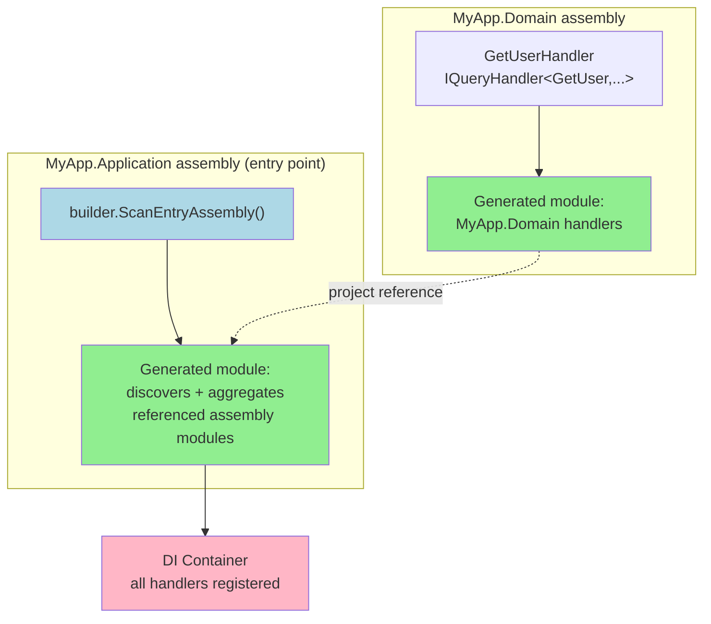

# Builder & Registration

How to register Interlocutor with dependency injection. Handlers are discovered at compile time by a source generator — there's no runtime reflection scan — and the pipeline is empty until you explicitly compose it; nothing runs by default.

## The Builder

`InterlocutorBuilder` is the single configuration entry point, container-agnostic. You pass it the same builder delegate to both Microsoft.Extensions.DependencyInjection and Autofac, unchanged:

```csharp
// Microsoft.Extensions.DependencyInjection
services.AddInterlocutor(builder =>
{
    builder.ScanAssembly(typeof(Program).Assembly);
    builder.UseRecommendedChain();
});

// Autofac — same builder delegate
containerBuilder.AddInterlocutor(builder =>
{
    builder.ScanAssembly(typeof(Program).Assembly);
    builder.UseRecommendedChain();
});
```

### Migration Note: No Legacy Overloads

This library has **no legacy registration API**. There are no bare `AddInterlocutor()` overloads with defaults, no `options` pattern, no separate `ScanAssembly(Assembly[])` method. All configuration flows through the builder delegate.

If you're coming from MediatR or an earlier Interlocutor prototype, the entry point is different:

```csharp
// ❌ Not supported — builder delegate is required
services.AddInterlocutor();

// ❌ Not supported — use the builder instead
services.AddInterlocutor<Program>();

// ✅ Correct — builder is always required
services.AddInterlocutor(builder =>
{
    builder.ScanAssembly(typeof(Program).Assembly);
});
```

## Assembly Scanning

Handlers, pipeline stages, and notifications are discovered by scanning one or more assemblies:

```csharp
services.AddInterlocutor(builder =>
{
    // Scan a single assembly
    builder.ScanAssembly(typeof(Program).Assembly);
    
    // Scan the entry assembly (shorthand)
    builder.ScanEntryAssembly();
    
    // Scan an assembly containing a specific marker type
    builder.ScanAssemblyContaining<UserService>();
    
    // Scan multiple assemblies
    builder.ScanAssembly(typeof(MyDomainModel).Assembly);
    builder.ScanAssembly(typeof(MyApplicationService).Assembly);
});
```

The source generator looks for:

- `IQueryHandler<TQuery, TResponse>` implementations → registered as scoped
- `ICommandHandler<TCommand, TResponse>` implementations → registered as scoped
- `ICommandHandler<TCommand>` (void) implementations → registered as scoped
- `INotificationHandler<TNotification>` implementations → registered as scoped
- `IPipelineStage<TRequest, TResponse>` implementations → auto-discovered and aggregated by `PipelineStageBehavior`

## Pipeline Behaviors

Add behaviors to the builder, in the order you want them to execute (outermost to innermost):

```csharp
services.AddInterlocutor(builder =>
{
    builder.ScanAssembly(typeof(Program).Assembly);
    
    // Explicitly compose your pipeline
    builder.AddBehavior(typeof(LoggingBehavior<,>));
    builder.AddBehavior(typeof(AuditingBehavior<,>));
    builder.AddBehavior(typeof(ValidationBehavior<,>));
    builder.AddBehavior(typeof(TransactionBehavior<,>));
    
    // Or use the documented recommended chain as sugar
    // builder.UseRecommendedChain();
});
```

See [pipeline-and-behaviors.md](pipeline-and-behaviors.md) for the full rationale of the recommended chain and how to compose your own.

## Dependency Defaults

Some behaviors and features need service registrations (an `IAuditSink`, a `IPolicyEvaluator`, an `IRequestContextAccessor`). The builder can register defaults, but your own registrations (made before the builder is applied) always take precedence:

```csharp
// ✅ Your registration wins — no default is registered
services.AddSingleton<IAuditSink, MyAuditSink>();
services.AddInterlocutor(builder =>
{
    builder.ScanAssembly(typeof(Program).Assembly);
    builder.AddBehavior(typeof(AuditingBehavior<,>));
    // MyAuditSink is used, no default is registered
});

// ✅ Builder's default is used
services.AddInterlocutor(builder =>
{
    builder.ScanAssembly(typeof(Program).Assembly);
    builder.AddBehavior(typeof(AuditingBehavior<,>));
    builder.DefaultAuditSink = new MyAuditSink();  // Falls back if not already registered
});

// ✅ Override your own registration
services.AddSingleton<IAuditSink, MyAuditSink>();
services.AddInterlocutor(builder =>
{
    builder.ScanAssembly(typeof(Program).Assembly);
    builder.AddBehavior(typeof(AuditingBehavior<,>));
    builder.OverrideAuditSink = new OtherAuditSink();  // This one wins
});
```

## Cross-Assembly Aggregation

When handlers live in a separate assembly, Interlocutor still discovers them — each assembly emits its own generated handler module, and the application-level generator aggregates all of them:

```
src/
  MyApp.Domain/
    Handlers/
      GetUserHandler.cs (IQueryHandler<GetUser, ...>)
    MyApp.Domain.csproj
    
  MyApp.Application/
    Program.cs
    MyApp.Application.csproj (references MyApp.Domain)
```

The generator:

1. **MyApp.Domain** emits a module registering `GetUserHandler` (and any other handlers in that assembly).
2. **MyApp.Application** (the entry point) emits a module that discovers and aggregates the module from MyApp.Domain.

Aggregation follows project references transitively, so scanning the entry assembly alone is sufficient regardless of how many referenced assemblies contain handlers:



You just need to scan the entry assembly:

```csharp
// Program.cs (MyApp.Application)
services.AddInterlocutor(builder =>
{
    builder.ScanEntryAssembly();  // Recursively discovers handlers in referenced assemblies
    builder.UseRecommendedChain();
});
```

No separate configuration for "also scan this assembly" — the generator follows project references automatically.

> [!NOTE]
> Runtime assembly scanning fallback — disabled by default and only active if you explicitly opt into the legacy scanning mode — exists for the plugin scenario where handler assemblies are loaded dynamically after startup. See [Trim & AOT support](trim-and-aot-support.md) for details.

## Startup Validation

Missing handler registrations fail at startup (container build time), not on the first request:

```csharp
public record GetUser(int UserId) : IQuery<OperationOutcome<UserDto, NotFound>>;

// If no IQueryHandler<GetUser, OperationOutcome<UserDto, NotFound>> is registered,
// AddInterlocutor throws InvalidOperationException at startup.
services.AddInterlocutor(builder =>
{
    builder.ScanAssembly(typeof(Program).Assembly);
    // If GetUserHandler is missing, exception here, not on the first request
});
```

This applies to every `IQuery<T>`, `ICommand<T>`, and `ICommand` discovered in scanned assemblies. If a handler type exists but no implementation is registered, you'll know before the application starts.

## Microsoft.Extensions.DependencyInjection

Entry point: `IServiceCollection.AddInterlocutor(Action<InterlocutorBuilder>)`

```csharp
var builder = WebApplication.CreateBuilder();
builder.Services.AddInterlocutor(interlocutor =>
{
    interlocutor.ScanAssembly(typeof(Program).Assembly);
    interlocutor.UseRecommendedChain();
});

var app = builder.Build();
// App starts; if handlers are missing or ambiguous, exception is thrown here
```

## Autofac

Entry point: `ContainerBuilder.AddInterlocutor(Action<InterlocutorBuilder>)`

```csharp
var containerBuilder = new ContainerBuilder();

// Identical builder delegate, same method signature
containerBuilder.AddInterlocutor(interlocutor =>
{
    interlocutor.ScanAssembly(typeof(Program).Assembly);
    interlocutor.UseRecommendedChain();
});

var container = containerBuilder.Build();
// App starts; if handlers are missing or ambiguous, exception is thrown here
```

The builder produces container-neutral `InterlocutorRegistration` records. Both Microsoft DI and Autofac extensions translate those into their respective service descriptors / module registrations.

## Container Lifetime: Mediator is Scoped

The mediator (`IMediator`, `ISender`, `IPublisher`) is **registered as scoped** and is **not configurable**:

- In a web context, one scope per HTTP request → one mediator instance per request.
- In a background service, you create a scope explicitly before dispatching.

See [mediator-lifetimes-and-scope.md](mediator-lifetimes-and-scope.md) for the rationale and how to dispatch correctly in background services.

## Verifying Your Registration

After registration, verify handlers can be resolved:

```csharp
using var scope = serviceProvider.CreateScope();
var mediator = scope.ServiceProvider.GetRequiredService<IMediator>();

// If a handler is missing, GetRequiredService throws before you dispatch
var result = await mediator.Send(new GetUser(1), cancellationToken);
```

This is optional — missing handlers already failed at startup. But it's a sanity check if you're debugging registration issues.
