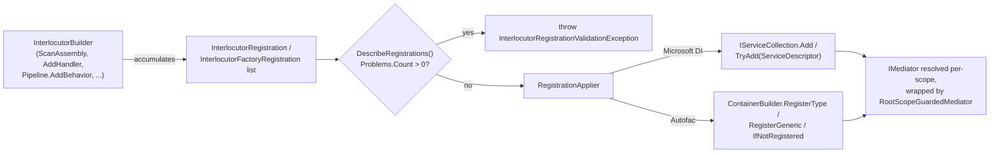

# Dependency Injection: Abstractions & Registration Model

`Interlocutor.DependencyInjection.Abstractions` is the container-neutral core shared by both container packages - `InterlocutorBuilder`/`InterlocutorPipelineBuilder`, the plain registration records they accumulate, and the reporting/validation surface built on top of that list. Neither `Interlocutor.DependencyInjection.Microsoft` nor `.Autofac` retains its own scanning or bookkeeping logic; both translate this package's output into their own container's primitives. This doc covers what's common to both - the model itself, and how to inspect/validate it. Package-specific translation and usage examples live in [Dependency Injection: Microsoft.Extensions.DependencyInjection](dependency-injection-microsoft.md) and [Dependency Injection: Autofac](dependency-injection-autofac.md).

## Package Map

| Package | Entry point | Depends on | Adds |
| :-- | :-- | :-- | :-- |
| `Interlocutor.DependencyInjection.Abstractions` | *(none - shared model)* | `Interlocutor.Abstractions` | `InterlocutorBuilder`, `InterlocutorPipelineBuilder`, the registration-record types below, `RootScopeGuardedMediator` |
| `Interlocutor.DependencyInjection.Microsoft` | `IServiceCollection.AddInterlocutor(Action<InterlocutorBuilder>)` | `Interlocutor.DependencyInjection.Abstractions`, `Interlocutor.Persistence.Abstractions` | Microsoft.Extensions.DependencyInjection translation, `MicrosoftRootScopeDetector`, `AddInterlocutorUnitOfWork`/`AddInterlocutorRepository` |
| `Interlocutor.DependencyInjection.Autofac` | `ContainerBuilder.AddInterlocutor(Action<InterlocutorBuilder>)` | `Interlocutor.DependencyInjection.Abstractions`, `Interlocutor.Persistence.Abstractions` | Autofac translation, `AutofacRootScopeDetector`, `AddInterlocutorUnitOfWork`/`AddInterlocutorRepository` |

Both container packages depend only on the zero-ORM `Interlocutor.Persistence.Abstractions`, never on `Interlocutor.Persistence.EntityFrameworkCore` or `.NHibernate` - a consumer who never calls the persistence extensions never pulls either store package in transitively.

> [!IMPORTANT]
> Reference only one container package per application. `InterlocutorBuilder` itself is container-neutral and produces plain records - nothing about it prevents referencing both, but each package independently registers its own `IMediator`/`ISender`/`IPublisher`, and the last one registered wins under Microsoft DI while Autofac would report an ambiguous registration. Pick Microsoft.Extensions.DependencyInjection or Autofac for a given application, not both.

## `InterlocutorBuilder` & `InterlocutorPipelineBuilder`

The single, container-neutral configuration surface both packages' `AddInterlocutor` accept as a delegate - assembly scanning, explicit handler/type-match registration, and infrastructure defaults live on `InterlocutorBuilder`; pipeline composition lives on `InterlocutorPipelineBuilder`, reachable via its `Pipeline` property:

```csharp
// Same delegate body, unchanged, against either container package's AddInterlocutor.
Action<InterlocutorBuilder> configure = builder =>
{
    builder.ScanAssembly(typeof(Program).Assembly);
    builder.Pipeline.UseRecommendedChain();
};
```

See [Builder & Registration](builder-and-registration.md) for the full how-to guide - assembly scanning forms, `AddHandler`, `AddTypeMatch`, pipeline composition, dependency defaults, and cross-assembly aggregation. This doc focuses on what the builder produces and how to inspect/validate it.

## The Registration Model

Every `InterlocutorBuilder` method - `ScanAssembly`, `AddHandler`, `AddTypeMatch`, `Pipeline.AddBehavior`, `Pipeline.AddStage`, the `Add*Behavior` defaults - ultimately appends one of two plain, container-neutral record types to the builder's internal list. Neither container package sees `InterlocutorBuilder` itself; both consume this list.

| Type | Shape | Produced by |
| :-- | :-- | :-- |
| `InterlocutorRegistration` | `ServiceType`, `ImplementationType`, `Lifetime`, `Kind`, `Provenance`, `MatchedByRule` | Type-based registrations - discovered handlers, `AddHandler`, `Pipeline.AddBehavior(Type)`, `Pipeline.AddStage`, generated registrations, and the infrastructure defaults (`IAuditSink`, `IPolicyEvaluator`, `IRequestContextAccessor`, `IResponseOutcomeDescriber`) and their `Override*` counterparts |
| `InterlocutorFactoryRegistration` | `ServiceType`, `Factory` (`Func<IServiceProvider, object>`), `Lifetime`, `Kind` | Factory-based registrations - lambda-form pipeline stages registered via `Pipeline.AddStage`'s delegate overloads |

```csharp
public readonly record struct InterlocutorRegistration(
    Type ServiceType,
    Type ImplementationType,
    RegistrationLifetime Lifetime,
    RegistrationKind Kind,
    RegistrationProvenance Provenance = RegistrationProvenance.Explicit,
    string? MatchedByRule = null);
```

`MatchedByRule` is populated only when `Provenance` is `Matched` - either the `AddTypeMatch` rule's own `name`, or its position among the builder's match rules when unnamed. It is `null` for every other provenance.

### `RegistrationLifetime`

The container-neutral lifetime every builder method takes, instead of a container-specific lifetime type:

```csharp
public enum RegistrationLifetime
{
    Singleton,
    Scoped,
    Transient,
}
```

Each container package translates this to its own vocabulary - see [Microsoft.Extensions.DependencyInjection § Lifetime Translation](dependency-injection-microsoft.md#lifetime-translation) and [Autofac § Lifetime Translation](dependency-injection-autofac.md#lifetime-translation).

### `RegistrationKind`

Classifies why a registration exists, and controls whether a duplicate is legal:

| Value | Meaning | Duplicate handling |
| :-- | :-- | :-- |
| `Handler` | A discovered or explicitly-registered query/command/notification handler | Always-add; `AddHandler` replaces a scanned duplicate for the same (service type, implementation type) pair |
| `Behavior` | A pipeline behavior added via `Pipeline.AddBehavior` or a named `Add*Behavior` | Always-add - a request type can legally run through more than one behavior instance |
| `Stage` | A pipeline stage added via `Pipeline.AddStage`/`AddStageHost` | Always-add |
| `Dispatcher` | The generator-emitted `IGeneratedRequestDispatcher` implementation - one compilation-wide singleton registered alongside `Handler` entries when `AddGeneratedRegistrations` is used | Always-add |
| `Default` | An infrastructure default (`IAuditSink`, `IPolicyEvaluator`, `IRequestContextAccessor`, `IResponseOutcomeDescriber`) | Try-add only - see [Builder & Registration § Dependency Defaults](builder-and-registration.md#dependency-defaults) |

### `RegistrationProvenance`

Recorded per registration so `DescribeRegistrations()` can explain *why* something is present - `Scanned` (found by `ScanAssembly`/`ScanAssemblyContaining`/`ScanEntryAssembly`), `Explicit` (`AddHandler`, `Pipeline.AddBehavior`, `Pipeline.AddStage`), or `Matched` (an `AddTypeMatch` rule, carrying that rule's `name`).

## Inspecting Registrations: `RegistrationReport`

`InterlocutorBuilder.DescribeRegistrations()` returns a `RegistrationReport` built from the same accumulated list, container-neutral and requiring no live container - call it any time, before or after configuring the rest of the builder:

| Type | Purpose |
| :-- | :-- |
| `RegistrationReport` | Every accumulated registration with its provenance; every `SkippedRegistration` (an optional-package probe, e.g. `AddValidationBehavior`, that found nothing to register); every `RegistrationProblem` once `ValidateOnBuild()` is configured. `Format()`/`ToString()` render it as text. |
| `SkippedRegistration` | One optional-package probe that matched nothing - for example `AddUnitOfWorkBehavior()` when neither `Interlocutor.Persistence.EntityFrameworkCore` nor `.Persistence.NHibernate` is referenced. |
| `RegistrationProblem` / `RegistrationProblemKind` | One `ValidateOnBuild()` finding - an unhandled request type, a required `AddTypeMatch` rule that matched nothing, or two registrations of the same (service type, implementation type) pair at conflicting lifetimes. |

### Example: printing the report

```csharp
var builder = new InterlocutorBuilder();
builder.ScanAssembly(typeof(Program).Assembly);
builder.Pipeline.UseRecommendedChain();

var report = builder.DescribeRegistrations();
Console.WriteLine(report.Format());
// Handlers:
//   GetUserHandler -> IQueryHandler<GetUser, ...> (Scoped, Scanned)
//   ...
// Behaviors:
//   LoggingBehavior<,> -> IPipelineBehavior<,> (Scoped, Explicit)
//   ...
// Skipped:
//   AddUnitOfWorkBehavior(): no store package referenced
```

Both `AddInterlocutor` entry points call `DescribeRegistrations()` themselves before applying anything to the container, so a report with `Problems.Count > 0` throws before any registration reaches your `IServiceCollection`/`ContainerBuilder` - see [Validation](#validation) below.

## Validation

Three independent mechanisms catch a missing handler or a conflicting registration, at different points in the lifecycle - none automatic:

### `ValidateOnBuild()` - checked at `AddInterlocutor()` time

Configured on the builder itself, checked against the accumulated registration list alone - no live container needed:

```csharp
services.AddInterlocutor(builder =>
{
    builder.ScanAssembly(typeof(Program).Assembly);
    builder.ValidateOnBuild();
});
// Throws InterlocutorRegistrationValidationException immediately if:
//  - a discovered request type has no matching handler
//  - a `require: true` AddTypeMatch rule matched nothing
//  - two registrations of the same (service type, implementation type) pair
//    were made at conflicting lifetimes
```

`InterlocutorRegistrationValidationException` carries the same `RegistrationReport` `DescribeRegistrations()` returns, with `Problems` populated - inspect `exception.Report.Problems` for every finding at once, not just the first.

### `IServiceProvider.ValidateHandlerRegistrations` - checked once the container is built

An explicit, opt-in runtime check against a live container - see the per-package docs for the exact call shape, since Microsoft DI resolves `IServiceProvider` directly while Autofac needs a `container.Resolve<IServiceProvider>()` first:

```csharp
// Reflects over the given assemblies, derives each request type's expected
// handler contract, and throws InvalidOperationException - naming every
// missing registration in one message - if any are absent.
provider.ValidateHandlerRegistrations(typeof(Program).Assembly);
```

### Build-time diagnostic - `INTERLOC001`

The source generator emits `INTERLOC001` as a compiler warning when a request type has no matching handler *in the same compilation* - default severity `Warning`, escalatable to a build error via `.editorconfig`:

```ini
dotnet_diagnostic.INTERLOC001.severity = error
```

This only sees what the compiler sees - it cannot know about a handler registered through runtime scanning of an assembly outside the current compilation.

See [Builder & Registration § Startup Validation](builder-and-registration.md#startup-validation) for the consumer-facing walkthrough of all three together.

## Translation Flow



`RegistrationApplier` is the one piece of translation logic shared by both packages - it walks the accumulated list and invokes three callbacks each package supplies: `addRegistration` (always-add, type-based), `addFactory` (always-add, factory-based), and `tryAddDefault` (try-add, `Default`-kind only). What each package's callbacks actually do - lifetime mapping, open/closed generic resolution, try-add semantics - is documented per package.

## `RootScopeGuardedMediator`

Both container packages register `IMediator` as this type wrapping the real `Mediator`, so a resolve from the application's root container throws instead of silently handing back a mediator whose scoped dependencies (a `DbContext`, for instance) have nowhere to resolve from:

```csharp
public sealed class RootScopeGuardedMediator(Mediator inner, IRootScopeDetector rootScopeDetector) : IMediator
{
    // Every IMediator/ISender/IPublisher member checks rootScopeDetector.IsRootScope
    // before forwarding to inner, throwing if resolved from the root container.
}
```

`IRootScopeDetector` is the one seam each container package implements differently (`MicrosoftRootScopeDetector`, `AutofacRootScopeDetector`) - see their package-specific docs for the detection mechanism. See [Mediator, Lifetimes & Scope § Root-Scope Exception & Guard](mediator-lifetimes-and-scope.md#root-scope-exception--guard) for the consumer-facing behavior this produces.

## Compile-Time Generated Registrations

`Interlocutor.Generator` can emit registrations at compile time instead of via runtime assembly scanning, consumed the same way regardless of container:

```csharp
builder.AddGeneratedRegistrations(Interlocutor.Generated.InterlocutorGeneratedRegistrations.Registrations);
```

Two assembly-level attributes make cross-assembly discovery work without runtime reflection - both applied by the generator only, never by hand:

| Type | Purpose |
| :-- | :-- |
| `InterlocutorGeneratedModuleAttribute` | Names the compiling assembly's generated registration module type (a static class exposing `IReadOnlyList<InterlocutorRegistration> Registrations`). Read by a referencing project's own generator run via Roslyn symbol inspection - never runtime reflection - to aggregate an upstream library's handlers into the application's own generated module. |
| `InterlocutorGeneratedHandlerAttribute` | Restates one discovered handler's `(requestType, responseType, kind)` as plain constructor-argument metadata, so the missing-handler diagnostic can answer "does some referenced assembly already handle this?" purely from attribute metadata, without evaluating `Registrations` itself. `kind` is a `GeneratedHandlerKind` (`Query`, `Command`, `BareCommand`, `Notification`) - notification handlers never receive one, since a notification may legally have zero handlers. |

See [Builder & Registration § Cross-Assembly Aggregation](builder-and-registration.md#cross-assembly-aggregation) for the consumer-facing usage, and [Trim & AOT Support](trim-and-aot-support.md) for why generated registrations avoid the runtime-scanning trim cost.

## Choosing Between the Two Container Packages

| | Microsoft.Extensions.DependencyInjection | Autofac |
| :-- | :-- | :-- |
| Handler/scoped lifetime name | `Scoped` | `InstancePerLifetimeScope` |
| Try-add mechanism | `IServiceCollection.TryAdd` | `.IfNotRegistered(serviceType)` |
| `IServiceProvider` availability | Native | Bridged via `AutofacServiceProvider` (`.ExternallyOwned()`) |
| Registration report logging | Synchronous, at `AddInterlocutor()` time | Deferred to `RegisterBuildCallback` |
| Root-scope comparison | Root `IServiceProvider` reference equality | `ILifetimeScope.Tag == LifetimeScope.RootTag` |

Functionally the two are equivalent - the same builder delegate, the same discovered handlers, the same pipeline, the same root-scope guard behavior. Pick whichever container the rest of the application already uses.

## See Also

- [Builder & Registration](builder-and-registration.md) - the full `InterlocutorBuilder`/`InterlocutorPipelineBuilder` how-to guide.
- [Dependency Injection: Microsoft.Extensions.DependencyInjection](dependency-injection-microsoft.md) - registration, injection, and validation examples for the Microsoft DI package.
- [Dependency Injection: Autofac](dependency-injection-autofac.md) - registration, injection, and validation examples for the Autofac package.
- [Mediator, Lifetimes, Scope & Ambient Context](mediator-lifetimes-and-scope.md) - the consumer-facing root-scope guard behavior and dispatching from web/background contexts.
- [Persistence Abstraction](persistence-abstraction.md) - the `IUnitOfWork`/`IDomainRepository<TEntity, TKey>` surface the persistence registration extensions register.
- [Glossary](glossary.md) - `InterlocutorBuilder`, `RegistrationLifetime`, `RegistrationKind`, and `Interlocutor.DependencyInjection.Abstractions` are already defined there.
