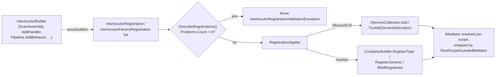

# Dependency Injection Packages

The container-neutral registration model behind `AddInterlocutor`, and the API each container package - `Interlocutor.DependencyInjection.Microsoft` and `Interlocutor.DependencyInjection.Autofac` - exposes on top of it. [Builder & Registration](builder-and-registration.md) covers *what you write* on `InterlocutorBuilder`; this doc covers *what each package does with it* - the registration records the builder accumulates, how each container translates them, and the package-specific surface (root-scope detection, the persistence opt-in extensions, generated-registration metadata) that lives outside the builder itself.

## Package Map

| Package | Entry point | Depends on | Adds |
| :-- | :-- | :-- | :-- |
| `Interlocutor.DependencyInjection.Abstractions` | *(none - shared model)* | `Interlocutor.Abstractions` | `InterlocutorBuilder`, `InterlocutorPipelineBuilder`, the registration-record types below, `RootScopeGuardedMediator` |
| `Interlocutor.DependencyInjection.Microsoft` | `IServiceCollection.AddInterlocutor(Action<InterlocutorBuilder>)` | `Interlocutor.DependencyInjection.Abstractions`, `Interlocutor.Persistence.Abstractions` | Microsoft.Extensions.DependencyInjection translation, `MicrosoftRootScopeDetector`, `AddInterlocutorUnitOfWork`/`AddInterlocutorRepository` |
| `Interlocutor.DependencyInjection.Autofac` | `ContainerBuilder.AddInterlocutor(Action<InterlocutorBuilder>)` | `Interlocutor.DependencyInjection.Abstractions`, `Interlocutor.Persistence.Abstractions` | Autofac translation, `AutofacRootScopeDetector`, `AddInterlocutorUnitOfWork`/`AddInterlocutorRepository` |

Both container packages depend only on the zero-ORM `Interlocutor.Persistence.Abstractions`, never on `Interlocutor.Persistence.EntityFrameworkCore` or `.NHibernate` - a consumer who never calls the persistence extensions never pulls either store package in transitively.

> [!IMPORTANT]
> Reference only one container package per application. `InterlocutorBuilder` itself is container-neutral and produces plain records - nothing about it prevents referencing both, but each package independently registers its own `IMediator`/`ISender`/`IPublisher`, and the last one registered wins under Microsoft DI while Autofac would report an ambiguous registration. Pick Microsoft.Extensions.DependencyInjection or Autofac for a given application, not both.

## The Registration Model

Every `InterlocutorBuilder` method - `ScanAssembly`, `AddHandler`, `AddTypeMatch`, `Pipeline.AddBehavior`, `Pipeline.AddStage`, the `Add*Behavior` defaults - ultimately appends one of two plain, container-neutral record types to the builder's internal list. Neither container package sees `InterlocutorBuilder` itself; both consume this list.

| Type | Shape | Produced by |
| :-- | :-- | :-- |
| `InterlocutorRegistration` | `ServiceType`, `ImplementationType`, `Lifetime`, `Kind`, `Provenance`, `MatchedByRule` | Type-based registrations - discovered handlers, `AddHandler`, `Pipeline.AddBehavior(Type)`, `Pipeline.AddStage`, generated registrations, and the infrastructure defaults (`IAuditSink`, `IPolicyEvaluator`, `IRequestContextAccessor`, `IResponseOutcomeDescriber`) and their `Override*` counterparts |
| `InterlocutorFactoryRegistration` | `ServiceType`, `Factory` (`Func<IServiceProvider, object>`), `Lifetime`, `Kind` | Factory-based registrations - lambda-form pipeline stages registered via `Pipeline.AddStage`'s delegate overloads |

```csharp
public readonly record struct InterlocutorRegistration(
    Type ServiceType,
    Type ImplementationType,
    RegistrationLifetime Lifetime,
    RegistrationKind Kind,
    RegistrationProvenance Provenance = RegistrationProvenance.Explicit,
    string? MatchedByRule = null);
```

`MatchedByRule` is populated only when `Provenance` is `Matched` - either the `AddTypeMatch` rule's own `name`, or its position among the builder's match rules when unnamed. It is `null` for every other provenance.

### `RegistrationLifetime`

The container-neutral lifetime every builder method takes, instead of a container-specific lifetime type:

```csharp
public enum RegistrationLifetime
{
    Singleton,
    Scoped,
    Transient,
}
```

Each package translates this to its own vocabulary - see the per-package tables below.

### `RegistrationKind`

Classifies why a registration exists, and controls whether a duplicate is legal:

| Value | Meaning | Duplicate handling |
| :-- | :-- | :-- |
| `Handler` | A discovered or explicitly-registered query/command/notification handler | Always-add; `AddHandler` replaces a scanned duplicate for the same (service type, implementation type) pair |
| `Behavior` | A pipeline behavior added via `Pipeline.AddBehavior` or a named `Add*Behavior` | Always-add - a request type can legally run through more than one behavior instance |
| `Stage` | A pipeline stage added via `Pipeline.AddStage`/`AddStageHost` | Always-add |
| `Dispatcher` | The generator-emitted `IGeneratedRequestDispatcher` implementation - one compilation-wide singleton registered alongside `Handler` entries when `AddGeneratedRegistrations` is used | Always-add |
| `Default` | An infrastructure default (`IAuditSink`, `IPolicyEvaluator`, `IRequestContextAccessor`, `IResponseOutcomeDescriber`) | Try-add only - see [Builder & Registration § Dependency Defaults](builder-and-registration.md#dependency-defaults) |

### `RegistrationProvenance`

Recorded per registration so `DescribeRegistrations()` can explain *why* something is present - `Scanned` (found by `ScanAssembly`/`ScanAssemblyContaining`/`ScanEntryAssembly`), `Explicit` (`AddHandler`, `Pipeline.AddBehavior`, `Pipeline.AddStage`), or `Matched` (an `AddTypeMatch` rule, carrying that rule's `name`).

### Reporting Types

`InterlocutorBuilder.DescribeRegistrations()` returns a `RegistrationReport` built from the same accumulated list, container-neutral and requiring no live container:

| Type | Purpose |
| :-- | :-- |
| `RegistrationReport` | Every accumulated registration with its provenance; every `SkippedRegistration` (an optional-package probe, e.g. `AddValidationBehavior`, that found nothing to register); every `RegistrationProblem` once `ValidateOnBuild()` is configured. `Format()`/`ToString()` render it as text. |
| `SkippedRegistration` | One optional-package probe that matched nothing - for example `AddUnitOfWorkBehavior()` when neither `Interlocutor.Persistence.EntityFrameworkCore` nor `.Persistence.NHibernate` is referenced. |
| `RegistrationProblem` / `RegistrationProblemKind` | One `ValidateOnBuild()` finding - an unhandled request type, a required `AddTypeMatch` rule that matched nothing, or two registrations of the same (service type, implementation type) pair at conflicting lifetimes. |

See [Builder & Registration § Inspecting What Was Registered](builder-and-registration.md#inspecting-what-was-registered) and [§ Startup Validation](builder-and-registration.md#startup-validation) for the consumer-facing walkthrough of these.

### Translation Flow



`RegistrationApplier` (in `Interlocutor.DependencyInjection.Abstractions`) is the one piece of translation logic shared by both packages - it walks the accumulated list and invokes three callbacks each package supplies: `addRegistration` (always-add, type-based), `addFactory` (always-add, factory-based), and `tryAddDefault` (try-add, `Default`-kind only). Everything below this line is what each package's callbacks actually do.

## Microsoft.Extensions.DependencyInjection

```csharp
public static class InterlocutorServiceCollectionExtensions
{
    public static IServiceCollection AddInterlocutor(
        this IServiceCollection services,
        Action<InterlocutorBuilder> configure);
}
```

```csharp
services.AddInterlocutor(builder =>
{
    builder.ScanAssembly(typeof(Program).Assembly);
    builder.Pipeline.UseRecommendedChain();
});
```

### Lifetime Translation

| `RegistrationLifetime` | `ServiceLifetime` |
| :-- | :-- |
| `Singleton` | `Singleton` |
| `Scoped` | `Scoped` |
| `Transient` | `Transient` |

Every registration becomes a `ServiceDescriptor` - `services.Add(...)` for `Handler`/`Behavior`/`Stage`, `services.TryAdd(...)` for `Default`.

### Open Generic Resolution

`Pipeline.AddBehavior` always records the open `IPipelineBehavior<TRequest, TResponse>` as `ServiceType`, regardless of whether `ImplementationType` is itself open or closed. Microsoft.Extensions.DependencyInjection requires an open generic *service* type to be paired with an open generic *implementation* - a closed implementation registered directly against `IPipelineBehavior<,>` throws at `BuildServiceProvider()` time. `AddInterlocutor` re-pairs a closed implementation with the specific closed `IPipelineBehavior<,>` interface it actually implements, so this never reaches the container in the invalid shape.

> [!WARNING]
> If a behavior implementation and the service type it's registered against are *both* open generics with a different number of type parameters - for example, EF Core's arity-3 `UnitOfWorkBehavior<TRequest, TResponse, TContext>` registered directly against the arity-2 `IPipelineBehavior<TRequest, TResponse>` - `AddInterlocutor` throws `InvalidOperationException` immediately, with a message naming the fix: declare a subclass that closes the extra type parameter and leaves the rest open, then register that subclass via `Pipeline.AddBehavior(typeof(...))` instead.
>
> ```csharp
> class MyUnitOfWorkBehavior<TRequest, TResponse>
>     : UnitOfWorkBehavior<TRequest, TResponse, MyDbContext> { }
>
> builder.Pipeline.AddBehavior(typeof(MyUnitOfWorkBehavior<,>));
> ```

### Registration Report Logging

If `ILoggerFactory` is already registered in `services` before `AddInterlocutor` runs, the formatted `RegistrationReport` is logged automatically at `AddInterlocutor()` time, under the `"Interlocutor"` category - additive, never required, and silently skipped if resolving a logger fails for any reason.

### Persistence Extensions

```csharp
public static class PersistenceServiceCollectionExtensions
{
    public static IServiceCollection AddInterlocutorUnitOfWork<TImplementation>(
        this IServiceCollection services,
        Func<IServiceProvider, TImplementation> implementationFactory)
        where TImplementation : class, IUnitOfWork;

    public static IServiceCollection AddInterlocutorRepository<TEntity, TKey, TImplementation>(
        this IServiceCollection services,
        Func<IServiceProvider, TImplementation> implementationFactory)
        where TImplementation : class, IDomainRepository<TEntity, TKey>;
}
```

Both register scoped, and both take a factory rather than a bare implementation type - an EF Core or NHibernate repository's constructor needs a key-selector expression (`e => e.Id`) no container can synthesize. Neither is called by `AddInterlocutor` itself; the persistence abstraction is entirely opt-in.

```csharp
services.AddInterlocutorUnitOfWork(sp =>
    new EntityFrameworkUnitOfWork<AppDbContext>(new Lazy<AppDbContext>(sp.GetRequiredService<AppDbContext>)));

services.AddInterlocutorRepository<Order, int, EntityFrameworkRepository<Order, int, AppDbContext>>(sp =>
    new EntityFrameworkRepository<Order, int, AppDbContext>(
        new Lazy<AppDbContext>(sp.GetRequiredService<AppDbContext>),
        order => order.Id));
```

See [Persistence Abstraction](persistence-abstraction.md) for the full `IUnitOfWork`/`IDomainRepository<TEntity, TKey>` surface these register, and why the constructors above take a `Lazy<AppDbContext>` rather than `AppDbContext` directly.

### Root-Scope Detection

`IMediator` is registered as a scoped `RootScopeGuardedMediator` wrapping the real `Mediator`, so a resolve from the application's root container throws instead of silently handing back a mediator whose scoped dependencies (a `DbContext`, for instance) have nowhere to resolve from. See [Mediator, Lifetimes & Scope § Root-Scope Exception & Guard](mediator-lifetimes-and-scope.md#root-scope-exception--guard) for the consumer-facing behavior; the detection mechanism itself:

| Type | Registered as | Role |
| :-- | :-- | :-- |
| `RootServiceProviderMarker` | Singleton | Captures the true root `IServiceProvider` via constructor injection. Microsoft.Extensions.DependencyInjection resolves a singleton's dependencies against its own internally-tracked root scope regardless of which scope first triggered construction, so this is a stable point of comparison even if the marker is built lazily from inside a request scope. |
| `MicrosoftRootScopeDetector` | Scoped, implements `IRootScopeDetector` | Compares the ambient `IServiceProvider` it was constructed with against `RootServiceProviderMarker.RootProvider`. Reference equality means this instance was resolved directly from the root provider, with no intervening `IServiceScopeFactory.CreateScope()` call. |

Both are re-registered fresh every scope alongside the mediator itself, so the comparison is recomputed per dispatch rather than cached once.

## Autofac

```csharp
public static class InterlocutorAutofacExtensions
{
    public static ContainerBuilder AddInterlocutor(
        this ContainerBuilder builder,
        Action<InterlocutorBuilder> configure);
}
```

```csharp
var containerBuilder = new ContainerBuilder();
containerBuilder.AddInterlocutor(builder =>
{
    builder.ScanAssembly(typeof(Program).Assembly);
    builder.Pipeline.UseRecommendedChain();
});
var container = containerBuilder.Build();
```

### Lifetime Translation

| `RegistrationLifetime` | Autofac scope method |
| :-- | :-- |
| `Singleton` | `SingleInstance()` |
| `Scoped` | `InstancePerLifetimeScope()` |
| `Transient` | `InstancePerDependency()` |

Handlers discovered by scanning are registered `InstancePerLifetimeScope` - unlike Microsoft DI, where the equivalent lifetime is called `Scoped`, but the semantics (one instance per DI scope) are identical.

### Open Generic Resolution

Unlike Microsoft DI, Autofac has no problem pairing an *open* generic implementation with an open generic service via `RegisterGeneric(...).As(...)`. The reverse shape - a *closed* implementation paired directly with an *open* service type via `RegisterType(...).As(...)` - throws `ArgumentException` at `ContainerBuilder.Build()` time instead. `AddInterlocutor` applies the identical re-pairing Microsoft DI's package does (see above): a closed implementation registered against the open `IPipelineBehavior<TRequest, TResponse>` is re-paired with the specific closed interface it implements before `RegisterType` is called.

### Try-Add Defaults

Infrastructure defaults are registered with `.IfNotRegistered(serviceType)` - Autofac's try-add equivalent - so a consumer's own registration made before `AddInterlocutor` runs is left untouched, matching Microsoft DI's `TryAdd` semantics.

### `IServiceProvider` Bridge

The mediator resolves handlers through `IServiceProvider`, not Autofac's own `IComponentContext`, so `AddInterlocutor` registers an `AutofacServiceProvider` (from `Autofac.Extensions.DependencyInjection`) wrapping the current `ILifetimeScope`, marked `.ExternallyOwned()` so Autofac does not attempt to dispose it independently of the scope it wraps.

### Registration Report Logging

Unlike Microsoft DI, Autofac's registration order is unordered relative to the `AddInterlocutor` call, so whether `ILoggerFactory` ends up registered can't be checked synchronously. The formatted `RegistrationReport` is instead logged from a `RegisterBuildCallback`, deferred until the container finishes building - skipped silently if no `ILoggerFactory` is resolvable from the finished container.

### Persistence Extensions

```csharp
public static class PersistenceContainerBuilderExtensions
{
    public static ContainerBuilder AddInterlocutorUnitOfWork<TImplementation>(
        this ContainerBuilder builder,
        Func<IComponentContext, TImplementation> implementationFactory)
        where TImplementation : notnull, IUnitOfWork;

    public static ContainerBuilder AddInterlocutorRepository<TEntity, TKey, TImplementation>(
        this ContainerBuilder builder,
        Func<IComponentContext, TImplementation> implementationFactory)
        where TImplementation : notnull, IDomainRepository<TEntity, TKey>;
}
```

Both register `InstancePerLifetimeScope`, over Autofac's own `IComponentContext` rather than `IServiceProvider`:

```csharp
containerBuilder.AddInterlocutorUnitOfWork(c =>
    new EntityFrameworkUnitOfWork<AppDbContext>(c.Resolve<Lazy<AppDbContext>>()));

containerBuilder.AddInterlocutorRepository<Order, int, EntityFrameworkRepository<Order, int, AppDbContext>>(c =>
    new EntityFrameworkRepository<Order, int, AppDbContext>(c.Resolve<Lazy<AppDbContext>>(), order => order.Id));
```

> [!TIP]
> Autofac resolves `Lazy<T>` natively for any registered `T`, so no separate `Lazy<AppDbContext>` registration is needed.

### Root-Scope Detection

Autofac auto-injects `ILifetimeScope` as the ambient currently-resolving scope with no explicit registration needed. The root `IContainer` `ContainerBuilder.Build()` produces is itself an `ILifetimeScope` whose `Tag` is `LifetimeScope.RootTag`; any scope created via `BeginLifetimeScope()` - directly under the root or nested further - carries a different tag.

| Type | Registered as | Role |
| :-- | :-- | :-- |
| `AutofacRootScopeDetector` | `InstancePerLifetimeScope`, implements `IRootScopeDetector` | Compares the ambient `ILifetimeScope.Tag` it was constructed with against `LifetimeScope.RootTag`. Equal means this instance was resolved directly from the root, regardless of how many other child scopes exist elsewhere in the application. |

## Choosing Between the Two Packages

| | Microsoft.Extensions.DependencyInjection | Autofac |
| :-- | :-- | :-- |
| Handler/scoped lifetime name | `Scoped` | `InstancePerLifetimeScope` |
| Try-add mechanism | `IServiceCollection.TryAdd` | `.IfNotRegistered(serviceType)` |
| `IServiceProvider` availability | Native | Bridged via `AutofacServiceProvider` (`.ExternallyOwned()`) |
| Registration report logging | Synchronous, at `AddInterlocutor()` time | Deferred to `RegisterBuildCallback` |
| Root-scope comparison | Root `IServiceProvider` reference equality | `ILifetimeScope.Tag == LifetimeScope.RootTag` |

Functionally the two are equivalent - the same builder delegate, the same discovered handlers, the same pipeline, the same root-scope guard behavior. Pick whichever container the rest of the application already uses.

## Compile-Time Generated Registrations

`Interlocutor.Generator` can emit registrations at compile time instead of via runtime assembly scanning, consumed the same way regardless of container:

```csharp
builder.AddGeneratedRegistrations(Interlocutor.Generated.InterlocutorGeneratedRegistrations.Registrations);
```

Two assembly-level attributes make cross-assembly discovery work without runtime reflection - both applied by the generator only, never by hand:

| Type | Purpose |
| :-- | :-- |
| `InterlocutorGeneratedModuleAttribute` | Names the compiling assembly's generated registration module type (a static class exposing `IReadOnlyList<InterlocutorRegistration> Registrations`). Read by a referencing project's own generator run via Roslyn symbol inspection - never runtime reflection - to aggregate an upstream library's handlers into the application's own generated module. |
| `InterlocutorGeneratedHandlerAttribute` | Restates one discovered handler's `(requestType, responseType, kind)` as plain constructor-argument metadata, so the missing-handler diagnostic can answer "does some referenced assembly already handle this?" purely from attribute metadata, without evaluating `Registrations` itself. `kind` is a `GeneratedHandlerKind` (`Query`, `Command`, `VoidCommand`, `Notification`) - notification handlers never receive one, since a notification may legally have zero handlers. |

See [Builder & Registration § Cross-Assembly Aggregation](builder-and-registration.md#cross-assembly-aggregation) for the consumer-facing usage, and [Trim & AOT Support](trim-and-aot-support.md) for why generated registrations avoid the runtime-scanning trim cost.

## See Also

- [Builder & Registration](builder-and-registration.md) - the `InterlocutorBuilder`/`InterlocutorPipelineBuilder` API surface these packages consume.
- [Mediator, Lifetimes, Scope & Ambient Context](mediator-lifetimes-and-scope.md) - the consumer-facing root-scope guard behavior and dispatching from web/background contexts.
- [Persistence Abstraction](persistence-abstraction.md) - the `IUnitOfWork`/`IDomainRepository<TEntity, TKey>` surface `AddInterlocutorUnitOfWork`/`AddInterlocutorRepository` register.
- [Glossary](glossary.md) - `InterlocutorBuilder`, `RegistrationLifetime`, `RegistrationKind`, and `Interlocutor.DependencyInjection.Abstractions` are already defined there.
