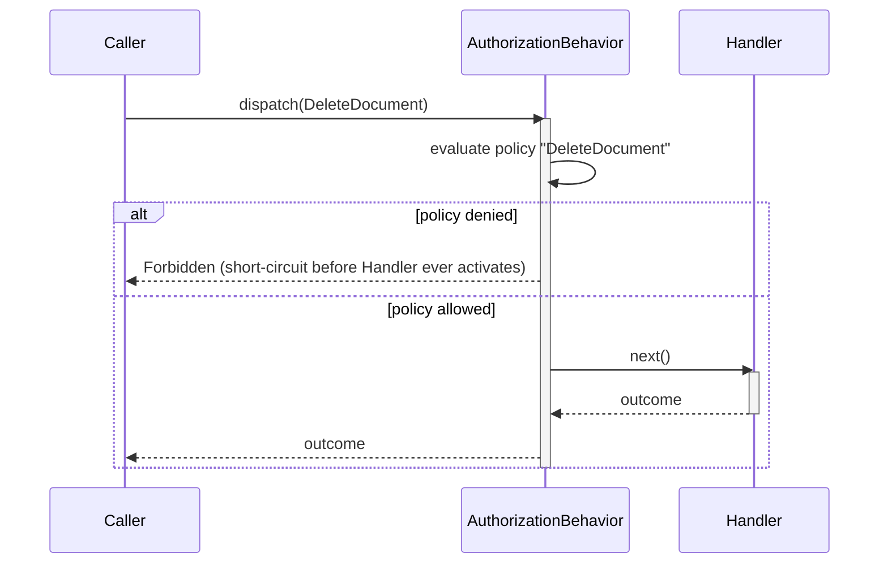
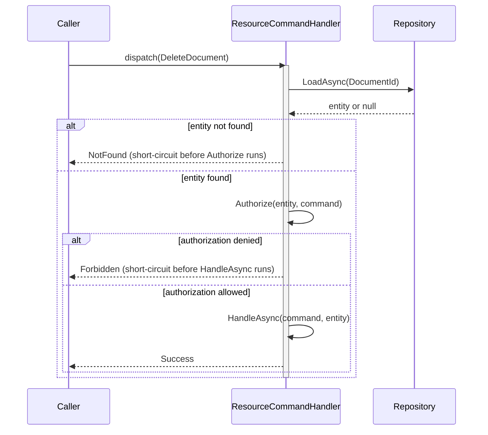

# Handler Selection & Dispatch

How Interlocutor finds the handler for a request. Handler discovery happens at compile time, and an ambiguous match is a build diagnostic, not a runtime guess.

## Compile-Time Discovery

Handlers are discovered at compile time via a Roslyn source generator, not at runtime via reflection. This means:

- **Missing handlers are build errors**, not first-request failures.
- **Ambiguous handlers are build errors**, not silent resolution.
- **AOT and trim-friendly** - no runtime reflection needed.

Every assembly containing handlers emits a generated module that the application-level generator aggregates. No runtime configuration or scanning is needed.

```csharp
// In your domain assembly:
public record GetUser(int UserId) : IQuery<Outcome<UserDto, NotFound>>;

public class GetUserHandler : IQueryHandler<GetUser, Outcome<UserDto, NotFound>>
{
    public async Task<Outcome<UserDto, NotFound>> Handle(
        GetUser query, CancellationToken ct)
    { /* ... */ }
}

// In your application assembly:
services.AddInterlocutor(builder =>
{
    builder.ScanAssembly(typeof(Program).Assembly);  // Registers GetUserHandler
    // If a query type is missing its handler, you'll get a build error, not a runtime error
});
```

## Handler Selection Rules

Given a request, which handler runs? The rules are:

```mermaid
flowchart TD
    Start["Dispatching a query/command"] --> Closed{"Any closed handler<br/>matches the request type?"}
    Closed -->|"yes, exactly one"| UseClosed["Use that closed handler"]
    Closed -->|"yes, more than one"| DuplicateClosed["Build diagnostic (INTERLOC002):<br/>remove or rename the extra handler -<br/>no override escape hatch here"]
    Closed -->|"no"| Open{"Any open generic<br/>handler matches?"}

    Open -->|"yes, exactly one"| UseOpen["Use that open generic handler"]
    Open -->|"yes, more than one"| Ambiguous{"Does one handler declare<br/>&#91;HandlerOverride&#93; naming the other?"}
    Open -->|"no"| NoHandler["No handler found:<br/>build diagnostic (INTERLOC001)"]

    Ambiguous -->|"yes"| UseOverride["Use the handler declaring the override"]
    Ambiguous -->|"no"| BuildError["Build error (INTERLOC006): ambiguous<br/>open generic handlers<br/>(namespace/assembly never break the tie)"]
```



Two different mechanisms handle the two ambiguity cases, and they're not interchangeable: two closed handlers matching the same request/response pair (`INTERLOC002`) have no override - the fix is to remove or rename one of them. Two open generic handlers closing over the same concrete request type (`INTERLOC006`) do have the `[HandlerOverride]` escape hatch, covered below.

### Single Handler for Queries & Commands

A query or command dispatch always resolves to **exactly one handler**. Two closed handlers matching the same request/response pair produce `INTERLOC002` (default severity `Warning`, escalatable to an error via `.editorconfig` the same way as `INTERLOC001`) - there's no `[HandlerOverride]` for this case, since it's a straightforward duplicate to remove or rename, not a genuine design ambiguity:

```csharp
public record GetUser(int UserId) : IQuery<Outcome<UserDto, NotFound>>;

public class GetUserHandler : IQueryHandler<GetUser, Outcome<UserDto, NotFound>>
{ /* ... */ }

// INTERLOC002: duplicate handler for the same closed request/response pair.
// Fix by removing or renaming one of them - there is no override for this case.
public class GetUserHandlerV2 : IQueryHandler<GetUser, Outcome<UserDto, NotFound>>
{ /* ... */ }
```

### Closed Handler Beats Open Generic

A closed handler wins over an open generic handler when both could apply:

```csharp
// Open generic - handles any GetById<T> query
public class GetByIdHandler<T> : IQueryHandler<GetById<T>, Outcome<T, NotFound>>
{
    public async Task<Outcome<T, NotFound>> Handle(
        GetById<T> query, CancellationToken ct)
    { /* generic implementation */ }
}

// Closed - specific to GetById<User>
public class GetUserByIdHandler : IQueryHandler<GetById<User>, Outcome<User, NotFound>>
{
    public async Task<Outcome<User, NotFound>> Handle(
        GetById<User> query, CancellationToken ct)
    { /* optimized implementation for User */ }
}

// When you send GetById<User>, GetUserByIdHandler runs (closed beats open)
var result = await mediator.Send(new GetById<User>(42));

// When you send GetById<Product>, GetByIdHandler<Product> runs (no closed alternative)
var result = await mediator.Send(new GetById<Product>(99));
```

### No Consideration of Namespace or Assembly

Handler selection is purely type-shape-driven. Namespace and assembly location never affect which handler runs:

```csharp
// src/MyApp.Domain/GetUserHandler.cs
namespace MyApp.Domain;
public class GetUserHandler : IQueryHandler<GetUser, Outcome<UserDto, NotFound>>
{ /* ... */ }

// src/MyApp.Api/Handlers/GetUserHandler.cs (different namespace, same assembly)
namespace MyApp.Api.Handlers;
public class GetUserHandler : IQueryHandler<GetUser, Outcome<UserDto, NotFound>>
{ /* ... */ }

// INTERLOC002 again: two handlers with the same signature, same reason as above.
// Moving one to a different namespace doesn't change the outcome.
```

### Open Generic Ambiguity Has an Override Escape Hatch

Closed beats open generic automatically - that's not an ambiguity, so it never needs an override. The escape hatch exists for the case the previous rule doesn't resolve: **two open generic handlers that both close over the same concrete request type.** Declare which one wins with `[HandlerOverride]`:

```csharp
// Both handlers close over GenericQuery<T> for the same T - an unresolved ambiguity
public class GenericQueryHandlerLosing<T> : IQueryHandler<GenericQuery<T>, Outcome<T, string>>
    where T : IEntity, new()
{ /* ... */ }

// Declares it takes precedence over the other - resolves the ambiguity
[HandlerOverride(typeof(GenericQueryHandlerLosing<>))]
public class GenericQueryHandlerWinning<T> : IQueryHandler<GenericQuery<T>, Outcome<T, string>>
    where T : IEntity, new()
{ /* ... */ }

// When you send GenericQuery<Foo>, GenericQueryHandlerWinning<Foo> runs
var result = await mediator.Send(new GenericQuery<Foo>());
```

Without the attribute, this would be a build error naming both handlers. `HandlerType` names the open generic handler being overridden via its own unbound generic type (`typeof(GenericQueryHandlerLosing<>)`), and the attribute can be applied more than once to override several handlers at once. `Interlocutor.Generator` validates at build time that the named type is itself a discovered handler in the same compilation.

> [!IMPORTANT]
> `HandlerOverrideAttribute` lives in `Interlocutor.Abstractions.Core`, so handlers take no additional DI dependency to use it.

## Resource-Based Authorization

Some commands need to authorize based on the loaded entity (ownership, entity state, etc.), not just a policy name. Use `ResourceCommandHandler<TCommand, TEntity, TResponse>` - a template method implementing the load → authorize → handle pattern:

```csharp
public record DeleteDocument(int DocumentId, int RequestedByUserId)
    : ICommand<Outcome<Success, NotFound, Forbidden>>;

public class DeleteDocumentHandler
    : ResourceCommandHandler<DeleteDocument, Document, Success>
{
    private readonly IDocumentRepository repository;

    public DeleteDocumentHandler(IDocumentRepository repository)
        => this.repository = repository;

    // Step 1: Load the entity
    protected override Task<Document?> LoadAsync(DeleteDocument command, CancellationToken ct)
        => this.repository.FindAsync(command.DocumentId, ct);

    // Step 2: Check authorization against the loaded entity
    protected override Forbidden? Authorize(Document entity, DeleteDocument command)
    {
        // Return null if authorized, a Forbidden if denied
        return entity.OwnerId == command.RequestedByUserId
            ? null
            : new Forbidden("Only the document owner can delete it");
    }

    // Step 3: Handle the command (entity is already loaded and authorized)
    protected override async Task<Outcome<Success, NotFound, Forbidden>> HandleAsync(
        DeleteDocument command, Document entity, CancellationToken ct)
    {
        await this.repository.DeleteAsync(entity, ct);
        return new Success();
    }
}

// Dispatch is normal:
var result = await mediator.Send(new DeleteDocument(42, currentUserId));
// result is Success, NotFound, or Forbidden depending on what Authorize/HandleAsync produce
```

**Why is this not a pipeline behavior?** A behavior cannot express "if this specific part fails, produce this specific outcome" for a reason that depends on data loaded mid-pipeline. Resource authorization needs the entity that was just loaded, and passing it forward would require shared mutable state - exactly the architectural pattern Interlocutor avoids. The template method encapsulates the load, authorize, handle sequence as a single cohesive unit, rather than splitting it across multiple layers.

> [!NOTE]
> `ResourceCommandHandler<TCommand, TEntity, TResponse>` is generic over `TResponse` - any `IUnion` that declares a `NotFound` case (for `LoadAsync` returning `null`) and a `Forbidden` case (for a denied `Authorize`) among its cases. It ejects those two cases via `Eject.WithCase` rather than constructing them itself, and any other outcome depends on what `HandleAsync` produces. `TResponse` isn't fixed to exactly those three cases - a subclass may add further cases (e.g. a domain-specific `Conflict`) as long as `NotFound` and `Forbidden` remain among them - and the required `Forbidden` case matches `AuthorizationBehavior`'s own `Forbidden` case for its equivalent denial (see CLAUDE.md's result-type convention: a denied authorization check is a classified case, not generic `Failure`).

## Contrast: Resource vs. Non-Resource Authorization

- **Non-resource authorization** (policy-based, `IRequiresPolicyRequest` marker) - evaluated by `AuthorizationBehavior` before the handler runs. Decides whether the caller can *attempt* a command, without needing to load anything first.
- **Resource authorization** (entity-based, `ResourceCommandHandler`) - decided after loading, based on the loaded entity's state or the caller's relationship to it.

Both are useful and solve different problems:

```csharp
// Non-resource: "Can this user DELETE (any) document?"
public record DeleteDocument(int DocumentId, int RequestedByUserId)
    : ICommand<Outcome<Success, NotFound, Forbidden>>,
      IRequiresPolicyRequest  // Evaluated before loading
{
    public string PolicyName => "DeleteDocument";
}

public class AdminOnlyPolicyEvaluator : IPolicyEvaluator
{
    // ... checks if user is admin, short-circuits with Forbidden if not
}

// Resource: "Can this user DELETE *this specific* document?"
public record DeleteDocument(int DocumentId, int RequestedByUserId)
    : ICommand<Outcome<Success, NotFound, Forbidden>>;  // No marker

public class DeleteDocumentHandler : ResourceCommandHandler<DeleteDocument, Document, Success>
{
    protected override Forbidden? Authorize(Document entity, DeleteDocument command)
    {
        // Checked after loading - based on entity ownership, status, etc.
        return entity.OwnerId == command.RequestedByUserId ? null : new Forbidden("Not the owner");
    }
}
```

Use non-resource authorization for coarse gating (role checks, feature flags). Use resource authorization for fine-grained access (ownership, entity state).

The two models don't just check different things - they short-circuit at different points relative to the handler:



Non-resource authorization runs and can deny *before the handler is ever reached* - the handler's lifeline never activates on the denied path.



Resource authorization's short-circuit happens *inside* the handler's own template method, after it has already started (and already loaded the entity) - there's no separate outer behavior to skip.

## Notifications (Multiple Handlers Allowed)

Notifications are different from queries/commands - they support contravariant fan-out, meaning one notification can match multiple handlers:

```csharp
public record OrderShipped(int OrderId, string TrackingNumber) : INotification;

public class OrderShippedEmailHandler : INotificationHandler<OrderShipped>
{
    public async Task Handle(OrderShipped notification, CancellationToken ct)
    { /* send email */ }
}

public class OrderShippedSmsHandler : INotificationHandler<OrderShipped>
{
    public async Task Handle(OrderShipped notification, CancellationToken ct)
    { /* send SMS */ }
}

// Both handlers run when the notification is published
await mediator.Publish(new OrderShipped(123, "TRACK-456"));
```

More than one handler for a notification is expected and normal. More than one handler for a query/command is a build error. See [notifications-and-fan-out.md](notifications-and-fan-out.md) for the full story on notification dispatch.

## Runtime-Typed Dispatch

In infrastructure code (outbox replay, queue consumers), you may not know the request type until runtime. Use the runtime-typed dispatch overload:

```csharp
// Outbox consumer that deserializes a message into an unknown-until-runtime request type
var requestType = Type.GetType(message.RequestType);  // Runtime type token
var request = JsonSerializer.Deserialize(message.Payload, requestType);

// Runtime-typed dispatch - no generic parameter
var result = await mediator.Send(request);  // request is object

// Result is IUnion (the base interface all outcomes implement)
// You can inspect success/failure without knowing the concrete outcome shape
```

This is backed by a generated type switch that routes to the strongly-typed dispatch path. See [runtime-typed-dispatch.md](runtime-typed-dispatch.md) for more detail.
