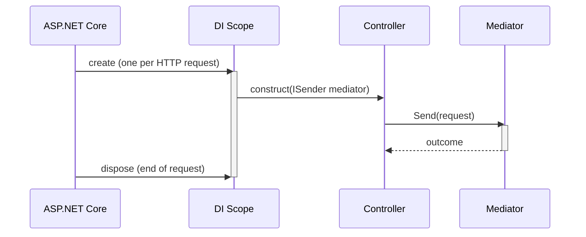
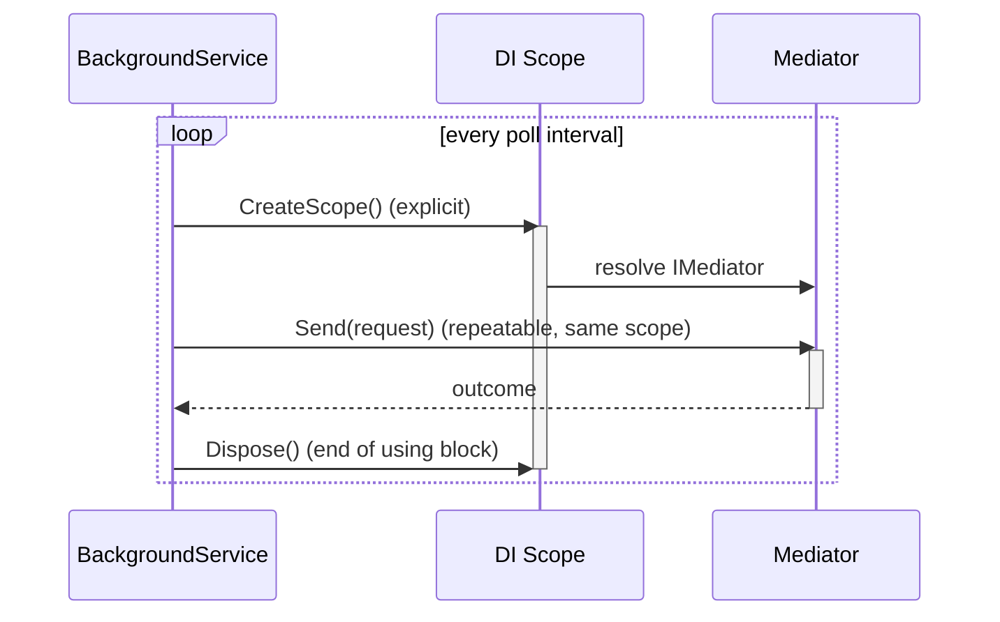

# Mediator, Lifetimes, Scope & Ambient Context

Core mediator interfaces, why scoped lifetime is non-configurable, and how to dispatch correctly in different contexts.

## Interfaces

### ISender

Narrow interface for send-only (request/response dispatch). Exposes `Send<TResponse>(...)` for queries and commands:

```csharp
public interface ISender
{
    Task<TResponse> Send<TResponse>(IQuery<TResponse> query, CancellationToken ct = default)
        where TResponse : IOutcome;

    Task<TResponse> Send<TResponse>(ICommand<TResponse> command, CancellationToken ct = default)
        where TResponse : IOutcome;

    // Unit ICommand carries no response type of its own - the caller picks it per call via TResult
    Task<TResult> Send<TResult>(ICommand command, CancellationToken ct = default)
        where TResult : IOutcome;

    // Runtime-typed dispatch - see runtime-typed-dispatch.md
    Task<IOutcome> Send(object request, CancellationToken ct = default);
}
```

Inject `ISender` in controllers, services, and any code that sends queries/commands but doesn't need notifications.

### IPublisher

Narrow interface for publish-only (fire-and-forget notifications). Exposes `Publish(...)` for notifications:

```csharp
public interface IPublisher
{
    // Defaults to PublishStrategy.Sequential
    Task Publish<TNotification>(TNotification notification, CancellationToken ct = default)
        where TNotification : INotification;

    // Pass PublishStrategy.Parallel explicitly to run every handler concurrently
    Task Publish<TNotification>(TNotification notification, PublishStrategy strategy, CancellationToken ct = default)
        where TNotification : INotification;
}
```

Inject `IPublisher` in code that publishes domain events but doesn't need request/response dispatch.

### IMediator

Combined convenience interface inheriting both `ISender` and `IPublisher`. Use this at the top level (controllers, background jobs, entry points) where you might need either capability:

```csharp
public interface IMediator : ISender, IPublisher { }
```

## Scoped Lifetime (Non-Configurable)

The mediator is **registered as scoped** and **cannot be changed to singleton or transient**.

```csharp
// The mediator is scoped - registered by AddInterlocutor:
services.AddScoped<IMediator>(/* ... */);

// NOT configurable - no way to register it singleton or transient
```

### Why Scoped?

One dispatch = one scoped DI container scope = one consistent view of scoped dependencies.

When you dispatch a command:

1. The mediator resolves handlers from the current scope.
2. Those handlers are scoped (by default) - same instance for the entire dispatch.
3. A `DbContext` or `ISession` is scoped - all database calls in the dispatch happen on the same session, in the same transaction.
4. Pipeline behaviors are scoped - same instances run the whole dispatch.

If the mediator were singleton:

- All dispatches share the same mediator instance.
- But handlers are still scoped per-request.
- A scoped `DbContext` registered in one dispatch's scope becomes inaccessible in another dispatch's scope - the mediator can't resolve it.
- Worse: multiple concurrent dispatches in the same application would see a mixed view of their scoped dependencies.

Scoped lifetime forces the invariant: **one dispatch, one scope, one consistent DI context**.

```csharp
// In a web context (ASP.NET Core)
// - each HTTP request gets its own DI scope automatically
var scope = serviceProvider.CreateScope();
var mediator = scope.ServiceProvider.GetRequiredService<IMediator>();

// mediator.Send() runs in this scope
// All handlers and behaviors resolve from this scope
// All scoped DbContext/ISession instances are shared within this dispatch
var result = await mediator.Send(new CreateOrder(...));
```

## Root-Scope Exception & Guard

You cannot use the mediator in the **root DI scope** (the application's main container). Resolving `IMediator` from the root provider succeeds - the guard fires on the *dispatch* call itself, throwing `MediatorResolvedFromRootScopeException`:

```csharp
var mediator = serviceProvider.GetRequiredService<IMediator>();  // succeeds even from the root provider
await mediator.Send(new Query(...));  // ❌ throws MediatorResolvedFromRootScopeException here

// ✅ Correct - create a child scope first
using var scope = serviceProvider.CreateScope();
var mediator = scope.ServiceProvider.GetRequiredService<IMediator>();
await mediator.Send(new Query(...));
```

`MediatorResolvedFromRootScopeException.RequestType` carries the runtime type being dispatched when the guard fired, for diagnostics.

### Why?

Scoped services (like `DbContext`) are only valid within a scope. Using a scoped mediator in the root scope means scoped services have no scope to resolve from - it's an architectural violation.

The root-scope guard catches this mistake at dispatch time, not silently at the first request.

## Dispatching from Different Contexts

### Web Context (ASP.NET Core)

The framework creates a scope per HTTP request automatically:



```csharp
[ApiController]
[Route("api/[controller]")]
public class UsersController : ControllerBase
{
    private readonly ISender mediator;

    public UsersController(ISender mediator) => this.mediator = mediator;

    [HttpGet("{id}")]
    public async Task<IActionResult> GetUser(int id, CancellationToken ct)
    {
        // No scope creation needed - the framework already created a scope for this request
        var result = await this.mediator.Send(new GetUser(id), ct);
        return result.ToActionResult();
    }
}
```

### Background Service / Hosted Service

You must create a scope explicitly - there's no framework request to hang it off of:



```csharp
public class OutboxProcessor : BackgroundService
{
    private readonly IServiceProvider serviceProvider;

    public OutboxProcessor(IServiceProvider serviceProvider)
        => this.serviceProvider = serviceProvider;

    protected override async Task ExecuteAsync(CancellationToken ct)
    {
        while (!ct.IsCancellationRequested)
        {
            // Create a new scope for this batch of work
            using var scope = this.serviceProvider.CreateScope();
            var mediator = scope.ServiceProvider.GetRequiredService<IMediator>();

            // All dispatches in this scope share scoped services (DbContext, etc.)
            var messages = await FetchOutboxMessages(ct);
            foreach (var message in messages)
            {
                var request = JsonSerializer.Deserialize(message.Payload, Type.GetType(message.RequestType));
                await mediator.Send(request, ct);  // Scoped session shared across all sends
            }

            await Task.Delay(TimeSpan.FromSeconds(5), ct);
        }
    }
}
```

### Minimal API

No explicit scope creation needed - ASP.NET Core handles it. Same framework-owned scope lifecycle as the [Web Context diagram above](#web-context-aspnet-core), just with a route delegate instead of a controller action:

```csharp
app.MapPost("/api/orders", async (CreateOrder command, ISender mediator, CancellationToken ct) =>
{
    // Framework created a scope for this request; mediator is already scoped
    var result = await mediator.Send(command, ct);
    return result.ToActionResult();
});
```

## Ambient Context

`IRequestContextAccessor` provides scoped ambient context (correlation ID, user ID, tenant ID, arbitrary items) that flows through the dispatch:

```csharp
public interface IRequestContextAccessor
{
    RequestContext? Context { get; set; }  // null if no middleware/caller populated it
}

public sealed record RequestContext
{
    public string CorrelationId { get; init; } = Guid.NewGuid().ToString();  // auto-generated if not set
    public string? UserId { get; init; }
    public string? TenantId { get; init; }
    public RequestContextItems Items { get; init; } = new();  // always non-null, mutable in place
}
```

`Items` is always non-null, and a handler or any pipeline behavior can write into it in place - no `with`-expression record replacement needed, unlike `CorrelationId`/`UserId`/`TenantId`:

```csharp
contextAccessor.Context?.Items.Set("some-key", "some-value");

if (contextAccessor.Context?.Items.TryGet<string>("some-key", out var value) == true)
{
    // ...
}
```

### Setting Context in a Web Request

```csharp
// Middleware or a filter
public class RequestContextMiddleware
{
    private readonly RequestDelegate next;

    public RequestContextMiddleware(RequestDelegate next) => this.next = next;

    public async Task InvokeAsync(HttpContext context, IRequestContextAccessor accessor)
    {
        // RequestContext.CorrelationId auto-generates a new GUID if you don't set one -
        // set it explicitly here to propagate an inbound header instead
        var correlationId = context.Request.Headers
            .TryGetValue("X-Correlation-ID", out var headerValue)
            ? headerValue.ToString()
            : Guid.NewGuid().ToString();

        // Extract user ID from claims
        var userId = context.User?.FindFirst(ClaimTypes.NameIdentifier)?.Value;

        // Set the request context - accessible throughout this request's dispatch
        accessor.Context = new RequestContext
        {
            CorrelationId = correlationId,
            UserId = userId,
            TenantId = context.Request.Headers["X-Tenant-ID"].ToString(),
        };

        await this.next(context);
    }
}

// In a handler or behavior, access it:
public class AuditingBehavior<TRequest, TResponse> : IPipelineBehavior<TRequest, TResponse>
{
    private readonly IRequestContextAccessor contextAccessor;

    public async Task<TResponse> Handle(
        TRequest request, Func<Task<TResponse>> next, CancellationToken ct)
    {
        // Read the context set by the middleware
        var context = this.contextAccessor.Context;
        var result = await next();
        // Use context.UserId, context.CorrelationId, etc. when auditing
        return result;
    }
}
```

### Setting Context in a Background Service

```csharp
protected override async Task ExecuteAsync(CancellationToken ct)
{
    while (!ct.IsCancellationRequested)
    {
        using var scope = this.serviceProvider.CreateScope();
        var mediator = scope.ServiceProvider.GetRequiredService<IMediator>();
        var contextAccessor = scope.ServiceProvider.GetRequiredService<IRequestContextAccessor>();

        // Set a correlation ID for this batch
        contextAccessor.Context = new RequestContext
        {
            CorrelationId = Guid.NewGuid().ToString(),
            UserId = "system:outbox-processor",
        };

        // Dispatches in this scope can access the context
        var messages = await FetchMessages(ct);
        foreach (var message in messages)
        {
            await mediator.Send(DeserializeRequest(message), ct);
        }

        await Task.Delay(TimeSpan.FromSeconds(5), ct);
    }
}
```

> [!NOTE]
> Each pass through the `while` loop above creates a fresh scope, so each batch gets its own `RequestContext` (and therefore its own `Items`). Within one batch, though, every message in the `foreach` shares that same scope - and the same `Items` bag - since `IRequestContextAccessor` is scoped per DI scope, not per `Send` call. If one message's dispatch should not see `Items` entries another message's dispatch wrote, call `contextAccessor.Context?.Items.Clear()` at the top of the `foreach`, or create a scope per message instead of per batch.

> [!IMPORTANT]
> `RequestContext`'s own properties are immutable - swap `CorrelationId`/`UserId`/`TenantId` via the property, not a setter:
> ```csharp
> // Create a new context; don't mutate the existing one
> accessor.Context = new RequestContext
> {
>     CorrelationId = /* ... */,
>     UserId = /* ... */,
> };
> ```
> `Items` is the one exception: write into it in place, from anywhere that can reach `accessor.Context` - no new `RequestContext` needed:
> ```csharp
> accessor.Context?.Items.Set("key", "value");
> ```

## Registering the Context Accessor

The mediator and request context are registered by `AddInterlocutor()`:

```csharp
services.AddInterlocutor(builder =>
{
    builder.ScanAssembly(typeof(Program).Assembly);
    builder.Pipeline.UseRecommendedChain();
});

// IRequestContextAccessor is already registered as scoped
```

If you need to customize the default context accessor implementation, register your own before calling `AddInterlocutor()` (try-add semantics win) or use `builder.OverrideRequestContextAccessor`.

## Singleton / Transient Handlers

Handlers are **scoped by default** (same instance for the entire dispatch). You can register a handler singleton or transient explicitly:

```csharp
services.AddInterlocutor(builder =>
{
    builder.ScanAssembly(typeof(Program).Assembly);
});

// Override a specific handler's lifetime
services.AddSingleton<IQueryHandler<GetSetting, Outcome<string, Failure>>, GetSettingHandler>();
// This handler is now singleton (stateless, side-effect-free queries can benefit)
```

> [!WARNING]
> If you make a handler singleton, ensure it's **stateless and thread-safe**. Singletons are shared across all dispatches, so mutable state is a concurrency bug waiting to happen.

```csharp
// ✅ Safe to make singleton - stateless
public class GetUserHandler : IQueryHandler<GetUser, Outcome<UserDto, NotFound>>
{
    private readonly IUserRepository repository;

    public GetUserHandler(IUserRepository repository) => this.repository = repository;

    public async Task<Outcome<UserDto, NotFound>> Handle(
        GetUser query, CancellationToken ct)
    {
        // Read-only, no shared mutable state
        return await this.repository.FindAsync(query.UserId, ct);
    }
}

// ❌ NOT safe to make singleton - has mutable state
public class CreateUserHandler : ICommandHandler<CreateUser, Outcome<int, ValidationError>>
{
    private int lastCreatedId = 0;  // Shared mutable state - concurrency bug

    public async Task<Outcome<int, ValidationError>> Handle(
        CreateUser command, CancellationToken ct)
    {
        return lastCreatedId++;
    }
}
```

## Distributed Tracing

`Mediator` starts one `System.Diagnostics.Activity` span per `Send`/`Publish` call, independent of whether `LoggingBehavior` is also registered - that behavior writes to `ILogger`, this one emits `Activity` spans; neither depends on or shares state with the other. `MediatorActivitySource` (`Interlocutor.Abstractions.Diagnostics`) hosts the stable `ActivitySource` name and tag keys:

```csharp
public static class MediatorActivitySource
{
    public const string Name = "Interlocutor.Mediator";
    public const string RequestTypeTag = "interlocutor.request_type";
    public const string HandlerTypeTag = "interlocutor.handler_type";
    public const string OutcomeTag = "interlocutor.outcome";
}
```

Attach a listener to observe dispatch spans - a plain `ActivityListener`:

```csharp
ActivitySource.AddActivityListener(new ActivityListener
{
    ShouldListenTo = source => source.Name == MediatorActivitySource.Name,
    Sample = (ref ActivityCreationOptions<ActivityContext> _) => ActivitySamplingResult.AllData,
    ActivityStarted = activity => Console.WriteLine($"Started: {activity.DisplayName}"),
    ActivityStopped = activity => Console.WriteLine($"Stopped: {activity.DisplayName}"),
});
```

or, with OpenTelemetry:

```csharp
services.AddOpenTelemetry().WithTracing(tracing => tracing.AddSource(MediatorActivitySource.Name));
```

> [!NOTE]
> When nothing is listening, `ActivitySource.StartActivity` returns `null` and every subsequent tagging call in the mediator is guarded on that null reference - the standard `Activity` mechanism's own short-circuit, not something Interlocutor re-implements. Dispatch performs no allocation or string formatting for tracing when unobserved, so this costs nothing in an application that never attaches a listener.
