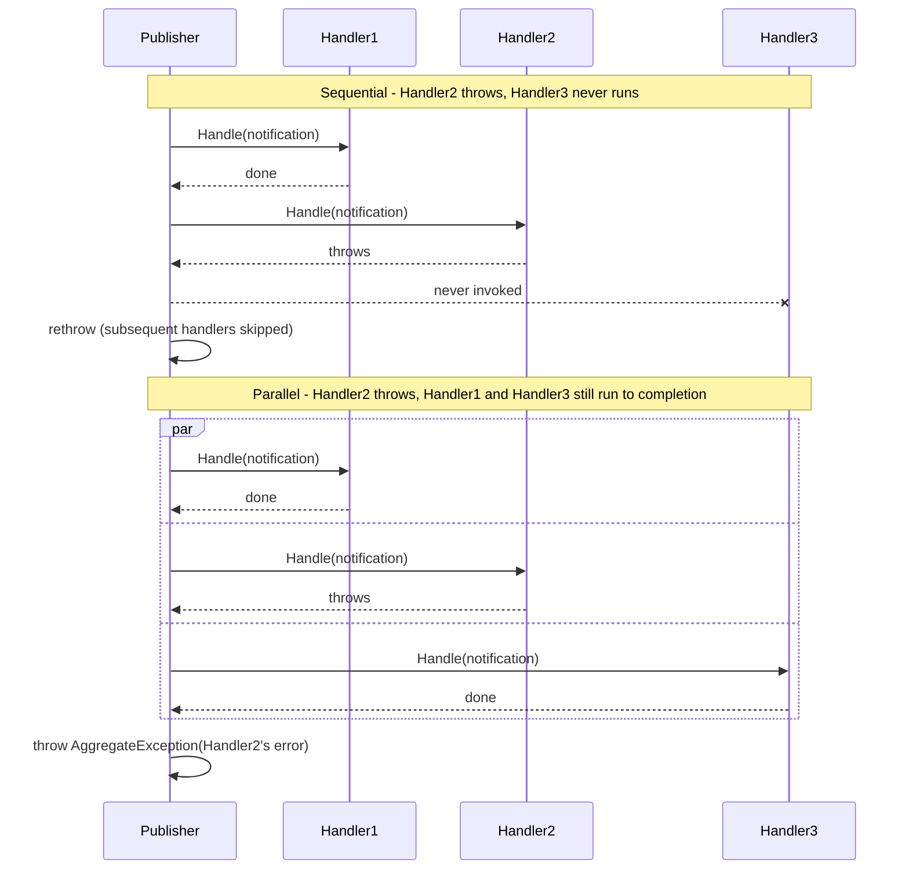

# Notifications & Fan-out

Fire-and-forget domain events and their contravariant fan-out.

## INotification

Marker interface for domain events. No return value - fire-and-forget semantics.

```csharp
public record OrderShipped(int OrderId, string TrackingNumber) : INotification;

public record UserCreated(int UserId, string Name) : INotification;
```

## Handlers & Multiple Subscribers

A single notification can have multiple handlers - normal and expected:

```csharp
public class OrderShippedEmailHandler : INotificationHandler<OrderShipped>
{
    private readonly IEmailService emailService;

    public async Task Handle(OrderShipped notification, CancellationToken ct)
    {
        await this.emailService.SendAsync(
            to: "customer@example.com",
            subject: "Order Shipped",
            body: $"Your order {notification.OrderId} is on the way (tracking: {notification.TrackingNumber})",
            ct
        );
    }
}

public class OrderShippedSmsHandler : INotificationHandler<OrderShipped>
{
    private readonly ISmsService smsService;

    public async Task Handle(OrderShipped notification, CancellationToken ct)
    {
        await this.smsService.SendAsync(
            to: "555-1234",
            message: $"Order {notification.OrderId} shipped: {notification.TrackingNumber}",
            ct
        );
    }
}

public class OrderShippedWebhookHandler : INotificationHandler<OrderShipped>
{
    private readonly IHttpClientFactory httpClientFactory;

    public async Task Handle(OrderShipped notification, CancellationToken ct)
    {
        var client = this.httpClientFactory.CreateClient();
        await client.PostAsJsonAsync(
            "https://analytics.example.com/webhook",
            notification,
            ct
        );
    }
}

// All three handlers run when the notification is published
await mediator.Publish(new OrderShipped(123, "TRACK-456"));
```

## Execution Order

Handlers run in **unspecified order** by default - no test in this repository, and none of your own, should depend on the order two independent handlers happen to run in.

> [!IMPORTANT]
> Keep notification handlers independent of one another. If one handler's outcome must influence another's, that's a signal the dependent step belongs in the originating command handler (or a follow-up command) rather than in a second notification handler.

For the rare genuine ordering need, declare it relative to another handler rather than reaching for a numeric priority:

```csharp
public class ReserveInventoryHandler : INotificationHandler<OrderCreated>
{
    public async Task Handle(OrderCreated notification, CancellationToken ct) =>
        await this.inventory.ReserveAsync(notification.OrderId, ct);
}

// Must run after inventory is reserved - a compiler-checked reference to the handler type, not a magic number.
[NotificationHandlerRunAfter(typeof(ReserveInventoryHandler))]
public class SendConfirmationEmailHandler : INotificationHandler<OrderCreated>
{
    public async Task Handle(OrderCreated notification, CancellationToken ct) =>
        await this.email.SendConfirmationAsync(notification.OrderId, ct);
}
```

`NotificationHandlerRunBeforeAttribute` is the mirror image - declare it on the predecessor instead of the successor when that reads more naturally at the call site. Both are compiler-checked (the named type must exist), topologically sorted at build time, and apply more than once to declare more than one predecessor/successor. Handlers with no ordering attribute, and named by none, stay unranked and keep their otherwise-unspecified order.

> [!WARNING]
> A cycle in the declared run-after/run-before relationships is a build error (`INTERLOC004`), naming every handler type involved - there is no runtime fallback for an order that cannot be computed.

Only reach for this when two specific handlers genuinely cannot be made independent - it is an escape hatch, not the default way to sequence notification work.

## Publish Strategies

Control how handlers are invoked:

### Sequential (Default)

Handlers run one by one in order. If one throws, subsequent handlers don't run (partial execution).

```csharp
public class SomeRequest : INotification { }

public class Handler1 : INotificationHandler<SomeRequest>
{
    public async Task Handle(SomeRequest notification, CancellationToken ct)
    {
        await Task.Delay(100, ct);
        Console.WriteLine("Handler1 done");
    }
}

public class Handler2 : INotificationHandler<SomeRequest>
{
    public async Task Handle(SomeRequest notification, CancellationToken ct)
    {
        throw new InvalidOperationException("Handler2 failed");
    }
}

public class Handler3 : INotificationHandler<SomeRequest>
{
    public async Task Handle(SomeRequest notification, CancellationToken ct)
    {
        Console.WriteLine("Handler3 done");  // Won't run - Handler2 threw first
    }
}

// Result: Handler1 ran, Handler2 threw, Handler3 never ran, exception propagates
try
{
    await mediator.Publish(new SomeRequest());
}
catch (InvalidOperationException ex)
{
    // Exception is thrown, Handler1's work is done, Handler2/3 never ran
}
```

### Parallel

All handlers run concurrently. All exceptions are aggregated:

```csharp
// Same handlers, but with Parallel strategy - pass it explicitly per call:
try
{
    await mediator.Publish(new SomeRequest(), PublishStrategy.Parallel);
}
catch (AggregateException ex)
{
    // Both Handler1 and Handler2 attempted to run concurrently
    // If both threw, ex.InnerExceptions contains both errors
    // Handler1 and Handler2 ran; if neither threw, exception isn't raised
    // Handler3 also ran
}
```

> [!NOTE]
> The strategy overload is exposed on `IPublisher` itself, so a consumer coding against `IPublisher` (rather than the wider `IMediator`) can still choose `Parallel` per call. There is no builder-level way to change the default strategy for every `Publish` call; each call site chooses explicitly.

### Which Strategy to Use

- **Sequential (default)**: safer, easier to reason about. Use when handler failures should stop subsequent handlers.
- **Parallel**: faster, all handlers get a chance to run. Use when handlers are independent and can tolerate partial failure.

> [!NOTE]
> In Parallel mode, if one handler throws and the others succeed, the exception is still raised (inside an `AggregateException`) - but those other handlers still ran. You must decide whether to catch the aggregate exception or let it propagate.

The two strategies aren't just a speed trade-off - they behave differently the moment one handler fails:



## Contravariant Fan-out (Base Event Types)

A handler registered for a base event type receives all derived events:

```csharp
// Base event
public record DomainEvent(int AggregateId) : INotification;

// Derived events
public record OrderCreated(int OrderId, int CustomerId, decimal Total) : DomainEvent(OrderId);
public record OrderShipped(int OrderId, string TrackingNumber) : DomainEvent(OrderId);

// Handler for the base type
public class DomainEventLogger : INotificationHandler<DomainEvent>
{
    private readonly ILogger<DomainEventLogger> logger;

    public async Task Handle(DomainEvent @event, CancellationToken ct)
    {
        this.logger.LogInformation("Domain event: {@Event}", @event);
        await Task.CompletedTask;
    }
}

// Now both derived events trigger the logger
await mediator.Publish(new OrderCreated(123, 456, 99.99m));
// DomainEventLogger.Handle runs

await mediator.Publish(new OrderShipped(123, "TRACK-789"));
// DomainEventLogger.Handle runs again
```

This is different from query/command dispatch, where a closed handler beats an open generic (single handler). Notifications support true contravariant fan-out so multiple interested parties can react to a base event.

### Catch-all Handlers

Subscribing to `INotification` itself - the base marker interface, not a domain-specific base type like `DomainEvent` above - is legal and receives every notification published anywhere in the process:

```csharp
public class ProcessWideAuditSink : INotificationHandler<INotification>
{
    public async Task Handle(INotification notification, CancellationToken ct) =>
        await this.auditLog.RecordAsync(notification, ct);
}
```

This is useful for a process-wide audit sink, but subscribing to everything is easy to do by accident (a typo'd generic constraint, for instance). The generator reports an informational diagnostic (`INTERLOC003`) naming any handler implementing `INotificationHandler<INotification>`, so it reads as a deliberate choice in build output rather than a silent surprise.

## Pattern: Notification + Command

Handlers often publish notifications, triggering a chain of follow-up work:

```csharp
public record CreateOrder(int CustomerId, List<OrderItem> Items)
    : ICommand<OperationOutcome<int>>;

public class CreateOrderHandler : ICommandHandler<CreateOrder, OperationOutcome<int>>
{
    private readonly IOrderRepository repository;
    private readonly IPublisher publisher;  // Injected

    public CreateOrderHandler(IOrderRepository repository, IPublisher publisher)
    {
        this.repository = repository;
        this.publisher = publisher;
    }

    public async Task<OperationOutcome<int>> Handle(CreateOrder command, CancellationToken ct)
    {
        var order = await this.repository.CreateAsync(command, ct);

        // Publish an event - all registered handlers will run
        await this.publisher.Publish(new OrderCreated(order.Id, command.CustomerId, order.Total), ct);

        return order.Id;
    }
}

// Multiple handlers react to the notification
public class OrderCreatedInventoryHandler : INotificationHandler<OrderCreated>
{
    public async Task Handle(OrderCreated notification, CancellationToken ct)
    {
        // Reserve inventory
        await this.inventoryService.ReserveAsync(notification.OrderId, ct);
    }
}

public class OrderCreatedEmailHandler : INotificationHandler<OrderCreated>
{
    public async Task Handle(OrderCreated notification, CancellationToken ct)
    {
        // Send order confirmation email
        await this.emailService.SendConfirmationAsync(notification.OrderId, ct);
    }
}

public class OrderCreatedAnalyticsHandler : INotificationHandler<OrderCreated>
{
    public async Task Handle(OrderCreated notification, CancellationToken ct)
    {
        // Log to analytics
        await this.analytics.LogOrderCreatedAsync(notification, ct);
    }
}

// When you create an order, all three handlers run (sequentially, by default)
var result = await mediator.Send(new CreateOrder(456, items));
// result.Value is the order ID
// OrderCreatedInventoryHandler, OrderCreatedEmailHandler, and OrderCreatedAnalyticsHandler all ran
```

This pattern decouples the command's core logic (create the order) from secondary concerns (inventory, email, analytics). Add a new handler later without touching the command code.

## Error Handling in Notifications

With Sequential strategy, if a handler throws, subsequent handlers don't run:

```csharp
public class Handler1 : INotificationHandler<SomeEvent> { /* ... */ }
public class Handler2 : INotificationHandler<SomeEvent> { throw new Exception("Handler2 failed"); }
public class Handler3 : INotificationHandler<SomeEvent> { /* ... */ }

// Handler1 runs, Handler2 throws, Handler3 never runs, exception propagates
await mediator.Publish(new SomeEvent());
```

With Parallel strategy, all handlers run regardless:

```csharp
// Same handlers, Parallel strategy
// Handler1, Handler2 (throws), and Handler3 all run concurrently
// If Handler2 threw, an AggregateException is raised with that error inside
// But Handler1 and Handler3 still ran
await mediator.Publish(new SomeEvent(), PublishStrategy.Parallel);
```

Consider whether partial failure is acceptable:

- **Sequential**: if one notification handler's failure stops others from running, and you want that, use Sequential.
- **Parallel**: if handlers are independent and you want all of them to attempt execution even if some fail, use Parallel.

In either case, logging exceptions is essential for debugging:

```csharp
public class SafeNotificationHandler<T> : INotificationHandler<T> where T : INotification
{
    private readonly ILogger<SafeNotificationHandler<T>> logger;

    public async Task Handle(T notification, CancellationToken ct)
    {
        try
        {
            await this.DoWork(notification, ct);
        }
        catch (Exception ex)
        {
            this.logger.LogError(ex, "Notification handler failed for {@Notification}", notification);
            // Don't rethrow - let other handlers continue (if using Parallel)
            // Or rethrow if you want Sequential mode to stop subsequent handlers
        }
    }

    protected virtual Task DoWork(T notification, CancellationToken ct) => Task.CompletedTask;
}
```
