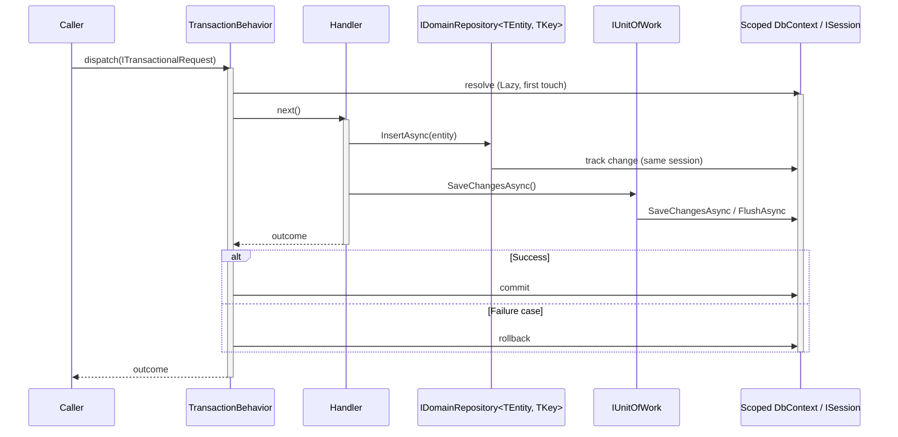

# Persistence Abstraction

`Interlocutor.Persistence.Abstractions` is an optional, opt-in CRUD/paging surface - `IUnitOfWork` and `IDomainRepository<TEntity, TKey>` - for handlers that want a narrower, store-agnostic alternative to injecting `Lazy<TContext>`/`Lazy<ISession>` directly. The direct-injection path described in [Transactions & Store Integration](transactions-and-store-integration.md) remains fully supported; nothing here replaces it. This doc covers the interfaces and how to register an implementation; see [Persistence Implementations](persistence-implementations.md) for what each store's concrete implementation actually does underneath them.

> [!IMPORTANT]
> This is a façade over the same scoped session `TransactionBehavior` already manages, not a second transaction owner. `IUnitOfWork` has no `BeginTransactionAsync`/`CommitAsync`/`RollbackAsync` - transaction begin/commit/rollback stays inside `TransactionBehavior`, driven by `ITransactionalRequest`. See [Transactions & Store Integration](transactions-and-store-integration.md) for how that scoped session lifetime works; this package relies on it rather than re-explaining it.

Both sides - the handler's repository calls and `TransactionBehavior`'s commit/rollback - resolve the *same* lazily-constructed scoped session, never two:



## Package layout

Three packages, mirroring the `Interlocutor.DependencyInjection.*` split:

| Package | Contents |
|---|---|
| `Interlocutor.Persistence.Abstractions` | `IUnitOfWork`, `IDomainRepository<TEntity, TKey>`, `SortCriterion<TEntity>`, `SortDirection`, `Page<T>`. Zero ORM dependency. |
| `Interlocutor.Persistence.EntityFrameworkCore` | `EntityFrameworkUnitOfWork<TContext>`, `EntityFrameworkRepository<TEntity, TKey, TContext>`. |
| `Interlocutor.Persistence.NHibernate` | `NHibernateUnitOfWork`, `NHibernateRepository<TEntity, TKey>`. |

Taking a dependency on `Interlocutor.Persistence.Abstractions` alone never pulls in EF Core or NHibernate - pick the implementation package matching whichever store `Interlocutor.EntityFrameworkCore`/`Interlocutor.NHibernate` is already configured against.

## `IUnitOfWork`

A single member, `SaveChangesAsync`, forwarding to the underlying scoped session:

```csharp
public interface IUnitOfWork
{
    Task SaveChangesAsync(CancellationToken cancellationToken = default);
}
```

For EF Core, `SaveChangesAsync` forwards to `DbContext.SaveChangesAsync`. For NHibernate, whose `ISession` already tracks pending changes and flushes them on transaction commit, it forwards to `ISession.FlushAsync` instead.

> [!NOTE]
> Neither `IUnitOfWork` nor `IDomainRepository<TEntity, TKey>` implements `IAsyncDisposable`. Disposal of the underlying `DbContext`/`ISession` remains the DI container's job, exactly as it is for direct injection.

## `IDomainRepository<TEntity, TKey>`

Generic and unconstrained - there is no `IAggregateRoot` marker requirement. Resolved via constructor injection per entity type (`IDomainRepository<Order, Guid>` injected directly), not through an `IUnitOfWork` factory method:

```csharp
public interface IDomainRepository<TEntity, TKey>
{
    IQueryable<TEntity> Query { get; }
    Expression<Func<TEntity, TKey>> IdSelector { get; }

    Task InsertAsync(TEntity entity, CancellationToken cancellationToken = default);
    Task UpdateAsync(TEntity entity, CancellationToken cancellationToken = default);
    Task DeleteAsync(TEntity entity, CancellationToken cancellationToken = default);

    Task<IReadOnlyList<TEntity>> GetManyAsync(
        Expression<Func<TEntity, bool>>? filter = null,
        IReadOnlyList<SortCriterion<TEntity>>? sort = null,
        CancellationToken cancellationToken = default);

    Task<Page<TEntity>> GetPagedAsync(
        int pageNumber,
        int pageSize,
        Expression<Func<TEntity, bool>>? filter = null,
        IReadOnlyList<SortCriterion<TEntity>>? sort = null,
        CancellationToken cancellationToken = default);

    TEntity? GetById(TKey id); // default interface method, built on Query and IdSelector
}
```

- **`Query`** is the escape hatch for ad hoc composition beyond the fixed method set - both EF Core's `DbContext` and NHibernate's `ISession` expose LINQ providers, so this one member covers both implementations.
- **`GetById`** ships as a default interface method built entirely on `Query` and `IdSelector` - implementations never override it. It returns a nullable result, not an `OperationOutcome` case: only the handler decides which `OperationOutcome<...>` case a "not found" maps to.
- **`GetManyAsync`/`GetPagedAsync`** take an optional `Expression<Func<TEntity, bool>>` filter and an ordered `SortCriterion<TEntity>` list for multi-column sort - the first entry is the primary sort key, each subsequent entry a tiebreaker. Filter, sort, and paging are all composed onto the query before either implementation materializes it, so filtering, ordering, and row-limiting happen in the database.

### Using a repository in a handler

```csharp
public sealed class GetOrderHandler(IDomainRepository<Order, int> orders)
    : IQueryHandler<GetOrder, OperationOutcome<OrderDto, NotFound>>
{
    public Task<OperationOutcome<OrderDto, NotFound>> Handle(GetOrder query, CancellationToken ct)
    {
        var order = orders.GetById(query.OrderId);
        return Task.FromResult<OperationOutcome<OrderDto, NotFound>>(
            order is null ? new NotFound($"Order {query.OrderId}") : OrderDto.From(order)
        );
    }
}
```

```csharp
public sealed class CreateOrderHandler(IDomainRepository<Order, int> orders, IUnitOfWork unitOfWork)
    : ICommandHandler<CreateOrder, OperationOutcome<int, ValidationError>>,
      ITransactionalRequest
{
    public async Task<OperationOutcome<int, ValidationError>> Handle(CreateOrder command, CancellationToken ct)
    {
        var order = new Order(command.CustomerId, command.Items);
        await orders.InsertAsync(order, ct);
        await unitOfWork.SaveChangesAsync(ct); // TransactionBehavior still owns commit/rollback
        return order.Id;
    }
}
```

## Paging

`Page<T>` carries the current page's items alongside paging metadata:

```csharp
public sealed record Page<T>(IReadOnlyList<T> Items, int PageNumber, int PageSize, int TotalCount)
{
    public int TotalPageCount { get; } // derived from TotalCount and PageSize
}
```

> [!NOTE]
> `Page<T>` is a different type, for a different concern, than a consumer-defined `PagedResult<T>` (see the [glossary](glossary.md#pagination)): `Page<T>` is this package's repository-return-shape vocabulary, not an `OperationOutcome` success-case type. A handler is free to map a `Page<T>` into its own success-case type, or return it unwrapped.

## Registering a repository per container

Registration is a dedicated, explicit call - separate from `AddInterlocutor()` - so opting into this package never becomes part of the default pipeline. Both `IUnitOfWork` and `IDomainRepository<TEntity, TKey>` register scoped, matching the underlying `DbContext`/`ISession`'s own registration lifetime.

Registration takes a factory delegate rather than a bare implementation type: the EF Core and NHibernate repository implementations both take a key-selector expression (`e => e.Id`) that no container can synthesize on its own, so the consumer builds the concrete instance themselves. Because of this, neither `Interlocutor.DependencyInjection.Microsoft` nor `Interlocutor.DependencyInjection.Autofac` takes a dependency on either store package - only on the zero-ORM `Interlocutor.Persistence.Abstractions` - so a consumer who never calls these methods never pulls EF Core or NHibernate in transitively through the DI package.

### Microsoft.Extensions.DependencyInjection

```csharp
services.AddInterlocutorUnitOfWork(sp =>
    new EntityFrameworkUnitOfWork<AppDbContext>(new Lazy<AppDbContext>(sp.GetRequiredService<AppDbContext>)));

services.AddInterlocutorRepository<Order, int, EntityFrameworkRepository<Order, int, AppDbContext>>(sp =>
    new EntityFrameworkRepository<Order, int, AppDbContext>(
        new Lazy<AppDbContext>(sp.GetRequiredService<AppDbContext>),
        order => order.Id));
```

### Autofac

```csharp
builder.AddInterlocutorUnitOfWork(c =>
    new EntityFrameworkUnitOfWork<AppDbContext>(c.Resolve<Lazy<AppDbContext>>()));

builder.AddInterlocutorRepository<Order, int, EntityFrameworkRepository<Order, int, AppDbContext>>(c =>
    new EntityFrameworkRepository<Order, int, AppDbContext>(c.Resolve<Lazy<AppDbContext>>(), order => order.Id));
```

> [!TIP]
> Autofac resolves `Lazy<T>` natively for any registered `T` - there is no need for a separate `Lazy<AppDbContext>` registration. Just be sure not to capture the `IComponentContext` parameter itself inside a lambda for later use; resolve everything the lambda needs from it before the lambda returns.

Each `AddInterlocutorRepository` call registers one entity type. There is no open-generic registration that closes `IDomainRepository<TEntity, TKey>` automatically for every entity, because the concrete implementation types take that additional key-selector expression no container can synthesize.

## NHibernate session concurrency

> [!WARNING]
> Never share the `ISession` an `NHibernateRepository<TEntity, TKey>` wraps across concurrent threads, or use it with more than one open transaction per connection - NHibernate's own concurrency contract for `ISession`. Registering this repository scoped, one session per dispatch, satisfies that contract by construction.
