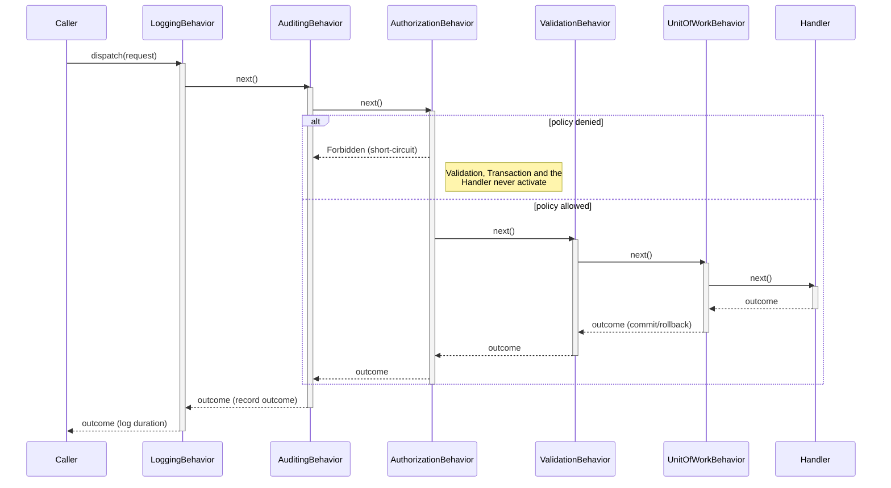

# Pipeline & Behavior Composition

The pipeline is the onion/Russian-doll model of cross-cutting concerns that wrap handler execution, and it's empty by default - nothing cross-cutting runs unless you explicitly compose it. See [Extensibility](extensibility.md) for how a custom marker interface, behavior, or outcome case fits into the picture end to end.

## No Default Pipeline

**Nothing runs unless you ask for it.** Behaviors form a flat ordered list. A bare `AddInterlocutor()` call produces the mediator and discovered handlers - zero pipeline behaviors. You compose exactly what you need.

```csharp
services.AddInterlocutor(builder =>
{
    builder.ScanAssembly(typeof(Program).Assembly);  // Register handlers

    // The pipeline is empty here. Add behaviors explicitly:
    builder.Pipeline.AddBehavior(typeof(LoggingBehavior<,>));
    builder.Pipeline.AddBehavior(typeof(AuthorizationBehavior<,>));
    // ... or use the recommended chain (see below)
});
```

### Flat Ordered List

Behaviors run in the order you register them - first registered wraps the outermost layer. Reading the builder configuration top to bottom tells you the execution order.

```csharp
// Registration order → execution order (outermost to innermost)
builder.Pipeline.AddLoggingBehavior();        // Outermost
builder.Pipeline.AddAuditingBehavior();       //
builder.Pipeline.AddValidationBehavior();     //
builder.Pipeline.AddUnitOfWorkBehavior();     // Innermost
// Handler executes here
```

Each behavior implements a single `Handle(request, next, ct)` method - there's no separate ingress/egress pair to override. The code on either side of its own `await next()` call *is* the inbound/outbound split: everything before that call runs on the way in, everything after runs on the way out, and one nested call chain carries both directions.

When a request dispatches:

1. **Inbound:** `Logging.Handle()` runs its pre-`next()` code, calls `next()`, which runs `Auditing.Handle()`'s pre-`next()` code, and so on through `Validation.Handle()` and `Transaction.Handle()`, until the innermost `next()` call reaches the handler.
2. **Outbound:** the handler's result flows back out through the same chain in reverse - each behavior's post-`next()` code runs on the awaited result, from `Transaction.Handle()` back up through `Validation.Handle()`, `Auditing.Handle()`, and finally `Logging.Handle()`.

### Filtered by Marker Interface

A behavior's scope (which requests it touches) is controlled by marker interfaces your request implements:

- **`IAuditableRequest`** - opts in `AuditingBehavior` (carries `ActionName`)
- **`IRequiresPolicyRequest`** - opts in `AuthorizationBehavior` (carries `PolicyName`)
- **`IExternalStoreRequest`** - opts a request *out* of `UnitOfWorkBehavior` entirely, even if it touches the scoped session
- **`ITransactionalRequest`** - does not opt into `UnitOfWorkBehavior` (every request gets it once registered, no marker needed); narrows to "begin the transaction eagerly, at pipeline start" instead of the default lazy begin-on-first-write - see [Transactions & Store Integration](transactions-and-store-integration.md)

A request's actual chain is the registered behavior list, filtered to entries whose generic constraint it satisfies, with relative order preserved. `UnitOfWorkBehavior` is unconstrained, so it's never filtered out by this mechanism.

```csharp
public record CreateOrder(int CustomerId, List<OrderItem> Items)
    : ICommand<Outcome<int, ValidationError>>,
      IAuditableRequest         // Runs only AuditingBehavior (if registered)
{
    // ValidationBehavior and UnitOfWorkBehavior run if registered, regardless of marker
    public string ActionName => "create_order";
}

public record GetSetting(string Key)
    : IQuery<Outcome<string, Failure>>
{
    // This request doesn't implement any markers, so it skips all scoped behaviors
    // (but still runs behaviors with no marker constraint, if you register any)
}
```

## Recommended Chain (Opt-in Sugar)

The library documents a recommended order with its rationale. Use it with `builder.Pipeline.UseRecommendedChain()`, or compose your own:

```csharp
builder.Pipeline.UseRecommendedChain();  // Sugar for the sequence below
```

Or explicitly:

```csharp
builder.Pipeline.AddLoggingBehavior();           // 1. Outermost
builder.Pipeline.AddAuditingBehavior();          // 2.
builder.Pipeline.AddAuthorizationBehavior();     // 3.
builder.Pipeline.AddValidationBehavior();        // 4.
builder.Pipeline.AddUnitOfWorkBehavior();        // 5. Innermost
```

### Why This Order

> [!IMPORTANT]
> This is the documented recommendation, not a default. The reasoning below is why you might compose this order. If your application has different needs, compose what serves you.

- **Logging outermost** - times and logs the *entire* request lifecycle. If it sat closer to the handler, a request denied by authorization would be timed/logged as if it ran the handler (misleading).
- **Auditing after logging** - an audit trail should record authorization denials and validation failures, not just successful handler runs. Placing it outside authorization captures the full story.
- **Authorization before validation** - there's no reason to validate the shape of a request the caller isn't authorized to make. Failing fast on authorization saves the validator's work.
- **Validation before transactions** - don't open a database transaction to discover the input was invalid. Catch input errors first.
- **Transaction innermost** - it wraps only the handler's persistence work. It commits on success and rolls back on any `Failure` outcome, but not when an outer behavior short-circuits (e.g., when authorization denies the request - the caller shouldn't see a rolled-back transaction when they were never authorized to run the command).

## Per-Request-Type Pipeline Overrides

The recommended chain - or whatever chain you compose in its place - is a general-purpose baseline: every request type draws from it unless you declare an override. `OverridePipelineFor` lets a specific request type, or a predicate matching a set of request types, run an independent, explicitly-ordered pipeline **instead of** the baseline entirely - a full, positively-declared replacement, never a merge with or modification of it.

### Worked example: an archival pipeline that skips authorization

Say most of your application uses the recommended chain, but a background archival job dispatches its own commands under a system identity that never carries a user's authorization context - running `AuthorizationBehavior` against it would always deny it. Give the archival command its own pipeline instead of teaching every other request about the exception:

```csharp
public interface IArchivalRequest;

public sealed record ArchiveOrder(Guid OrderId) : ICommand<Outcome<Success, Failure>>, IArchivalRequest;

public sealed class ArchivalAuditBehavior<TRequest, TResponse>(IAuditSink sink) : IPipelineBehavior<TRequest, TResponse>
    where TRequest : IArchivalRequest
{
    public async Task<TResponse> Handle(TRequest request, Func<Task<TResponse>> next, CancellationToken ct)
    {
        var result = await next();
        await sink.RecordAsync(new AuditEntry("Archival", typeof(TRequest).Name, "Completed", DateTime.UtcNow, null), ct);
        return result;
    }
}
```

```csharp
builder.Pipeline
    .UseRecommendedChain()
    .OverridePipelineFor<ArchiveOrder>("archive-order-pipeline", typeof(ArchivalAuditBehavior<,>));
```

`ArchiveOrder` now resolves exactly `ArchivalAuditBehavior<,>` - never `LoggingBehavior`, `AuthorizationBehavior`, `ValidationBehavior`, or the unit-of-work behavior the recommended chain also registers, even though `UseRecommendedChain()` ran first. Every other request type keeps drawing from the recommended chain unaffected.

The `IArchivalRequest` constraint on `ArchivalAuditBehavior<,>` matters beyond `ArchiveOrder`: because `OverridePipelineFor` registers each declared behavior type with the container exactly as an ordinary `AddBehavior` call would, an *unconstrained* override behavior would resolve for every other request type too, via the container's ordinary open-generic resolution - not only the request type(s) the override rule names. Scope an override-specific behavior with a marker interface or a `where TRequest : ...` constraint the same way any unconstrained `AddBehavior` registration already requires.

For matching more than one request type, use the predicate overload instead of the generic convenience one:

```csharp
builder.Pipeline.OverridePipelineFor(
    predicate: t => typeof(IArchivalRequest).IsAssignableFrom(t),
    name: "archival-pipeline",
    behaviors: [typeof(ArchivalAuditBehavior<,>)]
);
```

A request matched by a rule resolves *exactly* the declared list, in the declared order - the first entry runs first (inbound) and last (outbound), same as the baseline's own registration order. There is no "skip" or "exclude" primitive alongside it: declaring an override is the only action you take.

A request that structurally satisfies an existing marker interface (`IAuditableRequest`, `IRequiresPolicyRequest`, and so on) does not run that marker-constrained behavior once an override rule matches it, unless the override names the behavior explicitly - the override's declared list is exhaustive, not additive to whatever the marker would otherwise pull in. This is enforced once, centrally, at the point each dispatch path builds its behavior chain - not by asking every behavior to check whether it should yield to an override.

Two override rules whose predicates both match the same request type are a build-validation error, not a silent resolution - see [Startup Validation](builder-and-registration.md#startup-validation). There is no precedence-declaration escape hatch; resolve a conflict by narrowing one rule's match criteria.

Both dispatch paths - the ordinary typed `Send` API and the runtime-typed path used for scenarios like outbox replay - resolve an override identically; see [Runtime-Typed Dispatch](runtime-typed-dispatch.md).

## Validation, Authorization & Auditing Behaviors

These three are the main cross-cutting concerns:

### ValidationBehavior

Validates the request shape against registered FluentValidation rules. Returns `ValidationError` / `ValidationErrors<TErrorCode>` on validation failure, short-circuiting the pipeline.

- Requires: `Interlocutor.FluentValidation` package
- Marker: no marker - validates all requests, regardless of opt-in
- Constraint: `TResponse : IOutcome` (must be able to construct a `ValidationError` case)

```csharp
public record CreateUser(string Name, string Email)
    : ICommand<Outcome<int, ValidationError>>;

public class CreateUserValidator : AbstractValidator<CreateUser>
{
    public CreateUserValidator()
    {
        RuleFor(c => c.Name).NotEmpty().MaximumLength(100);
        RuleFor(c => c.Email).EmailAddress();
    }
}

// ValidationBehavior runs before your handler and short-circuits with ValidationError if invalid
var result = await mediator.Send(new CreateUser("", "bad-email"));
// result.Value is ValidationError with collected errors
```

### FluentValidationErrorsBehavior

Same validation, full fidelity: validates the request against registered FluentValidation rules, but returns
`Interlocutor.FluentValidation.FluentValidationErrors` - every `FluentValidation.Results.ValidationFailure`
preserved verbatim (property name, severity, error code, custom state, attempted value), not just its message.
An alternative to `ValidationBehavior` for a handler that wants full fidelity, not an addition to it - register
whichever one matches the case type your `Outcome<...>` union declares.

- Requires: `Interlocutor.FluentValidation` package
- Marker: no marker - validates all requests, regardless of opt-in
- Constraint: `TResponse : IOutcome` (must be able to construct a `FluentValidationErrors` case)

```csharp
public record CreateUser(string Name, string Email)
    : ICommand<Outcome<int, FluentValidationErrors>>;

builder.Pipeline.AddBehavior(typeof(FluentValidationErrorsBehavior<,>));

// FluentValidationErrorsBehavior runs before your handler and short-circuits with FluentValidationErrors if invalid
var result = await mediator.Send(new CreateUser("", "bad-email"));
// result.Value is FluentValidationErrors - result.Value.Failures[0].PropertyName is "Email"
```

`FluentValidationErrors` also implements `IFieldValidationFailureCase`, pairing each failure's message with its property name via `FieldMessages` - `Interlocutor.AspNetCore.DefaultHttpOutcomeStatusMapper` recognizes this and builds a field-keyed HTTP response instead of the flat one `ValidationBehavior`'s `ValidationErrors` gets; see [ASP.NET Core Integration § Field-Keyed Validation Errors](aspnetcore-integration.md#field-keyed-validation-errors).

### AuthorizationBehavior

Enforces policy-based, non-resource authorization. Short-circuits with `Forbidden` if the policy fails.

> [!NOTE]
> Resource-based authorization (needing the loaded entity) is *not* a behavior - it's handled by `ResourceCommandHandler`'s template method. See [handler-selection-and-dispatch.md](handler-selection-and-dispatch.md) for the full picture.

- Requires: nothing beyond the try-added `IOutcomeCaseRegistry` default (`DefaultOutcomeCaseRegistry`) and `IPolicyEvaluator` default (see the warning below)
- Marker: `IRequiresPolicyRequest` (carries the `PolicyName` to evaluate)
- Constraint: `TResponse : IOutcome` (must be able to construct a `Forbidden` case)

```csharp
public record DeleteAllUsers() : ICommand<Outcome<Success, Forbidden>>, IRequiresPolicyRequest
{
    public string PolicyName => "AdminOnly";
}

// AuthorizationBehavior evaluates the AdminOnly policy and short-circuits with Forbidden if denied
var result = await mediator.Send(new DeleteAllUsers());
```

The response type must have a `Forbidden` case to short-circuit into - the case-less, non-generic
`Outcome` has none, so pairing it with `IRequiresPolicyRequest` throws the first time a policy check
actually denies, rather than silently granting or swallowing the denial.

> [!WARNING]
> If no `IPolicyEvaluator` is registered, `AuthorizationBehavior` falls back to the try-added `DefaultPolicyEvaluator` - which **always returns `true`, granting every policy check unconditionally**. That default exists for development and testing, where authorization isn't implemented yet and shouldn't block work; it is not safe for production. Register your own `IPolicyEvaluator` (or `builder.Pipeline.OverridePolicyEvaluator<TEvaluator>()`) before deploying anything that uses `IRequiresPolicyRequest`.

### AuditingBehavior

Records an audit trail of what ran and its outcome.

- Requires: nothing - falls back to the try-added `LoggingAuditSink` (records via `ILogger`) if you don't register your own `IAuditSink`
- Marker: `IAuditableRequest` (carries the `ActionName` to record)
- Constraint: no constraint - can be used with any response type

```csharp
public record TransferFunds(int FromAccountId, int ToAccountId, decimal Amount)
    : ICommand<Outcome>, IAuditableRequest
{
    public string ActionName => "transfer_funds";
}

// AuditingBehavior records the action, response outcome, and optional user ID via RequestContextAccessor
var result = await mediator.Send(new TransferFunds(1, 2, 100));
```

## Outcome Description

`LoggingBehavior` and `AuditingBehavior` both need to answer the same question about a handler's response: *what should this be called in a log line or audit entry*. `IResponseOutcomeDescriber` is the shared abstraction that answers it, so the two behaviors label responses consistently instead of each re-implementing their own labeling.

```csharp
public interface IResponseOutcomeDescriber
{
    string Describe(object? response);   // e.g. "Success", "NotFound", "ValidationError"
}
```

- **`LoggingBehavior<TRequest, TResponse>`** calls `Describe()` to log the outcome alongside elapsed time.
- **`AuditingBehavior<TRequest, TResponse>`** calls `Describe()` to record the outcome on each `AuditEntry`.

> [!IMPORTANT]
> `UnitOfWorkBehavior` (both EF Core and NHibernate) commits whatever a dispatch left pending, regardless of the response's shape - no case type decides that. The only way to force a rollback is an explicit `IUnitOfWork.Cancel` call, or an unhandled exception; see [Transactions & Store Integration § Commit/Rollback Semantics](transactions-and-store-integration.md#commitrollback-semantics). `UnitOfWorkBehavior` still accepts an `IResponseOutcomeDescriber` (via an `IOutcomeClassifier`) purely to label its own commit debug log line, the same way `LoggingBehavior`/`AuditingBehavior` do.

`LoggingBehavior`, `AuditingBehavior`, and both `UnitOfWorkBehavior` implementations accept `IResponseOutcomeDescriber` as an *optional* constructor parameter. When nothing is registered in DI, each falls back to its own `DefaultResponseOutcomeDescriber` instance backed by `OutcomeClassifierBuilder.DefaultClassifier` - the shared, pre-seeded classifier described below.

> [!IMPORTANT]
> There is no automatic `IResponseOutcomeDescriber` registration in `InterlocutorBuilder`. Registering one would require also registering a default `IOutcomeClassifier` to keep it resolvable - an orphan dependency the no-default-pipeline design avoids introducing for consumers who never call `OverrideOutcomeDescriber`. The optional-parameter fallback covers everyone else.

### Overriding the Default

Reach for `InterlocutorPipelineBuilder.OverrideOutcomeDescriber<TDescriber>()` (reachable via `builder.Pipeline`) when the default classifier doesn't recognize your response types - most commonly because your handlers return a custom union type instead of `Outcome<...>`. The default classifier is fail-closed: any response type it hasn't seen is treated as a failure, so an unrecognized custom type would log misleading outcome labels and force every transaction to roll back even on success.

```csharp
services.AddInterlocutor(builder =>
{
    builder.ScanAssembly(typeof(Program).Assembly);
    builder.Pipeline.OverrideOutcomeDescriber<PaymentOutcomeDescriber>();  // see worked example below
    builder.Pipeline.AddLoggingBehavior();
    builder.Pipeline.AddAuditingBehavior();
});
```

`OverrideOutcomeDescriber<TDescriber>()` replaces the builder's internal default entry for `IResponseOutcomeDescriber` directly (registered as a singleton by default), so it wins regardless of whether it's called before or after `AddLoggingBehavior()` / `AddAuditingBehavior()` in the same chain.

### OutcomeClassifierBuilder

`OutcomeClassifierBuilder` is the fluent builder behind `DefaultResponseOutcomeDescriber` - it produces an immutable `IOutcomeClassifier`, a pure label registry, from a set of type and predicate registrations. `OutcomeClassifierBuilder.DefaultClassifier` is pre-seeded with every kernel result type's label, so a fresh builder only needs to add your own:

- **`RegisterType<T>(label)`** - registers a type's display label.
- **`RegisterType(Type, label)`** - the non-generic form, for registering a type known only at runtime.
- **`RegisterPredicate(predicate, label)`** - for shapes that can't be keyed by exact type (e.g. an open generic family). Predicates are evaluated in registration order, after the type table misses, and the first match wins.
- **`.Build()`** - produces the immutable `IOutcomeClassifier`.

> [!IMPORTANT]
> Labeling never throws: if neither the type table nor any predicate matches a response, `GetLabel()` falls back to the response's runtime type name (or `"None"` for a null/unset response). A custom outcome type you forget to register just logs under its raw type name instead of a friendlier label - it has no effect on commit/rollback, which no longer depends on classification at all.

#### Worked example: labeling a custom union type

Say your handlers return a hand-rolled payment outcome instead of `Outcome<...>`:

```csharp
public sealed record PaymentApproved(string ConfirmationCode);

public sealed record PaymentDeclined(string Reason);

public sealed record PaymentGatewayError(string Detail);
```

Build a classifier for it and wrap it in an `IResponseOutcomeDescriber`:

```csharp
public sealed class PaymentOutcomeDescriber : IResponseOutcomeDescriber
{
    private static readonly IOutcomeClassifier Classifier = new OutcomeClassifierBuilder()
        .RegisterType<PaymentApproved>("PaymentApproved")
        .RegisterType<PaymentDeclined>("PaymentDeclined")
        .RegisterType<PaymentGatewayError>("PaymentGatewayError")
        .Build();

    public string Describe(object? response) => Classifier.GetLabel(response);
}
```

Then wire it in with `OverrideOutcomeDescriber<TDescriber>()` as shown above. `LoggingBehavior` and `AuditingBehavior` now describe `PaymentApproved`/`PaymentDeclined`/`PaymentGatewayError` with a friendly label instead of falling back to the raw type name.

## Cancellation, Timeout & Rate Limiting Behaviors

These three behaviors are additive, opt-in cross-cutting concerns shipped alongside the recommended chain, but **not part of it**.

> [!IMPORTANT]
> `CancellationBehavior`, `TimeoutBehavior`, and `RateLimitedBehavior` have no prescribed position in the pipeline. They are ordinary `Add*Behavior()` calls - the consumer composes them wherever they choose in their own chain, exactly like any behavior outside `UseRecommendedChain()`. `UseRecommendedChain()` itself is unchanged: it still applies only the five behaviors documented above, in the same order.

### CancellationBehavior

Converts cooperative cancellation of the ambient request into a `Cancelled` outcome instead of letting `OperationCanceledException` propagate as an unexpected fault.

- Requires: nothing beyond the try-added `IOutcomeCaseRegistry` default (`DefaultOutcomeCaseRegistry`)
- Marker: `ICancellableRequest` (no members - opts the request in)
- Constraint: `TResponse : IOutcome` (must be able to construct a `Cancelled` case)

```csharp
public record ExportReport(int ReportId)
    : ICommand<Outcome<Success, Cancelled>>, ICancellableRequest;

// builder.Pipeline.AddCancellationBehavior();
// CancellationBehavior only converts cancellation tied to the ambient CancellationToken passed to
// Handle - an OperationCanceledException raised by some unrelated token propagates unchanged.
var result = await mediator.Send(new ExportReport(42), cancellationToken);
```

### TimeoutBehavior

Races the rest of the pipeline against a time budget resolved via `ITimeoutPolicy`, short-circuiting with `Timeout` if the budget elapses first.

- Requires: `ITimeoutPolicy` (you register your own, or accept the try-added `DefaultTimeoutPolicy`, which returns the request's own declared budget unchanged)
- Marker: `ITimeoutRequest` (carries the request's declared `Budget`)
- Constraint: `TResponse : IOutcome` (must be able to construct a `Timeout` case)

```csharp
public record ExportReport(int ReportId)
    : ICommand<Outcome<Success, Timeout>>, ITimeoutRequest
{
    public TimeSpan Budget => TimeSpan.FromSeconds(30);
}

// builder.Pipeline.AddTimeoutBehavior();
var result = await mediator.Send(new ExportReport(42));
```

> [!WARNING]
> `TimeoutBehavior` can only *report* a timeout, not enforce one. `IPipelineBehavior<TRequest, TResponse>.Handle`'s `next` parameter is a parameterless delegate - there is no way to hand it a shorter-lived token, so the abandoned work keeps running in the background, unobserved, after the `Timeout` response is returned to the caller. Genuinely aborting in-flight work requires the handler itself to observe the cancellation token.

For simple budget logic that doesn't warrant a named class, `DelegateTimeoutPolicy` wraps a `Func<ITimeoutRequest, TimeSpan>` directly - register the instance before `AddInterlocutor()` runs so the behavior's own try-added default is skipped:

```csharp
services.AddSingleton<ITimeoutPolicy>(new DelegateTimeoutPolicy(request => request.Budget * 2));  // double every declared budget
services.AddInterlocutor(builder =>
{
    builder.ScanAssembly(typeof(Program).Assembly);
    builder.Pipeline.AddTimeoutBehavior();
});
```

### RateLimitedBehavior

Checks a rate limit via `IRateLimiter`, short-circuiting with `RateLimited` if the check disallows the request.

- Requires: `IRateLimiter` (you register your own, or accept the try-added `DefaultRateLimiter`)
- Marker: `IRateLimitedRequest` (carries `LimitKey`, identifying which limiter/bucket applies)
- Constraint: `TResponse : IOutcome` (must be able to construct a `RateLimited` case)

```csharp
public record ExportReport(int ReportId)
    : ICommand<Outcome<Success, RateLimited>>, IRateLimitedRequest
{
    public string LimitKey => "exports";
}

// builder.Pipeline.AddRateLimitedBehavior();
var result = await mediator.Send(new ExportReport(42));
```

Like `DelegateTimeoutPolicy` above, `DelegateRateLimiter` wraps a check function directly, for cases that don't need a full class:

```csharp
services.AddSingleton<IRateLimiter>(new DelegateRateLimiter(async (limitKey, request, ct) =>
{
    var allowed = await myBucket.TryAcquireAsync(limitKey, ct);
    return new RateLimitResult(allowed, RetryAfter: allowed ? null : TimeSpan.FromSeconds(1));
}));
```

## Pipeline Stages (IPipelineStage)

Pipeline stages are a lighter-weight alternative to writing a full `IPipelineBehavior<TRequest,TResponse>`. Use them for pre/post hooks that don't need the complexity of wrapping a `next()` delegate.

```csharp
public class LoggingStage<TRequest, TResponse> : PipelineStageBase<TRequest, TResponse>
{
    private readonly ILogger<LoggingStage<TRequest, TResponse>> logger;

    public LoggingStage(ILogger<LoggingStage<TRequest, TResponse>> logger) => this.logger = logger;

    // Called before the handler; can short-circuit by returning ShortCircuited
    protected override Task<StageResult<TResponse>> OnBeforeAsync(
        TRequest request, CancellationToken ct)
    {
        logger.LogInformation("Request: {RequestType}", typeof(TRequest).Name);
        return Task.FromResult(StageResult<TResponse>.Continue);  // Don't short-circuit
    }

    // Called after the handler; executes even if short-circuited
    protected override Task OnAfterAsync(
        TRequest request, TResponse response, CancellationToken ct)
    {
        logger.LogInformation("Response: {@Response}", response);
        return Task.CompletedTask;
    }
}

// Register stages in the builder:
builder.Pipeline.AddStage(typeof(LoggingStage<,>));
```

Stages are hosted by `PipelineStageBehavior<TRequest,TResponse>` - an ordinary entry in the behavior list that aggregates all registered stages. Stages run in registration order on the way in, reverse order on the way out, much like behaviors themselves.

For a hook this small, skip the class entirely - `AddStage`'s delegate overload wraps the two lambdas in `DelegatePipelineStage<,>` for you:

```csharp
builder.Pipeline.AddStage<TRequest, TResponse>(
    onBefore: (request, ct) =>
    {
        logger.LogInformation("Request: {RequestType}", typeof(TRequest).Name);
        return Task.FromResult(StageResult<TResponse>.Continue);
    },
    onAfter: null  // omit either hook for a no-op - matches PipelineStageBase's own default
);
```

A second overload takes `IServiceProvider` as the first delegate parameter, for a stage that needs to resolve a scoped dependency rather than capture one at configuration time - see `InterlocutorPipelineBuilder.AddStage`'s XML docs for the exact signature.

### Short-Circuiting

A stage's `OnBeforeAsync` can short-circuit and return an outcome without the handler running:

```csharp
protected override Task<StageResult<TResponse>> OnBeforeAsync(
    TRequest request, CancellationToken ct)
{
    if (SomeCache.TryGetValue(request, out var cached))
    {
        return Task.FromResult(StageResult<TResponse>.ShortCircuit(cached));  // Skip handler
    }
    return Task.FromResult(StageResult<TResponse>.Continue);  // Run handler normally
}
```

When a stage short-circuits:

- Remaining stages' `OnBeforeAsync` methods **do not run** - we skip directly to egress.
- The handler **does not run**.
- Only the after-hooks of stages that already ran (including the one that short-circuited) execute.
- Behaviors outside the stage host see an ordinary response - they cannot distinguish a short-circuited outcome from a handler-produced one.

## Force-Ejecting From Deep In a Handler or Behavior

`StageResult.ShortCircuit` above is a return-type convention: it only works because `IPipelineStage.OnBeforeAsync` returns `StageResult<TResponse>`, a wrapper with a spare slot for "skip everything and use this response instead." An ordinary `IPipelineBehavior<TRequest,TResponse>.Handle` or a handler's own `Handle` has no such slot - both return `Task<TResponse>` directly - so there's nothing to repurpose the same way.

That's fine when the decision to stop can be made right where `Handle` returns (a behavior can already just not call `next()` and return any response it likes - `AuthorizationBehavior` does exactly this for `Forbidden`). It's not fine when the decision is discovered several method calls deep inside a handler's own logic, and manually threading the chosen outcome back up through every intermediate frame would turn a three-line early exit into a cascade of early returns. `Eject.With` is for that case:

```csharp
private Task<Outcome<Success, Conflict>> ApplyDiscount(Order order)
{
    if (!TryReserveInventory(order))
    {
        // Several calls deep in a handler's own logic - hand back the chosen outcome directly rather than
        // threading it up through every intermediate frame.
        return Task.FromResult(Eject.With<Outcome<Success, Conflict>>(new Conflict("Inventory already reserved")));
    }

    return Task.FromResult<Outcome<Success, Conflict>>(new Success());
}
```

`Eject.With` throws a `PipelineEjectException<TResponse>` that is caught immediately at the nearest enclosing `Handle` call - every place that composes the behavior chain around a handler (the hand-written command/query wrappers and the source generator's emitted dispatch wrappers alike) wraps each `Handle` call in a matching catch. That means:

- Nothing further out in the chain ever observes an exception - an enclosing behavior's own post-`next()` logic (auditing, logging, a transaction commit/rollback gate) runs exactly as if the ejecting code had returned the chosen response normally.
- No transaction-gating change is needed alongside this: a unit-of-work commit/rollback gate decides commit versus rollback from the outcome it classifies, not from how that outcome was produced, so an ejected non-success response is rolled back exactly like one returned normally.
- A behavior or handler can eject with *any* legal case of its response type - there is no dedicated "ejected" case to construct. For an unconstrained generic `TResponse` (typical when authoring a reusable behavior), construct the chosen case via `IOutcomeCaseRegistry.ConstructOrThrow` first, the same way `AuthorizationBehavior` builds `Forbidden`, then pass the result to `Eject.With`.

> [!IMPORTANT]
> This is unrelated to `CancellationBehavior`/`Cancelled`. Cancellation is cooperative cancellation of the ambient `CancellationToken` - no decision is involved, the caller asked the operation to stop. `Eject.With` is the opposite situation: nothing asked the operation to stop, a developer's own code decided, mid-flight, that the operation is at a dead end and chose to end it.

## Composition Diagram

A sequence diagram, not a flowchart, is the right shape here: the pipeline isn't two independent passes through the behavior list, it's one call nesting all the way down to the handler and back out. Activation bars below show that nesting directly, and the `alt` block shows what a flowchart of "ingress then egress" can't: a short-circuit skips the remaining inner behaviors and the handler entirely.



## Registering Custom Behaviors

A behavior is just a class implementing `IPipelineBehavior<TRequest,TResponse>`:

```csharp
public class CustomLoggingBehavior<TRequest, TResponse> : IPipelineBehavior<TRequest, TResponse>
{
    private readonly ILogger<CustomLoggingBehavior<TRequest, TResponse>> logger;

    public CustomLoggingBehavior(ILogger<CustomLoggingBehavior<TRequest, TResponse>> logger)
        => this.logger = logger;

    public async Task<TResponse> Handle(
        TRequest request,
        Func<Task<TResponse>> next,
        CancellationToken ct)
    {
        logger.LogInformation("Starting {RequestType}", typeof(TRequest).Name);
        try
        {
            var result = await next();  // Call the next behavior or handler
            logger.LogInformation("Completed {RequestType}", typeof(TRequest).Name);
            return result;
        }
        catch (Exception ex)
        {
            logger.LogError(ex, "Failed {RequestType}", typeof(TRequest).Name);
            throw;  // Behaviors can catch and rethrow; exceptions are never converted to outcomes
        }
    }
}

// Register it in the builder (position matters - registration order is execution order)
builder.Pipeline.AddBehavior(typeof(CustomLoggingBehavior<,>));
```

> [!CAUTION]
> **Exceptions are never converted to outcomes.** If a behavior throws, the exception propagates to the caller (or is handled by ASP.NET Core's exception middleware in a web context). Behaviors never catch an exception and convert it to a `Failure` outcome - that would blur the line between "expected failure" (an outcome) and "bug" (an exception).
