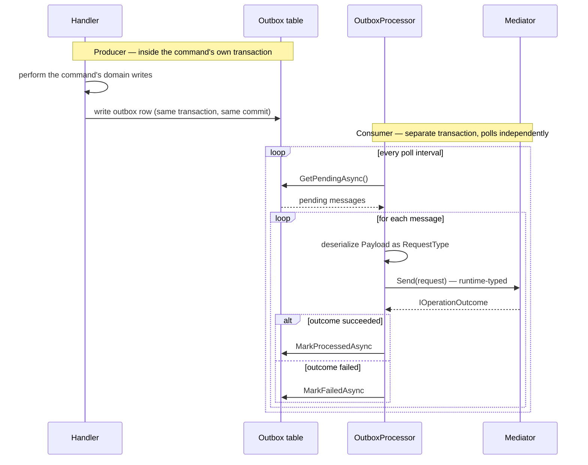
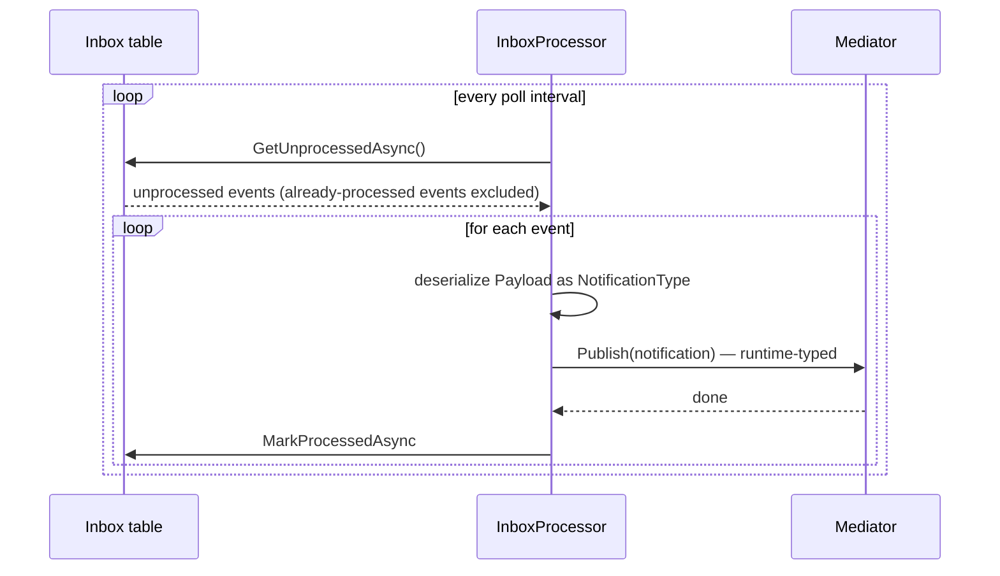

# Runtime-Typed Dispatch

Dispatching requests when the type is only known at runtime. Used in infrastructure code like outbox replay, message queues, and event sourcing consumers.

## The Use Case

In outbox/inbox/queue scenarios, messages are serialized. When you deserialize them, you don't have a compile-time type to pass to `mediator.Send<TResponse>(...)`:

```csharp
// Outbox consumer
var message = await outbox.DequeueAsync();
// message.Payload is a JSON string
// message.RequestType is "MyApp.Domain.Commands.CreateOrder, MyApp.Domain"

// You can't write: mediator.Send(???)  ← what type do you pass?
```

## Runtime-Typed Send

Use the runtime-typed overload:

```csharp
var requestType = Type.GetType(message.RequestType);  // Runtime type token
var request = JsonSerializer.Deserialize(message.Payload, requestType);

// Runtime-typed dispatch
var result = await mediator.Send(request);  // object, no generic parameter
```

The `result` is `IOperationOutcome` — the base interface all outcomes implement. You can inspect it without knowing the concrete outcome shape:

```csharp
var succeeded = result.IsSuccess;
var failure = result.Failure;

// Inspect the outcome's success/failure without knowing the concrete type
if (!succeeded)
{
    await outbox.MarkFailedAsync(message.Id);
}
else
{
    await outbox.DeleteAsync(message.Id);
}
```

## IOperationOutcome Interface

All outcome unions implement `IOperationOutcome`:

```csharp
public interface IOperationOutcome
{
    bool IsSuccess { get; }
    object? Failure { get; }
}
```

When you call runtime-typed `Send(object request)`, you get back an `IOperationOutcome` you can examine:

```csharp
var result = await mediator.Send(request);

// result is IOperationOutcome
// - result.IsSuccess: true if the result is the success case
// - result.Failure: the failure value (if IsSuccess is false), or null

if (result.IsSuccess)
{
    Console.WriteLine("Success");
}
else
{
    Console.WriteLine($"Failed: {result.Failure}");
}
```

## Outbox Pattern Example

The outbox row is written by the originating handler, in the *same* transaction as its other writes (see [Transactions & Store Integration](transactions-and-store-integration.md)); a separate background processor reads it back later, in its own transaction, and dispatches at runtime using the pattern above:



```csharp
public class OutboxProcessor : BackgroundService
{
    private readonly IServiceProvider serviceProvider;

    protected override async Task ExecuteAsync(CancellationToken ct)
    {
        while (!ct.IsCancellationRequested)
        {
            using var scope = this.serviceProvider.CreateScope();
            var mediator = scope.ServiceProvider.GetRequiredService<IMediator>();
            var outbox = scope.ServiceProvider.GetRequiredService<IOutboxRepository>();

            // Fetch pending messages
            var messages = await outbox.GetPendingAsync(100, ct);

            foreach (var message in messages)
            {
                try
                {
                    // Deserialize the request
                    var requestType = Type.GetType(message.RequestType);
                    var request = JsonSerializer.Deserialize(message.Payload, requestType);

                    // Runtime-typed dispatch
                    var result = await mediator.Send(request, ct);

                    // Examine the outcome
                    if (result.IsSuccess)
                    {
                        await outbox.MarkProcessedAsync(message.Id, ct);
                    }
                    else
                    {
                        await outbox.MarkFailedAsync(message.Id, result.Failure, ct);
                    }
                }
                catch (Exception ex)
                {
                    await outbox.MarkFailedAsync(message.Id, ex.Message, ct);
                }
            }

            await Task.Delay(TimeSpan.FromSeconds(5), ct);
        }
    }
}
```

## Inbox Pattern Example

`GetUnprocessedAsync` is where the dedupe happens — it excludes events already recorded as processed, so a redelivered message doesn't get published twice:



```csharp
public class InboxProcessor : BackgroundService
{
    private readonly IServiceProvider serviceProvider;

    protected override async Task ExecuteAsync(CancellationToken ct)
    {
        while (!ct.IsCancellationRequested)
        {
            using var scope = this.serviceProvider.CreateScope();
            var mediator = scope.ServiceProvider.GetRequiredService<IMediator>();
            var inbox = scope.ServiceProvider.GetRequiredService<IInboxRepository>();

            var events = await inbox.GetUnprocessedAsync(100, ct);

            foreach (var @event in events)
            {
                try
                {
                    // Deserialize the notification
                    var notificationType = Type.GetType(@event.NotificationType);
                    var notification = JsonSerializer.Deserialize(@event.Payload, notificationType);

                    // Runtime-typed dispatch for notifications
                    await mediator.Publish(notification, ct);

                    await inbox.MarkProcessedAsync(@event.Id, ct);
                }
                catch (Exception ex)
                {
                    await inbox.MarkFailedAsync(@event.Id, ex.Message, ct);
                }
            }

            await Task.Delay(TimeSpan.FromSeconds(5), ct);
        }
    }
}
```

## Error Handling

If the runtime type cannot be resolved or deserialized, exceptions are thrown:

```csharp
// ❌ Type doesn't exist
var requestType = Type.GetType("NonExistent.Command, NonExistent");
var request = JsonSerializer.Deserialize(payload, requestType);  // Returns null

// ❌ Deserialization fails
var request = JsonSerializer.Deserialize(malformedJson, typeof(CreateOrder));  // Throws JsonException

// ✅ Wrap in try/catch and handle gracefully
try
{
    var requestType = Type.GetType(message.RequestType);
    if (requestType == null)
        throw new InvalidOperationException($"Unknown request type: {message.RequestType}");

    var request = JsonSerializer.Deserialize(message.Payload, requestType);
    var result = await mediator.Send(request, ct);
}
catch (JsonException ex)
{
    // Log and mark as failed
    await outbox.MarkFailedAsync(message.Id, $"Deserialization error: {ex.Message}", ct);
}
catch (Exception ex)
{
    // Log and mark as failed
    await outbox.MarkFailedAsync(message.Id, ex.Message, ct);
}
```
