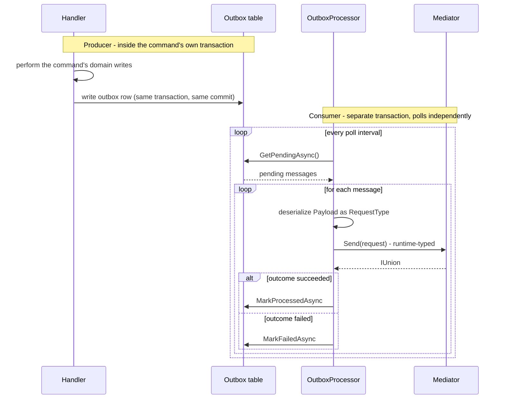
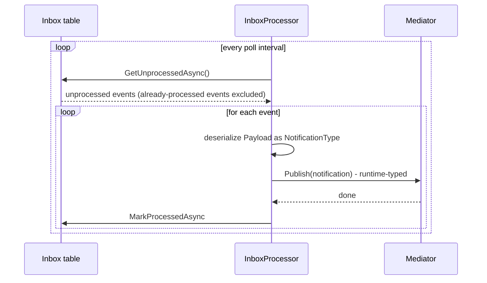

# Runtime-Typed Dispatch

Dispatching requests when the type is only known at runtime. Used in infrastructure code like outbox replay, message queues, and event sourcing consumers.

## The Use Case

In outbox/inbox/queue scenarios, messages are serialized. When you deserialize them, you don't have a compile-time type to pass to `mediator.Send<TResponse>(...)`:

```csharp
// Outbox consumer
var message = await outbox.DequeueAsync();
// message.Payload is a JSON string
// message.RequestType is "MyApp.Domain.Commands.CreateOrder, MyApp.Domain"

// You can't write: mediator.Send(???)  ← what type do you pass?
```

## Runtime-Typed Send

Use the runtime-typed overload:

```csharp
var requestType = Type.GetType(message.RequestType);  // Runtime type token
var request = JsonSerializer.Deserialize(message.Payload, requestType);

// Runtime-typed dispatch
var result = await mediator.Send(request);  // object, no generic parameter
```

The `result` is `IUnion` - the base interface every outcome union implements, exposing only a single boxed `Value` member (see below for how to actually inspect it).

A per-request-type pipeline override (`Pipeline.OverridePipelineFor`) applies uniformly regardless of dispatch path: a request type with a declared override resolves that same override whether it arrives through the ordinary typed `Send<TResponse>` API or through this runtime-typed overload - there is no divergence for a caller who uses both. See [Per-Request-Type Pipeline Overrides](pipeline-and-behaviors.md#per-request-type-pipeline-overrides) for how to declare one.

## IUnion Interface

Every outcome union implements `System.Runtime.CompilerServices.IUnion` - the interface the compiler generates for every `union` declaration - exposing a single boxed `Value` member:

```csharp
public interface IUnion
{
    object? Value { get; }
}
```

That means runtime-typed `Send(object request)`'s `IUnion` result exposes only its boxed `Value` directly - not enough on its own to know the active case's type, since a `null` `Value` can mean either a legitimate null payload or a genuinely unset union. Resolving that fully, without knowing the concrete union type, is exactly what [`IOutcomeCaseRegistry`](messages-and-result-types.md#iunion-as-an-extension-point) is for - inject it and call `TryGetActiveCase(response, out caseType, out caseValue)`. The Outbox Pattern example below shows the full pattern.

> [!NOTE]
> `IOutcomeCaseRegistry` is try-added by several `Pipeline.Add*Behavior()` calls (`AddAuthorizationBehavior`, `AddCancellationBehavior`, `AddTimeoutBehavior`, `AddRateLimitedBehavior`, and FluentValidation's `AddValidationBehavior`) and by `UseRecommendedChain()`, which includes `AddValidationBehavior`. If your pipeline uses none of those, register `DefaultOutcomeCaseRegistry` yourself, or supply a custom `IOutcomeCaseRegistry` per [messages-and-result-types.md](messages-and-result-types.md#iunion-as-an-extension-point).

## Outbox Pattern Example

The outbox row is written by the originating handler, in the *same* transaction as its other writes (see [Transactions & Store Integration](transactions-and-store-integration.md)); a separate background processor reads it back later, in its own transaction, and dispatches at runtime using the pattern above:



```csharp
public class OutboxProcessor : BackgroundService
{
    private readonly IServiceProvider serviceProvider;

    protected override async Task ExecuteAsync(CancellationToken ct)
    {
        while (!ct.IsCancellationRequested)
        {
            using var scope = this.serviceProvider.CreateScope();
            var mediator = scope.ServiceProvider.GetRequiredService<IMediator>();
            var caseRegistry = scope.ServiceProvider.GetRequiredService<IOutcomeCaseRegistry>();
            var outbox = scope.ServiceProvider.GetRequiredService<IOutboxRepository>();

            // Fetch pending messages
            var messages = await outbox.GetPendingAsync(100, ct);

            foreach (var message in messages)
            {
                try
                {
                    // Deserialize the request
                    var requestType = Type.GetType(message.RequestType);
                    var request = JsonSerializer.Deserialize(message.Payload, requestType);

                    // Runtime-typed dispatch
                    var result = await mediator.Send(request, ct);

                    // IUnion exposes only Value - extract the active case via IOutcomeCaseRegistry to inspect it
                    caseRegistry.TryGetActiveCase(result, out var caseType, out var caseValue);

                    if (caseType == typeof(Success))
                    {
                        await outbox.MarkProcessedAsync(message.Id, ct);
                    }
                    else
                    {
                        await outbox.MarkFailedAsync(message.Id, caseValue, ct);
                    }
                }
                catch (Exception ex)
                {
                    await outbox.MarkFailedAsync(message.Id, ex.Message, ct);
                }
            }

            await Task.Delay(TimeSpan.FromSeconds(5), ct);
        }
    }
}
```

## Inbox Pattern Example

`GetUnprocessedAsync` is where the dedupe happens - it excludes events already recorded as processed, so a redelivered message doesn't get published twice:



```csharp
public class InboxProcessor : BackgroundService
{
    private readonly IServiceProvider serviceProvider;

    protected override async Task ExecuteAsync(CancellationToken ct)
    {
        while (!ct.IsCancellationRequested)
        {
            using var scope = this.serviceProvider.CreateScope();
            var mediator = scope.ServiceProvider.GetRequiredService<IMediator>();
            var inbox = scope.ServiceProvider.GetRequiredService<IInboxRepository>();

            var events = await inbox.GetUnprocessedAsync(100, ct);

            foreach (var @event in events)
            {
                try
                {
                    // Deserialize the notification
                    var notificationType = Type.GetType(@event.NotificationType);
                    var notification = JsonSerializer.Deserialize(@event.Payload, notificationType);

                    // Runtime-typed dispatch for notifications
                    await mediator.Publish(notification, ct);

                    await inbox.MarkProcessedAsync(@event.Id, ct);
                }
                catch (Exception ex)
                {
                    await inbox.MarkFailedAsync(@event.Id, ex.Message, ct);
                }
            }

            await Task.Delay(TimeSpan.FromSeconds(5), ct);
        }
    }
}
```

## Error Handling

Beyond type resolution and deserialization failures, `Send(object, ct)` itself throws three specific, named exceptions (all `Interlocutor.Abstractions.Core`):

- **`UnsupportedRequestTypeException`** - the deserialized object doesn't implement `IQuery<TResponse>`, `ICommand<TResponse>`, or `ICommand` at all. This means the object was never a request to begin with - a deserialization or caller bug, not a missing registration. Carries `RequestType` for diagnostics.
- **`HandlerNotRegisteredException`** - the object *is* a recognized request shape, but no handler for it is registered. This is the runtime-typed path's equivalent of the generic `InvalidOperationException` typed dispatch throws (see [Builder & Registration § Verifying Your Registration](builder-and-registration.md#verifying-your-registration)) - a specific, named type instead, since an infrastructure caller needs `RequestType` to log which message it couldn't process. It also carries `HandlerType` - the specific closed handler interface expected, or `null` when none could be determined (a bare command, whose result type isn't fixed by the command).
- **`AmbiguousBareCommandResultTypeException`** - the object is a bare command (`ICommand`), and more than one distinct result type was found across the loaded `IBareCommandHandler<TCommand, TResult>` closings registered for it. A bare command carries no result type of its own - the strongly-typed `Send<TResult>` overload's caller-supplied type argument normally picks it - so `Send(object, ct)` has no such argument to fall back on, and refuses to guess by returning whichever closing happened to be discovered first. Carries `CommandType` and `AmbiguousResultTypes` (every distinct result type found) for diagnostics; the fix is to register only one handler per bare command type.

```csharp
// ❌ Type doesn't exist
var requestType = Type.GetType("NonExistent.Command, NonExistent");
var request = JsonSerializer.Deserialize(payload, requestType);  // Returns null

// ❌ Deserialization fails
var request = JsonSerializer.Deserialize(malformedJson, typeof(CreateOrder));  // Throws JsonException

// ✅ Wrap in try/catch and handle gracefully
try
{
    var requestType = Type.GetType(message.RequestType);
    if (requestType == null)
        throw new InvalidOperationException($"Unknown request type: {message.RequestType}");

    var request = JsonSerializer.Deserialize(message.Payload, requestType);
    var result = await mediator.Send(request, ct);
}
catch (UnsupportedRequestTypeException ex)
{
    // The payload deserialized fine, but it isn't a request at all - a caller/producer bug
    await outbox.MarkFailedAsync(message.Id, $"Not a request type: {ex.RequestType}", ct);
}
catch (HandlerNotRegisteredException ex)
{
    // A recognized request shape, but no handler registered - a deployment/configuration bug
    await outbox.MarkFailedAsync(message.Id, $"No handler for {ex.RequestType}", ct);
}
catch (AmbiguousBareCommandResultTypeException ex)
{
    // A bare command with more than one registered handler closing over a different result type - a
    // deployment/configuration bug, not something a per-message retry can resolve
    await outbox.MarkFailedAsync(message.Id, $"Ambiguous result type for {ex.CommandType}", ct);
}
catch (JsonException ex)
{
    // Log and mark as failed
    await outbox.MarkFailedAsync(message.Id, $"Deserialization error: {ex.Message}", ct);
}
catch (Exception ex)
{
    // Log and mark as failed
    await outbox.MarkFailedAsync(message.Id, ex.Message, ct);
}
```
