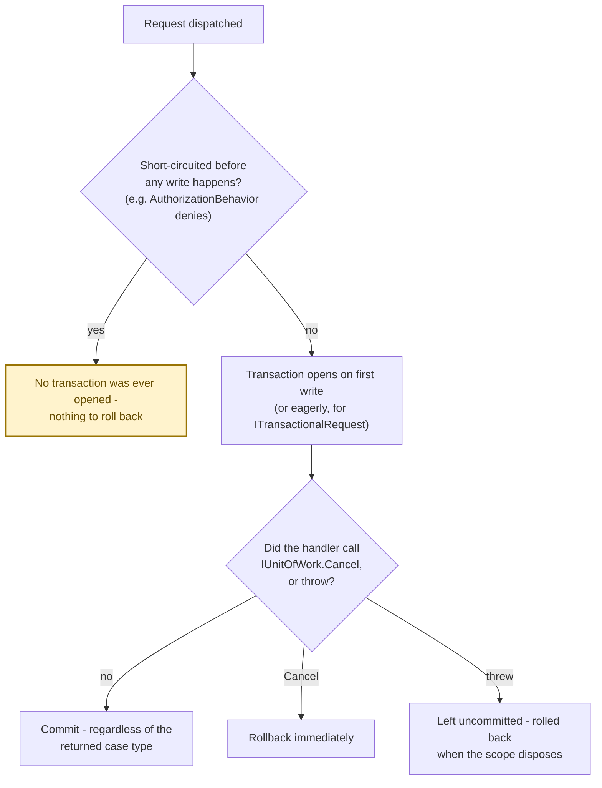

# Transactions & Store Integration

Managing transactions with `Interlocutor.Persistence.EntityFrameworkCore` and `Interlocutor.Persistence.NHibernate`. Because the mediator is scoped, each dispatch gets exactly one store session - a lookup and a write inside the same command execute against the same session. `IUnitOfWork` owns that session's transaction: it opens lazily, the first time anything actually writes, and commits automatically once the dispatch completes - unless the handler explicitly cancels it via `IUnitOfWork.Cancel`, or an unhandled exception leaves it uncommitted for the scope to dispose.

## UnitOfWorkBehavior

Both EF Core and NHibernate ship a `UnitOfWorkBehavior` that owns transaction lifecycle for every request it's registered against - no marker required to participate:

```csharp
// No ITransactionalRequest needed - the write below gets a transaction automatically.
public record CreateOrder(int CustomerId, List<OrderItem> Items)
    : ICommand<Outcome<int, ValidationError>>;

// When the handler runs, UnitOfWorkBehavior:
// 1. Lets reads run against the scoped session with no transaction open
// 2. Opens a transaction the first time anything writes (IDomainRepository, IUnitOfWork,
//    or a directly-injected Lazy<TContext>/Lazy<ISession>)
// 3. Commits once the handler returns, regardless of the outcome's shape - no case type
//    (Success, NotFound, Conflict, ValidationError, ...) decides this
// 4. Rolls back only via an explicit IUnitOfWork.Cancel call, or an unhandled exception
//    that leaves the transaction uncommitted for the scope to dispose
```

A dispatch that only ever reads never pays for an open transaction - it never opens one at all.

## ITransactionalRequest Marker

`ITransactionalRequest` no longer means "this request wants a transaction" - every write already gets one, automatically. It narrows to: force the transaction to begin *eagerly*, at pipeline start, instead of waiting for the first write - for the check-then-act case where a read must be protected by the same transaction as a write that follows it:

```csharp
// A duplicate check immediately before an insert - without an eager transaction, a concurrent
// request could pass the same check before either insert commits.
public record CreateOrder(int CustomerId, List<OrderItem> Items)
    : ICommand<Outcome<int, ValidationError>>,
      ITransactionalRequest;

// A plain create with no preceding read to protect doesn't need the marker at all - begin-on-first-write
// already covers it.
public record UpdateProduct(int Id, string Name, int Version)
    : ICommand<Outcome<Success, Conflict>>;

// Queries never write, so a transaction never opens for one regardless of this marker.
public record GetProduct(int Id)
    : IQuery<Outcome<ProductDto, NotFound>>;
```

`ITransactionalRequest` only has an effect when `UnitOfWorkBehavior` sits *outside* whatever pipeline stage or handler code performs the protected read - see "Where to register the behavior" below.

## IExternalStoreRequest Marker

Declare a command is backed by a non-SQL store so `UnitOfWorkBehavior` never opens a local transaction around it, even if the handler happens to touch the scoped session:

```csharp
// This command uses a NoSQL store (Redis, MongoDB, etc.)
public record SetUserPreferences(int UserId, Dictionary<string, object> Prefs)
    : ICommand<Outcome>,
      IExternalStoreRequest;  // ← Never gets a local transaction

// UnitOfWorkBehavior sees this marker and skips transaction management entirely
// but other behaviors (validation, auditing) still run
```

> [!IMPORTANT]
> `UnitOfWorkBehavior` and the `IUnitOfWork`/`IDomainRepository<T>` implementations all use `Lazy<TContext>`/`Lazy<ISession>` - a dispatch that never writes never opens a transaction, and one that never touches storage at all never even constructs the session. This is critical for performance in applications with mixed transactional/non-transactional work.

## EntityFramework Core Integration

`Interlocutor.Persistence.EntityFrameworkCore`'s `UnitOfWorkBehavior<TRequest, TResponse, TContext>` is generic over the `DbContext` type too (arity 3), unlike NHibernate's (arity 2, below) - `ISession` isn't generic, so it doesn't need that third parameter. Register it with `AddUnitOfWorkBehavior()`, which probes for whichever store package is referenced and closes it correctly:

```csharp
services.AddInterlocutor(builder =>
{
    builder.ScanAssembly(typeof(Program).Assembly);

    // Add the unit-of-work behavior (requires DbContext in DI) - see the Autofac/Microsoft DI
    // note below before using this under Microsoft.Extensions.DependencyInjection.
    builder.Pipeline.AddUnitOfWorkBehavior();
});

// DbContext must be registered as scoped (usually already is)
services.AddDbContext<AppDbContext>(
    options => options.UseSqlServer(/* ... */),
    ServiceLifetime.Scoped
);
```

> [!WARNING]
> **Under Microsoft.Extensions.DependencyInjection specifically, `AddUnitOfWorkBehavior()` currently throws at container-build time when `Interlocutor.Persistence.EntityFrameworkCore` is referenced** - `services.AddScoped(typeof(IPipelineBehavior<,>), typeof(UnitOfWorkBehavior<,,>))` fails because Microsoft DI requires an open generic implementation's arity to match its service interface's arity exactly, and `UnitOfWorkBehavior<,,>`'s extra `TContext` parameter breaks that. Autofac's generic registration doesn't have this restriction, so `AddUnitOfWorkBehavior()` works there unmodified today.
>
> Until this is fixed, register a small subclass under Microsoft DI that closes `TContext` over your own `DbContext` type, then register that subclass through the general-purpose `AddBehavior` escape hatch instead of `AddUnitOfWorkBehavior()`:
>
> ```csharp
> // Closes TContext over AppDbContext, bringing the arity back down to 2
> internal sealed class AppUnitOfWorkBehavior<TRequest, TResponse>(
>     Lazy<AppDbContext> context,
>     IOutcomeClassifier classifier,
>     IResponseOutcomeDescriber? describer = null
> ) : UnitOfWorkBehavior<TRequest, TResponse, AppDbContext>(context, classifier, describer);
>
> services.AddInterlocutor(builder =>
> {
>     builder.ScanAssembly(typeof(Program).Assembly);
>     builder.Pipeline.AddBehavior(typeof(AppUnitOfWorkBehavior<,>));  // not AddUnitOfWorkBehavior()
> });
> ```
>
> This is the pattern to reach for whenever an open generic implementation's arity doesn't match the service interface it's registered against - close the extra parameter in a small subclass, then register the subclass through the general-purpose escape hatch instead of the arity-specific helper.

### Whole-session protection for direct `DbContext` access

Nothing reaches the database before EF Core's `SaveChanges`/`SaveChangesAsync` runs, regardless of how entities were staged - `IDomainRepository`, `IUnitOfWork`, or a handler's own directly-injected `Lazy<AppDbContext>`. `UnitOfWorkBehavior` and `IUnitOfWork` both protect the first two paths on their own. To close the third - a handler calling `context.SaveChangesAsync()` itself - wire `UnitOfWorkSaveChangesInterceptor` into the same `AddDbContext` call:

```csharp
services.AddDbContext<AppDbContext>(options =>
    options
        .UseSqlServer(/* ... */)
        .AddInterceptors(new UnitOfWorkSaveChangesInterceptor())  // stateless - one shared instance is fine
);
```

Without it, a raw `SaveChangesAsync()` call with no transaction already open commits immediately via EF Core's own per-call implicit transaction, uncontrolled by the dispatch's later commit/rollback decision.

The behavior will inject `Lazy<AppDbContext>` and resolve it only when needed:

```csharp
public class CreateOrderHandler : ICommandHandler<CreateOrder, Outcome<int, ValidationError>>
{
    private readonly Lazy<AppDbContext> lazyContext;  // Injected by DI

    public CreateOrderHandler(Lazy<AppDbContext> lazyContext)
        => this.lazyContext = lazyContext;

    public async Task<Outcome<int, ValidationError>> Handle(
        CreateOrder command, CancellationToken ct)
    {
        var context = this.lazyContext.Value;  // Session is resolved here; the write below opens the transaction

        var order = new Order { CustomerId = command.CustomerId, /* ... */ };
        context.Orders.Add(order);
        await context.SaveChangesAsync(ct);  // Committed by UnitOfWorkBehavior (if no Failure)

        return order.Id;
    }
}
```

## NHibernate Integration

Register the NHibernate `UnitOfWorkBehavior` the same way - `AddUnitOfWorkBehavior()` works unmodified here on both Microsoft DI and Autofac, since `ISession` isn't generic and the behavior stays arity 2:

```csharp
services.AddInterlocutor(builder =>
{
    builder.ScanAssembly(typeof(Program).Assembly);

    // Add the unit-of-work behavior (requires ISession factory in DI)
    builder.Pipeline.AddUnitOfWorkBehavior();
});

// NHibernate session factory must be registered
services.AddSingleton(sessionFactory);  // ISessionFactory
services.AddScoped<ISession>(sp => sp.GetRequiredService<ISessionFactory>().OpenSession());
```

`UnitOfWorkBehavior` sets the session's `FlushMode` to `Commit` at pipeline start (unless the request is an `IExternalStoreRequest`), so NHibernate's default auto-flush-before-query can never write staged changes to the database ahead of a transaction this behavior opens around them - this is the one piece of richer NHibernate access begin-on-first-write depends on.

NHibernate behavior works the same way - scoped `ISession` is shared per dispatch and transacted:

```csharp
public class CreateOrderHandler : ICommandHandler<CreateOrder, Outcome<int, ValidationError>>
{
    private readonly Lazy<ISession> lazySession;

    public CreateOrderHandler(Lazy<ISession> lazySession)
        => this.lazySession = lazySession;

    public async Task<Outcome<int, ValidationError>> Handle(
        CreateOrder command, CancellationToken ct)
    {
        var session = this.lazySession.Value;  // Session is resolved here

        var order = new Order { CustomerId = command.CustomerId, /* ... */ };
        await session.SaveAsync(order, ct);
        await session.FlushAsync(ct);  // Opens a transaction first if one isn't already open, then flushes

        return order.Id;  // Committed by UnitOfWorkBehavior
    }
}
```

## Cancel: the only way to force a rollback

No response case type - `Success`, `NotFound`, `Conflict`, `ValidationError`, or any other - decides whether a dispatch's transaction commits or rolls back. `UnitOfWorkBehavior` commits whatever is left pending once the handler returns, unconditionally. `IUnitOfWork.Cancel` is the one way to override that: it rolls back the current transaction immediately and returns control to the caller, independently of what the handler returns afterward. It is not a short-circuit primitive - the handler still decides what to return, and the pipeline's commit gate simply finds nothing pending at completion:

```csharp
public record ArchiveOrder(int OrderId) : ICommand<Outcome>;

public class ArchiveOrderHandler : ICommandHandler<ArchiveOrder, Outcome>
{
    private readonly IUnitOfWork unitOfWork;
    private readonly Lazy<AppDbContext> lazyContext;

    public async Task<Outcome> Handle(ArchiveOrder command, CancellationToken ct)
    {
        var context = this.lazyContext.Value;
        context.Orders.Remove(/* ... */);

        if (await ExternalArchiveWasAlreadyRunning(command.OrderId, ct))
        {
            // Force a rollback of whatever this handler staged, then decide the outcome independently -
            // UnitOfWorkBehavior finds nothing open or pending and does nothing further.
            await this.unitOfWork.CancelAsync(ct);
            return new Success();  // Still reports success: the archive already happened elsewhere.
        }

        await this.unitOfWork.SaveChangesAsync(ct);
        return new Success();
    }
}
```

## Commit/Rollback Semantics

- **Never opens for a pure read**: a dispatch that never writes never opens a transaction at all - no marker to remember, no cost to pay.
- **Begins on first write**: the transaction opens the moment anything writes - through `IDomainRepository`, `IUnitOfWork`, or a directly-injected `Lazy<TContext>`/`Lazy<ISession>` - not at dispatch start.
- **Begins eagerly for `ITransactionalRequest`**: at pipeline start instead, so an earlier protective read shares the same transaction as the write that follows it.
- **Commits by default**: once a dispatch has an active transaction with pending work, it commits - regardless of what case type the handler returns. No case type - `Success`, `NotFound`, `Conflict`, `ValidationError`, or any other - is inspected to make this decision.
- **Rolls back only on an explicit signal**: a call to `IUnitOfWork.Cancel` rolls back immediately, independently of what the handler returns afterward; an unhandled exception leaves the transaction uncommitted for the scope to dispose, which rolls it back too. Nothing else rolls a transaction back.
- **No rollback on pipeline short-circuit**: if `AuthorizationBehavior` or `ValidationBehavior` short-circuits a request before any write happens, no transaction was ever opened. No transaction to roll back.

The rule that's easy to misread is "returning a failure case rolls back" - it doesn't. A handler that wants a rollback alongside a returned failure case must call `IUnitOfWork.Cancel` itself:



```csharp
public record UpdateProduct(int Id, string Name, int Version)
    : ICommand<Outcome<Success, NotFound, Conflict>>,
      ITransactionalRequest;

public class UpdateProductHandler
    : ICommandHandler<UpdateProduct, Outcome<Success, NotFound, Conflict>>
{
    private readonly Lazy<AppDbContext> lazyContext;

    public async Task<Outcome<Success, NotFound, Conflict>> Handle(
        UpdateProduct command, CancellationToken ct)
    {
        var context = this.lazyContext.Value;
        var product = await context.Products.FirstOrDefaultAsync(p => p.Id == command.Id, ct);

        // Neither early return stages a write, so the (eagerly-opened, empty) transaction commits
        // with nothing in it either way - returning NotFound/Conflict does not, on its own, roll
        // anything back.
        if (product == null)
            return new NotFound($"Product {command.Id}");

        if (product.Version != command.Version)
            return new Conflict("Concurrency conflict");

        product.Name = command.Name;
        await context.SaveChangesAsync(ct);
        return new Success();  // Commits transaction
    }
}
```

## Where to register the behavior, relative to pipeline stages

Because the transaction only covers what runs *after* `UnitOfWorkBehavior` begins it, a `PipelineStageBehavior`-hosted stage that performs a check-then-act read needs `UnitOfWorkBehavior` registered *outside* the stage host, not innermost the way the library's recommended chain places it:

```csharp
// The duplicate-title stage's read and the handler's insert below it share one transaction only because
// the unit-of-work behavior wraps the stage host, not the other way around.
builder.Pipeline
    .AddLoggingBehavior()
    .AddBehavior(typeof(AppUnitOfWorkBehavior<,>))
    .AddStage<DuplicateTitleGuardStage>()
    .AddStageHost();
```

Get this ordering wrong and the stage's read runs outside the transaction the handler's write commits inside, defeating the whole reason for combining the two into one transaction in the first place.

## Nested Scope Behavior

If you dispatch from within a command handler (rare, but possible), each dispatch still shares the parent's scoped session:

```csharp
public class ComplexOrderHandler : ICommandHandler<CreateComplexOrder, Outcome<int, InsufficientStock>>
{
    private readonly Lazy<AppDbContext> lazyContext;
    private readonly IUnitOfWork unitOfWork;
    private readonly ISender mediator;

    public async Task<Outcome<int, InsufficientStock>> Handle(
        CreateComplexOrder command, CancellationToken ct)
    {
        var context = this.lazyContext.Value;

        // Create the order
        var order = new Order { /* ... */ };
        context.Orders.Add(order);

        // Dispatch a nested command
        var inventoryResult = await this.mediator.Send(
            new ReserveInventory(order.Id, command.Items),
            ct
        );

        if (!inventoryResult.TryGetValue(out Success _))
        {
            // Returning InsufficientStock does not, on its own, roll anything back - the order
            // insert staged above would otherwise still commit. Cancel forces the rollback.
            await this.unitOfWork.CancelAsync(ct);
            return (InsufficientStock)inventoryResult.Value!;
        }

        await context.SaveChangesAsync(ct);
        return order.Id;  // Same transaction commits
    }
}

public record ReserveInventory(int OrderId, List<OrderItem> Items)
    : ICommand<Outcome<Success, InsufficientStock>>;

// This command runs inside the parent's transaction, sharing the same DbContext - it doesn't need its
// own ITransactionalRequest marker; the parent dispatch already opened the transaction.
```

## Transactions with Notifications

`UnitOfWorkBehavior` commits or rolls back once the whole dispatch completes - concretely, once the handler's `Handle` method returns to the pipeline (see [UnitOfWorkBehavior](#unitofworkbehavior) above). A `Publish` call made *from inside* `Handle`, before it returns, therefore still runs **inside** the still-open transaction, not after it:

```csharp
public class CreateOrderHandler : ICommandHandler<CreateOrder, Outcome<int, Failure>>
{
    private readonly Lazy<AppDbContext> lazyContext;
    private readonly IPublisher publisher;

    public async Task<Outcome<int, Failure>> Handle(
        CreateOrder command, CancellationToken ct)
    {
        var context = this.lazyContext.Value;
        var order = new Order { /* ... */ };
        context.Orders.Add(order);
        await context.SaveChangesAsync(ct); // Stages the insert; UnitOfWorkBehavior hasn't committed yet.

        // Still inside the open transaction: UnitOfWorkBehavior only commits after this Handle
        // method returns. A subscriber that throws here unwinds past UnitOfWorkBehavior's own
        // commit/rollback check entirely, leaving the transaction open and implicitly rolled back
        // when the scope disposes - not the "command already committed, notification failure is
        // safely decoupled" guarantee this might look like at a glance.
        await this.publisher.Publish(new OrderCreated(order.Id, /* ... */), ct);

        return order.Id;
    }
}
```

To genuinely publish *after* the command's transaction has committed, publish from the code that calls `Send`, once that call has returned - not from inside the handler:

```csharp
// In the caller (an endpoint, or another handler) - not inside CreateOrderHandler itself.
var result = await sender.Send(new CreateOrder(customerId, items), ct);
if (result.Value is int orderId)
{
    // UnitOfWorkBehavior has already committed by the time Send returns, so this genuinely
    // runs after the command's transaction - a subscriber failure here can never roll it back.
    await publisher.Publish(new OrderCreated(orderId, /* ... */), ct);
}
```

If you need to guarantee command + side effect atomicity instead - the notification must not be lost even if the process crashes between commit and publish - use the outbox pattern: publish events *inside* the transaction (as a persisted `Outbox` table row, using the same session `SaveChangesAsync` above already writes through), then process them asynchronously in a separate transaction.
