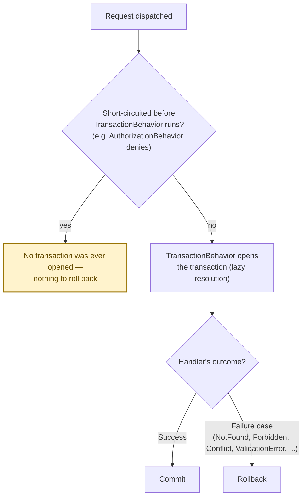

# Transactions & Store Integration

Managing transactions with `Interlocutor.EntityFrameworkCore` and `Interlocutor.NHibernate`. Because the mediator is scoped, each dispatch gets exactly one store session — a lookup and a write inside the same command execute against the same session.

## TransactionBehavior

Both EF Core and NHibernate ship a `TransactionBehavior` that manages transactions for commands implementing `ITransactionalRequest`:

```csharp
// Mark a command as transactional
public record CreateOrder(int CustomerId, List<OrderItem> Items)
    : ICommand<OperationOutcome<int, ValidationError>>,
      ITransactionalRequest;

// When the handler runs, TransactionBehavior:
// 1. Begins a transaction
// 2. Runs the handler
// 3. Commits on Success
// 4. Rolls back on any Failure case
```

## ITransactionalRequest Marker

Opt a command into the transaction behavior:

```csharp
// This command gets a transaction
public record UpdateProduct(int Id, string Name, int Version)
    : ICommand<OperationOutcome<Success, Conflict>>,
      ITransactionalRequest;

// This command does not get a transaction
public record GetProduct(int Id)
    : IQuery<OperationOutcome<ProductDto, NotFound>>;
```

Queries never have transactions (they're read-only). Some commands may not need one (external APIs, non-database updates).

## IExternalStoreRequest Marker

Declare a command is backed by a non-SQL store so `TransactionBehavior` doesn't try to resolve the SQL session:

```csharp
// This command uses a NoSQL store (Redis, MongoDB, etc.)
public record SetUserPreferences(int UserId, Dictionary<string, object> Prefs)
    : ICommand<Success>,
      IExternalStoreRequest;  // ← Don't resolve DbContext/ISession

// TransactionBehavior sees this marker and skips session resolution
// but other behaviors (validation, auditing) still run
```

> [!IMPORTANT]
> `TransactionBehavior` uses `Lazy<TContext>` / `Lazy<ISession>` — it defers session construction until it confirms the command implements `ITransactionalRequest`. Non-transactional requests never construct the session at all. This is critical for performance in applications with mixed transactional/non-transactional work.

## EntityFramework Core Integration

Register the EF Core `TransactionBehavior`:

```csharp
services.AddInterlocutor(builder =>
{
    builder.ScanAssembly(typeof(Program).Assembly);
    
    // Add the transaction behavior (requires DbContext in DI)
    builder.AddBehavior(typeof(TransactionBehavior<,>));
});

// DbContext must be registered as scoped (usually already is)
services.AddDbContext<AppDbContext>(
    options => options.UseSqlServer(/* ... */),
    ServiceLifetime.Scoped
);
```

The behavior will inject `Lazy<AppDbContext>` and resolve it only when needed:

```csharp
public class CreateOrderHandler : ICommandHandler<CreateOrder, OperationOutcome<int, ValidationError>>
{
    private readonly Lazy<AppDbContext> lazyContext;  // Injected by DI

    public CreateOrderHandler(Lazy<AppDbContext> lazyContext)
        => this.lazyContext = lazyContext;

    public async Task<OperationOutcome<int, ValidationError>> Handle(
        CreateOrder command, CancellationToken ct)
    {
        var context = this.lazyContext.Value;  // Session is resolved here, in a transaction
        
        var order = new Order { CustomerId = command.CustomerId, /* ... */ };
        context.Orders.Add(order);
        await context.SaveChangesAsync(ct);  // Committed by TransactionBehavior (if no Failure)
        
        return order.Id;
    }
}
```

## NHibernate Integration

Register the NHibernate `TransactionBehavior`:

```csharp
services.AddInterlocutor(builder =>
{
    builder.ScanAssembly(typeof(Program).Assembly);
    
    // Add the transaction behavior (requires ISession factory in DI)
    builder.AddBehavior(typeof(TransactionBehavior<,>));
});

// NHibernate session factory must be registered
services.AddSingleton(sessionFactory);  // ISessionFactory
services.AddScoped<ISession>(sp => sp.GetRequiredService<ISessionFactory>().OpenSession());
```

NHibernate behavior works the same way — scoped `ISession` is shared per dispatch and transacted:

```csharp
public class CreateOrderHandler : ICommandHandler<CreateOrder, OperationOutcome<int, ValidationError>>
{
    private readonly Lazy<ISession> lazySession;

    public CreateOrderHandler(Lazy<ISession> lazySession)
        => this.lazySession = lazySession;

    public async Task<OperationOutcome<int, ValidationError>> Handle(
        CreateOrder command, CancellationToken ct)
    {
        var session = this.lazySession.Value;  // Session is resolved here, in a transaction
        
        var order = new Order { CustomerId = command.CustomerId, /* ... */ };
        await session.SaveAsync(order, ct);
        await session.FlushAsync(ct);  // Committed by TransactionBehavior (if no Failure)
        
        return order.Id;
    }
}
```

## Commit/Rollback Semantics

- **Commit on Success**: transaction commits when the handler returns `Success` or a success-type case.
- **Rollback on Failure**: transaction rolls back when the handler returns any `Failure` case (`NotFound`, `Forbidden`, `Conflict`, `ValidationError`, etc.).
- **No rollback on pipeline short-circuit**: if `AuthorizationBehavior` or `ValidationBehavior` short-circuits a request before the handler runs, the transaction doesn't even start (lazy resolution). No transaction to roll back.

The third rule is the one that's easy to misread as "any denied or failed request rolls back" — it doesn't, because a short-circuit means `TransactionBehavior` never ran in the first place:



```csharp
public record UpdateProduct(int Id, string Name, int Version)
    : ICommand<OperationOutcome<Success, NotFound, Conflict>>,
      ITransactionalRequest;

public class UpdateProductHandler 
    : ICommandHandler<UpdateProduct, OperationOutcome<Success, NotFound, Conflict>>
{
    private readonly Lazy<AppDbContext> lazyContext;

    public async Task<OperationOutcome<Success, NotFound, Conflict>> Handle(
        UpdateProduct command, CancellationToken ct)
    {
        var context = this.lazyContext.Value;
        var product = await context.Products.FirstOrDefaultAsync(p => p.Id == command.Id, ct);

        if (product == null)
            return new NotFound($"Product {command.Id}");  // Rolls back transaction

        if (product.Version != command.Version)
            return new Conflict("Concurrency conflict");  // Rolls back transaction

        product.Name = command.Name;
        await context.SaveChangesAsync(ct);
        return new Success();  // Commits transaction
    }
}
```

## Nested Scope Behavior

If you dispatch from within a command handler (rare, but possible), each dispatch still shares the parent's scoped session:

```csharp
public class ComplexOrderHandler : ICommandHandler<CreateComplexOrder, OperationOutcome<int>>
{
    private readonly Lazy<AppDbContext> lazyContext;
    private readonly ISender mediator;

    public async Task<OperationOutcome<int>> Handle(
        CreateComplexOrder command, CancellationToken ct)
    {
        var context = this.lazyContext.Value;
        
        // Create the order
        var order = new Order { /* ... */ };
        context.Orders.Add(order);

        // Dispatch a nested command
        var inventoryResult = await this.mediator.Send(
            new ReserveInventory(order.Id, command.Items),
            ct
        );

        if (!inventoryResult.IsSuccess)
            return inventoryResult.Failure;  // Same transaction rolls back

        await context.SaveChangesAsync(ct);
        return order.Id;  // Same transaction commits
    }
}

public record ReserveInventory(int OrderId, List<OrderItem> Items)
    : ICommand<OperationOutcome<Success, InsufficientStock>>,
      ITransactionalRequest;

// This command runs inside the parent's transaction, sharing the same DbContext
```

## Transactions with Notifications

When a command publishes a notification, the notification's handlers run **after** the command's transaction commits:

```csharp
public class CreateOrderHandler : ICommandHandler<CreateOrder, OperationOutcome<int>>
{
    private readonly Lazy<AppDbContext> lazyContext;
    private readonly IPublisher publisher;

    public async Task<OperationOutcome<int>> Handle(
        CreateOrder command, CancellationToken ct)
    {
        var context = this.lazyContext.Value;
        var order = new Order { /* ... */ };
        context.Orders.Add(order);
        await context.SaveChangesAsync(ct);

        // At this point, the transaction commits (TransactionBehavior)
        // Then notification handlers run outside the transaction
        await this.publisher.Publish(new OrderCreated(order.Id, /* ... */), ct);

        return order.Id;
    }
}
```

If a notification handler fails, it **does not roll back the command**. The command already committed. This is correct for the outbox pattern — you want the command to succeed even if downstream handlers fail.

If you need to guarantee command + side effect atomicity, use the outbox pattern: publish events *inside* the transaction (as a persisted `Outbox` table row), then process them asynchronously in a separate transaction.
